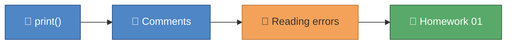

# Visual Docs Creator

Encodes the house style for every module's `INDEX.md` — the mermaid
palette, the emoji-per-node rule, the section anatomy (and its
`claude_course` variant), and the links policy — so a new module's visual
docs are indistinguishable from the hand-built ones already in the repo.

**Living exemplar:** `python_course/module_01_hello_python/INDEX.md` for
the `python_course` anatomy;
`claude_course/module_01_what_is_claude_code/INDEX.md` for the
`claude_course` anatomy. When in doubt, open one and match its structure
exactly. This skill describes the current, evolved convention actually
used across all eight `python_course` modules and all seven `claude_course`
modules — where an older planning doc disagrees, this skill and the
exemplars win.

## INDEX.md anatomy — `python_course/module_XX_<name>/INDEX.md`

Exactly these sections, in this order (H1 + 6 H2s = 7 sections):

1. `# 🎓 Module XX — <Title>` — a 2–4 sentence prose intro. Open with what
   the student has been missing or struggling with, name the concept the
   module gives them, and close by naming something concrete they'll have
   built plus "completed your Nth homework".
2. `## 🎯 What you'll learn` — a flat bullet list, one line per concept,
   phrased as a capability ("How to…", "Why…", "What… means").
3. `## 🗺️ Concept map` — exactly one mermaid `flowchart LR` (see below).
4. `## 📚 Lessons` — a table with header
   `| File | Concept | 📖 Docs | 🎬 Video |`, one row per lesson file, the
   `File` column a code-formatted filename.
5. `## 📝 Homework` — one sentence naming the file/functions to complete,
   then a fenced code block with the exact check command:
   `uv run pytest python_course/module_XX_<name> -v -m homework`
6. `## ✅ Progress checklist` — one `- [ ]` per: each lesson run
   ("Ran `lesson_...py` and read every comment"), each lesson's TRY IT
   count ("Completed {both|all three|all four} 🧪 TRY IT experiments in
   lesson X.Y" — the count word must match the real number, see the
   `lesson-creator` skill's checklist), any extra artifacts a lesson
   produces (e.g. "Looked inside the `sandbox/` folder…"), the homework
   TODOs filled in, and a final "All N homework tests pass (`uv run
   pytest python_course/module_XX_<name> -v -m homework`)".
7. `## 🆘 When you're stuck` — this exact fixed wording, verbatim, every
   time:
   ```
   1. Re-read the comments in the lesson file — the answer is usually explained right above the code.
   2. Ask the homework-checker agent — it hints, it never spoils the answer.
   3. Ask Claude to **explain** the concept — never to solve the homework for you.
   ```

**Optional capstone addendum:** the final module of a track may append an
8th section, `## 🎓 Graduation` (see
`python_course/module_08_testing_tooling/INDEX.md`), that reflects on the
whole track and previews what changes next (e.g. a new workflow, a new
course). Only the last module of a track gets this — don't add it to a
regular module.

## INDEX.md anatomy — `claude_course/module_XX_<name>/INDEX.md`

Same spirit, different sections — **not** a direct copy of the
`python_course` anatomy. Exactly these sections, in this order (H1 + 7 H2s
= 8 sections):

1. `# 🎓 Module XX — <Title>` — same style of prose intro, but framed
   around Claude Code itself and this repo, not a Python concept.
2. `## 🎯 What you'll learn`
3. `## 🗺️ Concept map` — mermaid `flowchart LR`; because the whole track
   is about Claude/AI tooling, nodes are commonly `:::ai` (purple) rather
   than `:::concept` (blue) — see the palette section below.
4. `## 📚 Learn` — **heading text is "Learn", not "Lessons"** (there are
   no `lesson_*.py` files in `claude_course`). Table header
   `| Topic | Concept | 📖 Docs | 🎬 Video |` (first column is `Topic`,
   not `File`).
5. `## 🛠 Hands-on exercise` — a concrete task performed against **this
   repo** (not an abstract exercise): a shell/terminal snippet to run,
   often followed by a blockquoted example prompt to type at Claude, then
   a short numbered list of things to notice while it runs.
6. `## ✅ Progress checklist` — one `- [ ]` per concrete, observable step
   from the hands-on exercise.
7. `## 🧭 You know you've got it when…` — a flat bullet list (no
   checkboxes) of observable outcomes/self-assessment signals — this
   section replaces `python_course`'s homework-pass-count bullet, since
   there's no pytest gate here.
8. `## 🆘 When you're stuck` — this exact fixed wording, verbatim, every
   time (different from the `python_course` version above):
   ```
   1. Re-read the 📚 Learn links above — the docs almost always answer it directly.
   2. Ask Claude itself — it has built-in knowledge of its own documentation. Try: "<a concrete question about this module's topic>"
   3. Ask Alberto if you're still stuck after trying both.
   ```

Docs links in `claude_course` point at `https://code.claude.com/docs/...`.

## Mermaid palette (identical everywhere — copy exactly)

```
classDef concept fill:#4F86C6,color:#fff,stroke:#2B4C7E
classDef win fill:#59A96A,color:#fff,stroke:#2E5E3A
classDef warn fill:#F4A259,color:#333,stroke:#B87333
classDef ai fill:#8E6BAF,color:#fff,stroke:#5D3F7A
```

- `concept` (blue) — a core idea being taught.
- `win` (green) — homework, a completed milestone, a successful outcome.
- `warn` (amber) — a pitfall, an error, something to watch out for.
- `ai` (purple) — Claude/AI itself, or an AI-adjacent concept.

Rules (track-conditional — verified against all 8 `python_course` and all 7
`claude_course` `INDEX.md` files, and they genuinely differ):

- **`python_course` diagrams: declare only the `classDef`s actually used.**
  A diagram with no pitfalls omits `warn`; a diagram with no AI content
  omits `ai`. Every `python_course/*/INDEX.md` trims this way — never paste
  all four unconditionally there.
- **`claude_course` diagrams: always declare all four `classDef`s**,
  regardless of which ones the nodes in that diagram actually use. All 7
  `claude_course/*/INDEX.md` files declare `concept`, `win`, `warn`, and
  `ai` every time, even when a given diagram's nodes only use `ai`/`win` —
  match that exactly, don't trim.
- In both tracks: no trailing comments, no alignment padding — one tight
  `classDef <name> fill:...,color:...,stroke:...` line per class, in this
  fixed order: `concept`, `win`, `warn`, `ai`.
- Colors are exact hex values, copied verbatim — never approximate or
  invent a shade.

## Concept-map anatomy and the emoji-per-node rule



(This is the real `module_01_hello_python` diagram — a `python_course`
example, so `ai` is correctly omitted since no node uses it. A
`claude_course` diagram with the same three classes in use would still
declare all four `classDef` lines, `ai` included — see the track-conditional
rule above.)

- `flowchart LR` (left-to-right), a short linear chain — 4 to 7 nodes,
  mirroring the module's actual teaching progression from first concept to
  the homework/exercise at the end.
- Node IDs are sequential capital letters (`A`, `B`, `C`, …) in a simple
  chain, connected with plain `-->` arrows — no branching, no cycles.
- **Every node label starts with an emoji**, then a short (2–4 word) label
  naming the concept, wrapped in `["..."]`. Never ship a node without an
  emoji.
- Every node gets exactly one `:::<class>` suffix from the palette above.
  The chain typically ends in a `:::win` node (the homework or exercise).
- Put the `classDef` lines at the bottom of the diagram, after the node
  chain, in the fixed order `concept`, `win`, `warn`, `ai` — trimmed to
  used classes in `python_course`, always all four in `claude_course` (see
  the track-conditional rule above).

## Links policy

- 📖 **Docs** — official docs only, verified before shipping (WebFetch
  it): `docs.python.org` for Python-fundamentals content,
  `docs.pytest.org` / `docs.astral.sh/uv` for testing/tooling content,
  `https://code.claude.com/docs/...` for `claude_course` content.
- 🎬 **Video** — YouTube only. A specific `watch?v=` URL only if you can
  positively verify it's a real, canonical, well-known video on the exact
  topic. Otherwise fall back to a search-results URL:
  `https://www.youtube.com/results?search_query=<url-encoded+query>`.
  Never guess a `watch?v=` id and never ship a link that could 404.
- 🖼 **Images** — prefer mermaid diagrams over external images everywhere.
  Only embed an external image from a source you're confident is stable
  long-term, and never in place of a diagram that mermaid could render
  just as well.

## Diagram type guide

- **`flowchart LR` — the default, for almost everything.** Concept maps in
  every `INDEX.md` (both tracks), and even genuinely sequential/pipeline
  content (e.g. a git workflow: branch → commit → PR → review → merge) —
  see `python_course/module_08_testing_tooling/INDEX.md`'s `## 🎓
  Graduation` diagram. The house palette (`classDef` + `:::class`) only
  applies cleanly to `flowchart`, which is exactly why the repo has
  consistently rendered even git-flow content as a `flowchart LR` instead
  of mermaid's native `gitGraph` — reach for `flowchart LR` first, always.
- **`sequenceDiagram`** — reserve for genuine actor ↔ actor message
  exchanges where the *order and direction* of messages is the point (an
  OAuth device-code flow, an MCP request/response cycle, a multi-turn
  agent handoff). Mermaid's `sequenceDiagram` does not support the
  `classDef`/`:::class` palette the same way `flowchart` does — style
  participants and messages with emoji labels for clarity instead of
  fighting the syntax to force house colors onto it.
- **`gitGraph`** — reserve only for a lesson specifically about *branch
  topology* (multiple diverging/merging branches, not just a linear
  add→commit→push pipeline) where a flowchart would misrepresent the
  shape. Even then, prefer `flowchart LR` unless the branching structure
  itself is the teaching point, since `gitGraph` can't carry the house
  palette.

## Final checklist

- [ ] Section list matches the correct anatomy exactly for the track
      (`python_course`: 7 sections ending in `🆘`, optionally + `🎓
      Graduation` on the track's last module; `claude_course`: 8 sections
      including `🛠 Hands-on exercise` and `🧭 You know you've got it
      when…`, `📚 Learn` not `📚 Lessons`).
- [ ] Section headings use the exact emoji and wording from the anatomy
      above, including the ellipsis character `…` in "You know you've got
      it when…" (not three periods).
- [ ] `## 🆘 When you're stuck` uses the exact fixed wording for the
      correct track, verbatim.
- [ ] Concept map is a `flowchart LR` (unless a `sequenceDiagram`/
      `gitGraph` is genuinely justified per the diagram type guide),
      4–7 nodes, sequential letter IDs, plain `-->` arrows.
- [ ] Every node label starts with an emoji.
- [ ] Every node has exactly one `:::<class>` suffix from the palette.
- [ ] `classDef` declarations follow the track-conditional rule: only the
      classes actually used, in `python_course`; all four, always, in
      `claude_course` — fixed order (`concept`, `win`, `warn`, `ai`), exact
      hex values, no trailing comments.
- [ ] `python_course` table header is
      `| File | Concept | 📖 Docs | 🎬 Video |`; `claude_course` table
      header is `| Topic | Concept | 📖 Docs | 🎬 Video |`.
- [ ] Every 📖 Docs and 🎬 Video link verified per the Links policy (no
      unverified `watch?v=` URLs, no unverifiable docs URLs).
- [ ] Homework/exercise command block quoted verbatim, matching the
      `lesson-creator` skill's run-command conventions.
- [ ] Progress checklist item counts (TRY IT experiments, homework tests)
      match the real numbers in the lesson/test files — grep to confirm.
- [ ] `uv run ruff format --check .` clean (note: `.md` files are excluded
      from ruff via `extend-exclude` in `pyproject.toml`, so this mainly
      guards against you having accidentally touched a `.py` file while
      editing docs).
