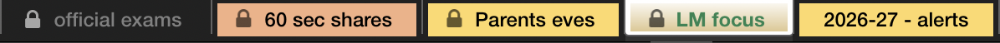
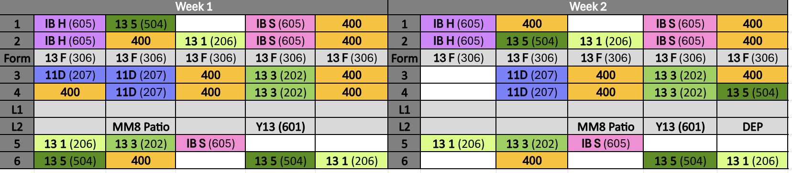

# 📋 Questions for Gemma

Hello! This file is how the four prototypes at the end of this course become *real* — built around your actual timetable, your actual students, your actual school systems, instead of made-up examples.

You don't need to answer everything today, and you don't need to know any Python to do this. Just edit this file in whatever way feels comfortable (even a plain text editor), and write your answer under each `✍️ Your answer:` line.

**Fun fact: answering this file IS your first git exercise.** Editing a file, saving ("committing") that change, and sending it up to GitHub ("pushing") is exactly what you'll do here. Module 08 walks through those exact three steps — or just ask Claude "how do I commit and push my changes?" and it will talk you through it live.

No rush, no wrong answers, and "I don't know" is a completely fine answer too — just say so and who might know instead.

---
## A. Teacher Planner 📅

**A1.** Can you open the school calendar `.xlsx` file from your Mac? If so, could you copy it into this repo's `prototypes/ai_teacher_planner/real_data/` folder? (This folder is set up so that file never gets uploaded to GitHub — it stays private, on your machine only.)

> ✍️ Your answer: [2026-27 Secondary Calendar ALL STAFF.xlsx](prototypes/ai_teacher_planner/2026-27%20Secondary%20Calendar%20ALL%20STAFF.xlsx)

**A2.** What tabs and columns does that calendar file have? A screenshot is totally fine if that's easier than typing it out.

> ✍️ Your answer: 

**A3.** Tell me about your timetable: which classes do you teach, which year groups, and how many periods per week for each class?

> ✍️ Your answer: We use a two-week timetable. Over two weeks I teach one Y11 IGCSE Edexcel Business group ("11D") for five 55minute periods, one Y12 IBDP Business Management group that is split into Standard ("IB S") and Higher ("IB H") leveled groups where "IB S" is made up of students from both "IB S" and "IB H" and I have six 55minute periods, and the "IB H" group is only "IB H" students and I have 4 55minute periods, and I also teach three Y13 IAL Edexcel Business groups ("13 1", "13 3", and "13 5") for six 55minute periods each. "400" means I supervise a study hall. Blank cells mean I have preparation time. Grey cells mean I have break/lunch.

**A4.** What are the term dates for 2026–27?

> ✍️ Your answer: [Hastings School - Calendar 26-27 (Teaching) updated Oct26.pdf](prototypes/resources/Hastings%20School%20-%20Calendar%2026-27%20%28Teaching%29%20updated%20Oct26.pdf) Term 1: 04/09/26 - 22/12/26, Term 2: 08/01/27 - 19/03/27, Term 3: 5/4/27 - 29/6/27. See Calendar for exceptions such as holidays and non-teaching days.

**A5.** How would you like the planner's output? Excel, Word, Markdown, or OneNote?

> ✍️ Your answer: Excel

---

## B. Examiner ✍️

**B1.** Could you get 2–3 anonymized sample scans per paper type (remember: filenames like `student1_2026_01_15_business.png`, never a real name)?

> ✍️ Your answer:

**B2.** Which papers should come first — IB Business? Edexcel IAL Business Units 1–4? IGCSE?

> ✍️ Your answer:

**B3.** Where do the official mark schemes live for you — Examwizard, or somewhere else?

> ✍️ Your answer:

**B4.** How do you annotate scripts today — pen on paper, or PDF markup?

> ✍️ Your answer:

**B5.** What would a correction output need to look like for you to actually trust it?

> ✍️ Your answer:

---

## C. Practice Companion 📝

**C1.** Which units or topics do your students struggle with most?

> ✍️ Your answer:

**C2.** Which question sizes matter most to you — 4, 8, 10, 12, or 20 marks?

> ✍️ Your answer: For IAL Edexcel Business 8, 10, 12 and 20marks. For IGCSE Edexcel Business 9 and 12marks. For IBDP Business 10 and 17marks.

**C3.** How long should a case study be?

> ✍️ Your answer:

---

## D. Automations ⚙️

**D1.** What are your top 3 most repetitive weekly tasks, and roughly how many minutes does each take?

> ✍️ Your answer:

**D2.** SIMS runs in a VM for you — what exactly do you do inside it each week?

> ✍️ Your answer: Each lesson I complete the attendance register. 

**D3.** Cognita Connect — do you use it as a web app or a desktop app?

> ✍️ Your answer: As a web app.

**D4.** Does school IT allow signing into Microsoft from a Python app on your Mac (a "device-code" login — the same kind of sign-in as a smart TV app)? If you're not sure, who could we ask?

> ✍️ Your answer: Yes. But for now I only have access to read/view files not edit on my mac. I can edit files on the online version on my mac.

**D5.** Which Teams channel holds the staff calendar file?

> ✍️ Your answer: "Hastings Secondary Staff" https://teams.cloud.microsoft/l/team/19%3A39dbc32cdc8a4ac7afcae513c25938de%40thread.tacv2/conversations?groupId=31f15e49-c937-4e5d-9cfd-975a42c072e4&tenantId=06d2dc82-6fed-4d3b-9218-37d34fb0405b

---

## E. You 🙋

**E1.** Roughly how many hours a week can you give this course?

> ✍️ Your answer:

**E2.** What are your best learning time slots — mornings, evenings, weekends?

> ✍️ Your answer:

**E3.** After finishing module 01, is there anything about the course style you'd like changed?

> ✍️ Your answer:

---

Thank you! Whenever you're ready, save this file, commit it, and push it — Alberto (and the prototypes) will pick up your answers from there. 💛
