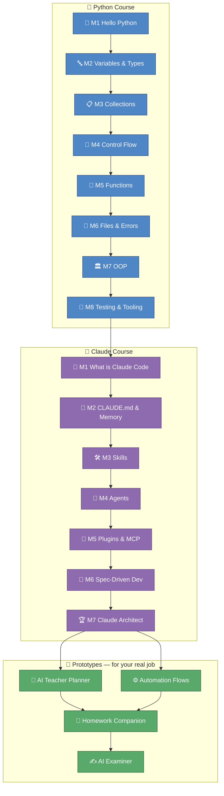

# 🎓 python-for-gemma — Agentic AI Masters for Education

Welcome, Gemma! This repo is your own tailored Python + Claude Code course, built around your job as a teacher. You'll go from "never written a line of Python" to shipping small, real tools for your classroom — a lesson planner, exam practice generator, and an exam corrector — all commented for a beginner and drawn out visually wherever it helps. Take it one module at a time; nothing here expects you to already know how any of this works.

## 🚀 Start here

1. **Install `uv`** (the tool that runs everything in this course):
   ```bash
   curl -LsSf https://astral.sh/uv/install.sh | sh
   ```
2. **Clone this repo** to your Mac:
   ```bash
   git clone https://github.com/albertols/python-for-gemma.git
   cd python-for-gemma
   ```
3. **Install the course's dependencies:**
   ```bash
   uv sync --all-packages
   ```
4. **See your first green test:**
   ```bash
   uv run pytest tests -v
   ```
5. **Open your first lesson:** [`python_course/module_01_hello_python/INDEX.md`](python_course/module_01_hello_python/INDEX.md)

💡 **One friendly heads-up:** each module's homework has its own check command, shaped like `uv run pytest python_course/module_XX_<name> -v -m homework`. That `-m homework` marker is how your exercises get run. Plain `uv run pytest` (used above, and by the shared CI) skips homework on purpose, so the course stays green while you're still mid-exercise — you're never "breaking the build" by working on your homework.

## 🗺️ Your learning map



You work left to right within each row, and top to bottom between rows: finish the Python course, then the Claude course, then the prototypes come alive. (The Teacher Planner and Automation Flows prototypes are built together first — see [`docs/adr/001-prototype-build-order.md`](docs/adr/001-prototype-build-order.md) for why.)

## 🏛️ The four pillars

| Pillar | What it is | Where it lives |
|---|---|---|
| 🐍 Python course | 8 modules, `print()` to pytest, taught with marks/registers/prices examples | `python_course/` |
| 🤖 Claude Code course | 7 modules to becoming a "Claude Architect" | `claude_course/`, indexed at `docs/how_to_learn_claude.md` |
| ⚙️ Workflow automation | Python + Microsoft Graph, wired to your Teams/OneDrive/SharePoint | `prototypes/automation_flows/` |
| 🚀 Work prototypes | Four real tools for your classroom, scaffolded now, built out with your answers | `prototypes/` |

## 📎 Before you go further

- **[`QUESTIONS_FOR_GEMMA.md`](QUESTIONS_FOR_GEMMA.md)** — a short questionnaire that turns the prototypes above from scaffolds into tools built around *your* classroom. Answering it is also your first git exercise.
- **[`docs/how_to_learn_claude.md`](docs/how_to_learn_claude.md)** — your guide to the Claude Code course.
- **[`docs/security.md`](docs/security.md)** — a plain-language explanation of how your passwords and tokens stay safe in this repo.

Whenever you're stuck: re-read the lesson comments first, then try the homework-checker agent, then ask Claude to *explain* — never to solve it for you. You've got this. 💪
