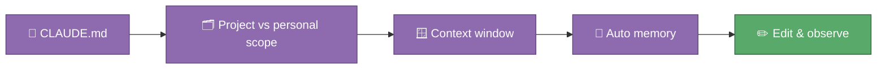

# 🎓 Module 02 — CLAUDE.md & Memory

Every time you open a fresh `claude` session, it doesn't remember yesterday's
chat — but it does remember a file called `CLAUDE.md`, and this repo already
has one at the root. Think of it as the note you'd leave a substitute
teacher: not the whole curriculum, just the things they'd otherwise get
wrong. This module explains where that note lives, how "context" and
"memory" differ from each other, and gives you a safe, real edit to make so
you can watch the effect for yourself.

## 🎯 What you'll learn

- What `CLAUDE.md` is and why Claude reads it at the start of every session
- Where `CLAUDE.md` files can live — project (shared, in git) vs. personal (just for you) — and why this repo's copy is the shared kind
- What a "context window" is, in plain words: Claude's working memory for the current conversation, which fills up and eventually gets summarised
- What "auto memory" is: short notes Claude writes for *itself* between sessions, separate from the `CLAUDE.md` you write
- How to check what actually loaded with `/memory` and `/context`

## 🗺️ Concept map



## 📚 Learn

| Topic | Concept | 📖 Docs | 🎬 Video |
|---|---|---|---|
| CLAUDE.md files | what to put in one, project vs. personal scope, `/memory`, `/init` | [How Claude remembers your project](https://code.claude.com/docs/en/memory) | [Search: Claude Code CLAUDE.md memory explained](https://www.youtube.com/results?search_query=claude+code+claude.md+memory+explained) |
| The `.claude/` directory | where memory, settings, skills, and agents all live side by side | [Explore the .claude directory](https://code.claude.com/docs/en/claude-directory) | [Search: what is the .claude folder in Claude Code](https://www.youtube.com/results?search_query=what+is+the+.claude+folder+in+claude+code) |

## 🛠 Hands-on exercise

Open [`CLAUDE.md`](../../CLAUDE.md) at the repo root and add one genuine
personal preference line — something true about how *you* like to work, for
example under "## Teaching tone":

```markdown
- Gemma prefers short, direct explanations over long ones.
```

Save it, start a **new** `claude` session in this repo (a fresh one, so the
file gets re-read), and ask a question where that preference would matter —
for example, ask Claude to explain a concept from Module 01 again. Compare
the length and tone of the answer to what you got before. It's your repo:
keep the line if you like it, or revert it once you've seen the effect.

## ✅ Progress checklist

- [ ] Read through the whole of `CLAUDE.md` and understood each section
- [ ] Added one real personal-preference line to `CLAUDE.md`
- [ ] Started a fresh session and asked a question that exercised the new line
- [ ] Noticed a difference (or confidently concluded there wasn't one, and can say why)
- [ ] Ran `/memory` to see the list of memory file locations
- [ ] Ran `/context` to see what actually loaded into this session

## 🧭 You know you've got it when…

- You can explain the difference between `CLAUDE.md` (you write it) and auto memory (Claude writes it) without looking it up
- You know why a 500-line `CLAUDE.md` is worse than a 50-line one
- You've watched your own edit change Claude's behaviour in a live session

## 🆘 When you're stuck

1. Re-read the 📚 Learn links above — the docs almost always answer it directly.
2. Ask Claude itself: "why didn't my CLAUDE.md edit change your answer?" is a perfectly good question to ask it directly.
3. Ask Alberto if you're still stuck after trying both.
