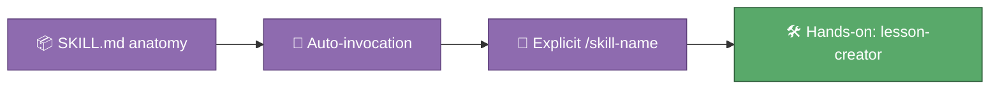

# 🎓 Module 03 — Skills

A skill is how you teach Claude a repeatable trick once, and have it
remembered forever after. Under the hood it's refreshingly simple: a
markdown file named `SKILL.md`, with a short header describing what it does
and when to use it, followed by plain-English instructions. Claude reads
that description and decides for itself when a task matches — or you can
call it by name. This module is where you meet skills as a *user* before
Module 07 asks you to build your own.

## 🎯 What you'll learn

- What a skill is: a markdown file that packages instructions Claude loads on demand, instead of every single session
- The anatomy of `SKILL.md`: YAML frontmatter (`name`, `description`) followed by the instructions themselves
- The difference between Claude *auto-invoking* a skill (because your prompt matches its description) and you *explicitly* running `/skill-name`
- Where skills live in this repo: `.claude/skills/<name>/SKILL.md`
- Why the `description` field matters more than almost anything else in the file — it's the only part Claude sees before deciding to use it

## 🗺️ Concept map

## 📚 Learn

| Topic | Concept | 📖 Docs | 🎬 Video |
|---|---|---|---|
| Skills | `SKILL.md` frontmatter, auto-invocation vs. `/skill-name`, supporting files | [Extend Claude with skills](https://code.claude.com/docs/en/skills) | [Search: Claude Code skills tutorial](https://www.youtube.com/results?search_query=claude+code+skills+tutorial) |

## 🛠 Hands-on exercise

This repo ships a `lesson-creator` skill at
[`.claude/skills/lesson-creator/SKILL.md`](../../.claude/skills/lesson-creator/SKILL.md)
— it knows the exact house style every `python_course` lesson follows. Ask
Claude to use it for something low-stakes and fun:

> Use the lesson-creator skill to draft a bonus lesson on rounding numbers for the Python course.

Read the draft it produces. Notice whether Claude names the skill it used,
or whether you needed to name it yourself. This is a sandbox exercise — you
don't need to keep the generated file; discard it (or ask Claude to delete
it) once you've seen how it works.

## ✅ Progress checklist

- [ ] Opened `.claude/skills/lesson-creator/SKILL.md` and read its frontmatter and body
- [ ] Asked Claude to use the lesson-creator skill on a bonus "rounding numbers" lesson
- [ ] Noticed whether the skill was auto-invoked or you had to name it explicitly
- [ ] Could point to the exact line in `SKILL.md` that made Claude choose it
- [ ] Cleaned up (or kept, your call) the practice file it produced

## 🧭 You know you've got it when…

- You can describe `SKILL.md`'s two parts — frontmatter and body — without opening the file
- You know the difference between a skill Claude picks on its own and one you call with `/skill-name`
- You could sketch, on paper, the `description` line for a skill of your own

## 🆘 When you're stuck

1. Re-read the 📚 Learn links above — the docs almost always answer it directly.
2. Ask Claude itself: "why did (or didn't) you use the lesson-creator skill just now?"
3. Ask Alberto if you're still stuck after trying both.
