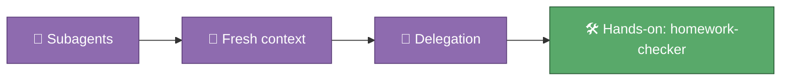

# 🎓 Module 04 — Agents

A subagent is a colleague you can hand a task to. It starts with a blank
memory — none of your current conversation — reads only what you tell it to,
does the work in its own separate context, and reports back a summary. You
already have one waiting for you: the `homework-checker`, which reviews your
Python homework and hints without ever handing you the answer. This module
is about understanding why that separation matters, and using it for real.

## 🎯 What you'll learn

- What a subagent is, and how it differs from a skill: a subagent gets a *fresh context window*, a skill loads *into your current one*
- Why delegating research or repetitive checking to a subagent keeps your main conversation focused and uncluttered
- The anatomy of an agent file: `.claude/agents/<name>.md`, with frontmatter (`name`, `description`, `tools`) and a system prompt
- How to ask Claude to delegate explicitly — "use the homework-checker agent to…" — and what it means for an agent to have restricted tools

## 🗺️ Concept map

## 📚 Learn

| Topic | Concept | 📖 Docs | 🎬 Video |
|---|---|---|---|
| Subagents | agent file anatomy, tool restriction, when to delegate vs. do it yourself | [Create custom subagents](https://code.claude.com/docs/en/sub-agents) | [Search: Claude Code subagents explained](https://www.youtube.com/results?search_query=claude+code+subagents+explained) |

## 🛠 Hands-on exercise

You've already met the `homework-checker` agent by name in every module's
🆘 section, back in the Python course — now use it directly. Open
[`.claude/agents/homework-checker.md`](../../.claude/agents/homework-checker.md)
and read its rules, then ask Claude:

> Use the homework-checker agent to check my `python_course/module_02_variables_types` homework.

Read its reply carefully. Notice that it:

1. Runs the module's homework tests itself, rather than asking you to
2. Tells you what's already right before pointing at what isn't
3. Gives a hint, never the corrected code
4. Never edits `homework_02.py` for you

## ✅ Progress checklist

- [ ] Opened `.claude/agents/homework-checker.md` and read its frontmatter and rules
- [ ] Asked Claude to delegate to the homework-checker agent on your Module 02 homework
- [ ] Confirmed it ran the tests itself rather than asking you to paste output
- [ ] Confirmed it never wrote or suggested corrected code directly
- [ ] Can explain, in one sentence, why an agent's context being "fresh" is useful here

## 🧭 You know you've got it when…

- You can explain why a subagent starting with a blank memory is a feature, not a limitation
- You know where agent definitions live and what their frontmatter controls
- You've watched the homework-checker hint at a real mistake without spoiling it

## 🆘 When you're stuck

1. Re-read the 📚 Learn links above — the docs almost always answer it directly.
2. Ask Claude itself: "what tools does the homework-checker agent have, and why those?"
3. Ask Alberto if you're still stuck after trying both.
