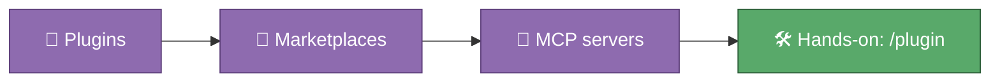

# 🎓 Module 05 — Plugins & MCP

Skills and agents (Modules 03 and 04) live inside one project's `.claude/`
folder. Plugins are how you bundle several of them — skills, agents, hooks,
even MCP servers — into one shareable, installable unit, distributed through
a catalog called a marketplace. MCP is a different kind of extension
entirely: it's a socket standard, like a USB port for AI tools, that lets
Claude plug into things *outside* this repo — a calendar, a Slack channel, a
database. This module is about recognising the difference and knowing where
to look.

## 🎯 What you'll learn

- What a plugin is: a bundle of skills, agents, hooks, and MCP servers you can install as one unit, versus the standalone `.claude/` files you've used so far
- What a marketplace is: a catalog of plugins you add with `/plugin marketplace add`, then browse and install from with `/plugin`
- What MCP (Model Context Protocol) is, in plain words: an open standard that lets Claude connect to external tools and data sources it wouldn't otherwise have access to
- How to browse what's installed and available in your own session with `/plugin`

## 🗺️ Concept map

## 📚 Learn

| Topic | Concept | 📖 Docs | 🎬 Video |
|---|---|---|---|
| Plugins | plugin.json manifest, skills/agents/hooks bundled together, standalone vs. plugin | [Create plugins](https://code.claude.com/docs/en/plugins) | [Search: Claude Code plugins explained](https://www.youtube.com/results?search_query=claude+code+plugins+explained) |
| Marketplaces & MCP | `/plugin marketplace add`, installing, MCP as a socket for external tools | [Create and distribute a plugin marketplace](https://code.claude.com/docs/en/plugin-marketplaces), [Connect Claude Code to tools via MCP](https://code.claude.com/docs/en/mcp) | [Search: Claude Code MCP explained](https://www.youtube.com/results?search_query=claude+code+mcp+model+context+protocol+explained) |

## 🛠 Hands-on exercise

Run `/plugin` in a `claude` session inside this repo and look through its
tabs. This repo's own project-level `.claude/` folder doesn't currently ship
any team-installed plugins of its own — that's completely normal for a small
learning repo, and it means what you're inspecting today is mostly the
*mechanism* rather than a long list. If your personal account already has
plugins installed (in `~/.claude/`, outside this repo), they'll show up
here too — that's worth noticing as the difference between personal and
project-level tooling.

Then open [`.claude/settings.json`](../../.claude/settings.json) and read
the `permissions.deny` rules already in there. That file is a taste of what
plugins and settings can control together: it's why Claude can never read
`.env` files or token caches in this repo, no matter what anyone asks it.

## ✅ Progress checklist

- [ ] Ran `/plugin` and looked at the marketplace / installed tabs
- [ ] Confirmed what is (or isn't) installed for this repo specifically
- [ ] Opened `.claude/settings.json` and read every deny rule
- [ ] Can explain, in one sentence, the difference between a skill, an agent, and a plugin
- [ ] Can explain, in one sentence, what MCP is for

## 🧭 You know you've got it when…

- You can tell someone the difference between "standalone `.claude/`" and "plugin" without hesitating
- You know a marketplace is a catalog, not a plugin itself
- You could describe MCP as "a socket for external tools" and have it be accurate

## 🆘 When you're stuck

1. Re-read the 📚 Learn links above — the docs almost always answer it directly.
2. Ask Claude itself: "what plugins and MCP servers do I currently have connected?"
3. Ask Alberto if you're still stuck after trying both.
