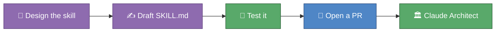

# 🎓 Module 07 — Claude Architect Capstone

This is it — the last module of the Claude course, and your first skill
built for someone other than you. Everything so far has been about learning
the tool: sessions, memory, skills, agents, plugins, spec-first thinking.
Now you build one real thing with all of it at once — a skill that drafts
parent emails — test it honestly, and open your first pull request. Alberto
reviews it the same way any teammate's PR gets reviewed. That's the whole
point: you're not a student using Claude Code anymore. You're the person who
designs how it works for your department.

## 🎯 What you'll learn

- How to turn everything so far — `SKILL.md` anatomy, spec-first thinking, TDD, and the git/PR workflow from Module 08's graduation — into one shipped skill
- How to structure a skill with more than one "mode": a positive-note template and a concern-note template, both selectable from one file
- How to test a skill honestly, on real-shaped scenarios, before calling it done
- How to open your first pull request in this repo

## 🗺️ Concept map

## 📚 Learn

| Topic | Concept | 📖 Docs | 🎬 Video |
|---|---|---|---|
| Skills, revisited | multi-template skills, writing a `description` Claude will actually match on | [Extend Claude with skills](https://code.claude.com/docs/en/skills) | [Search: how to build a Claude Code skill](https://www.youtube.com/results?search_query=how+to+build+a+claude+code+skill) |
| Pull requests with Claude | branch → commit → PR, the workflow from Module 08's graduation, now for real | [Common workflows](https://code.claude.com/docs/en/common-workflows) | [Search: Claude Code git and pull requests](https://www.youtube.com/results?search_query=claude+code+git+and+pull+requests) |

## 🛠 Hands-on exercise

Build `.claude/skills/parent-email-drafts/SKILL.md` (a new file — it doesn't
exist yet; you're creating it) with Claude's help, using the anatomy from
Module 03. It should draft two kinds of parent email:

- A **positive-note** template — celebrating good work, specific and warm
- A **concern-note** template — raising an issue kindly, constructively, and clearly, without being alarming

Both templates must stay anonymized, exactly like every other piece of
student data in this repo: no real names, `student1`-style placeholders
only (see the "Security — NON-NEGOTIABLE" section of
[`CLAUDE.md`](../../CLAUDE.md)). Give the skill a `description` specific
enough that Claude reaches for it unprompted when you ask for a parent
email.

Test it on at least one scenario per template before you call it done — made
up, anonymized situations are fine. Then create a branch, commit the new
skill file, and open your first pull request.

## ✅ Progress checklist

- [ ] `.claude/skills/parent-email-drafts/SKILL.md` exists with frontmatter (`name`, `description`) and both templates
- [ ] Tested the skill on one positive-note scenario and one concern-note scenario, anonymized
- [ ] Created a branch and committed the new skill file
- [ ] Opened your first pull request
- [ ] Read Alberto's review comments (if any) and understood every one

## 🧭 You know you've got it when…

Alberto approves your PR without changes 😄

## 🆘 When you're stuck

1. Re-read the 📚 Learn links above — the docs almost always answer it directly.
2. Ask Claude itself: "review my SKILL.md draft against the anatomy from Module 03" before you open the PR.
3. Ask Alberto if you're still stuck after trying both.
