# AI Teacher Planner: architecture at a glance

Ten diagrams, drawn as code. Read them top to bottom for the whole picture, or jump to the one you need. They show the design agreed in `docs/superpowers/specs/2026-11-19-ai-teacher-planner-design.md`; when the code and a diagram disagree, fix the diagram in the same commit.

**Colour key, the same in every diagram:** blue is our code, green is data that stays on the Mac, amber is a boundary or guard, purple means a model is involved, grey dashed is later work, red dashed is denied.

| # | Diagram | Answers |
|---|---|---|
| 1 | [System context](#1-system-context) | Who and what does the planner touch? |
| 2 | [Containers](#2-containers) | What runs, and where? |
| 3 | [Backend components](#3-backend-components) | How is the API put together? |
| 4 | [Frontend components](#4-frontend-components) | Which screens exist and what do they share? |
| 5 | [Domain model](#5-domain-model) | What is stored and what is derived? |
| 6 | [Scheduling pipeline](#6-scheduling-pipeline) | How does a calendar become an accepted plan? |
| 7 | [AI flow](#7-ai-flow) | What happens when Gemma clicks an AI action? |
| 8 | [Data and privacy](#8-data-and-privacy) | What stays, what leaves, what is denied? |
| 9 | [Tech stack](#9-tech-stack) | Which tools, at which versions? |
| 10 | [Roadmap](#10-roadmap) | What comes in v1, v2 and after? |

## 1. System context

Look for the dashed box: everything v1 uses sits on Gemma's Mac, and a single purple arrow leaves it.

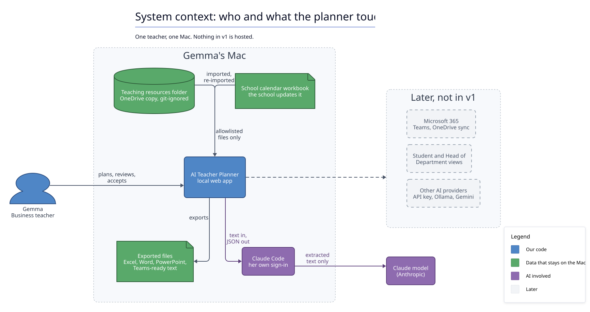

## 2. Containers

Look for the two things that import the engine (the web app and the API) and the one route to a model, through the AiProvider port.

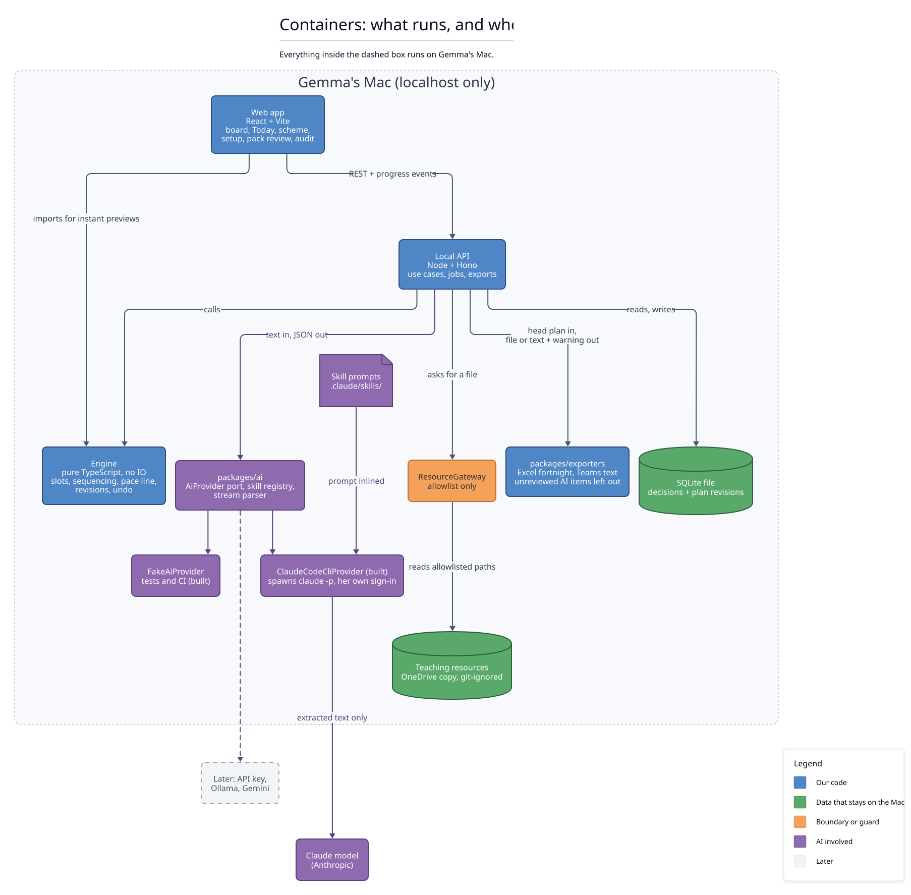

## 3. Backend components

Look for the direction of the arrows: use cases call ports, while disk, files and the model sit behind adapters at the edge. The M1b routes and tables (disruptions, corrections, events, exams, to-do notes) all live in the same routes, use cases and repository box.

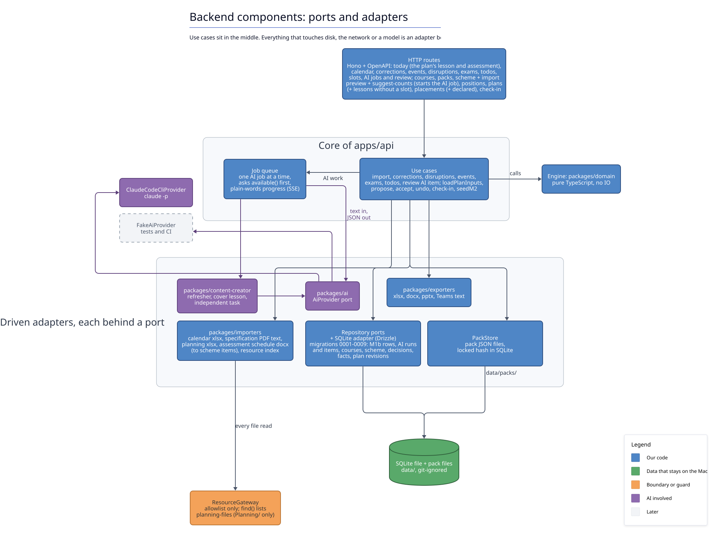

## 4. Frontend components

Look for the five shared pieces every screen reuses; the purple ones are where AI shows up in the GUI.

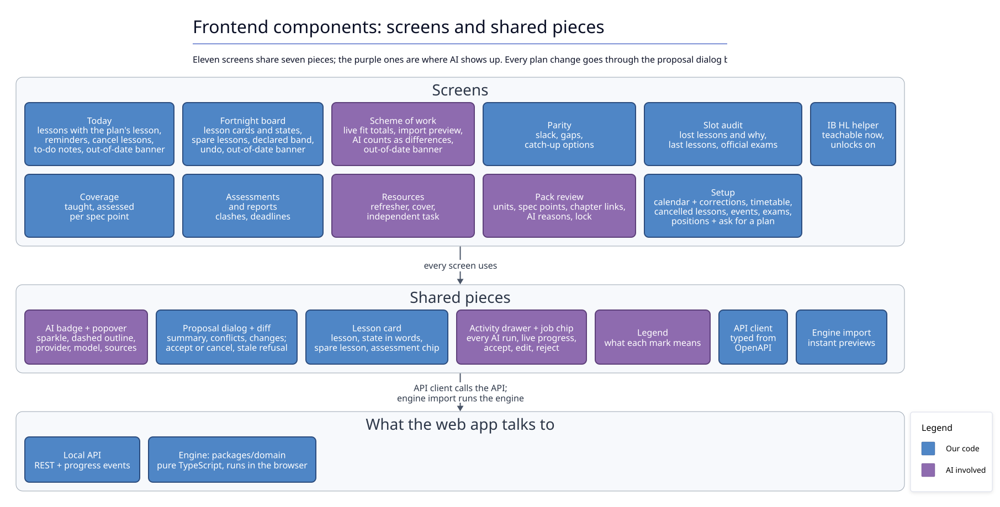

## 5. Domain model

Look for the colour split: green is stored, blue is worked out by the engine each time and never stored. Her M1b corrections and confirmations are green rows that survive a new import.

## 6. Scheduling pipeline

Look for the amber gate: a candidate revision becomes the head revision only when Gemma accepts the diff.

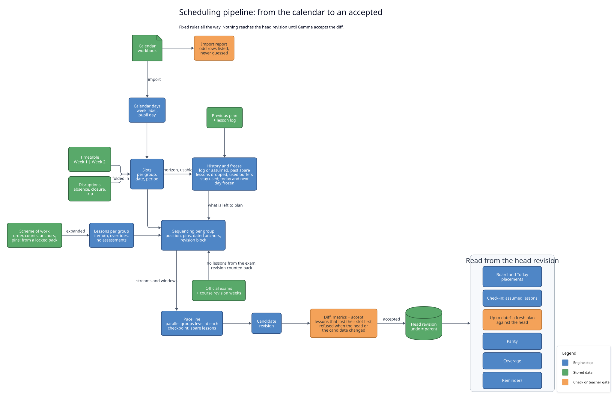

## 7. AI flow

Look for what crosses to the model (extracted text) and what comes back (JSON), then the review step at the end.

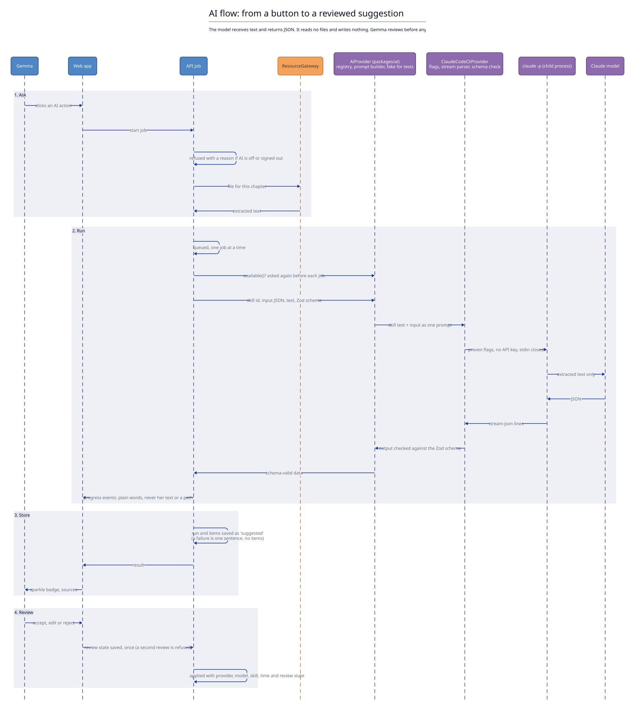

## 8. Data and privacy

Look for the red dashed arrows: each one ends at a guard.

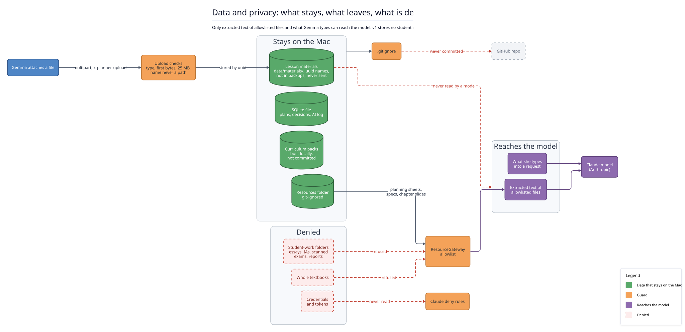

## 9. Tech stack

Look for the exact versions: every library built in milestone M1 is pinned, and the office-file readers for later milestones are marked "later".

## 10. Roadmap

Look for the order inside v1: one course end to end at a time, before any logins or hosting.

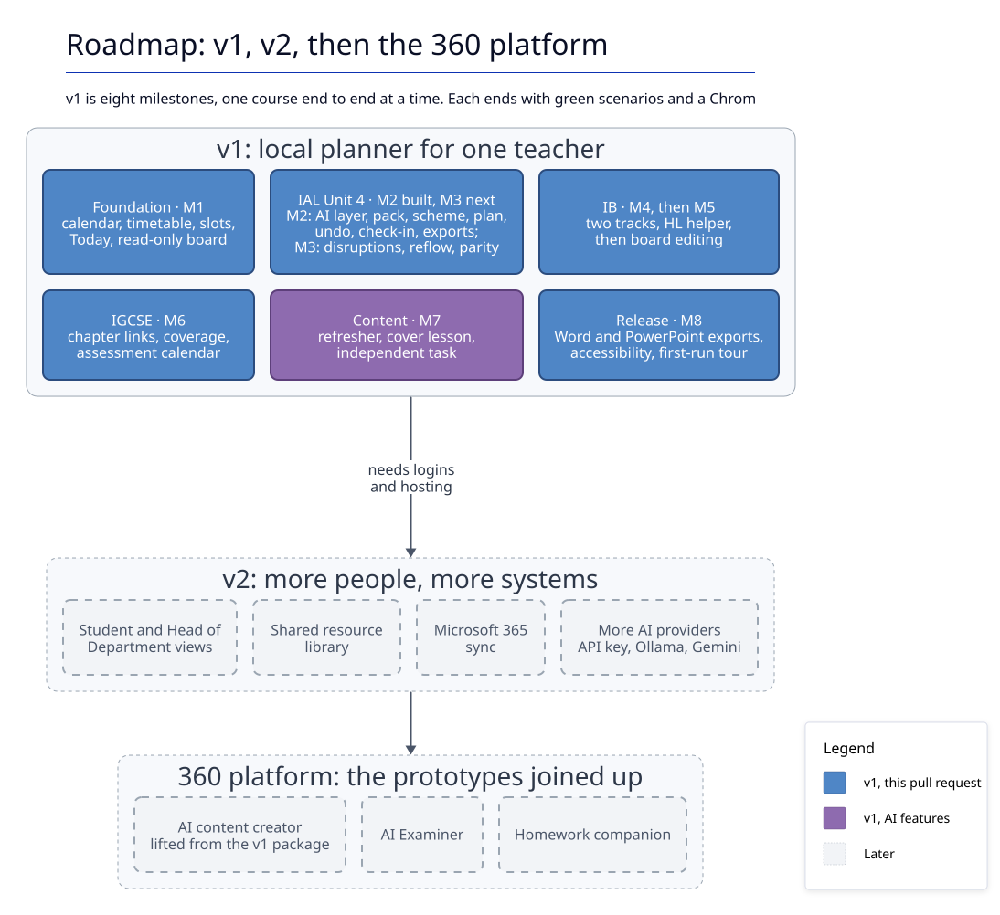

## How to update

If you are Claude, follow the `architecture-visual-docs` skill (`.claude/skills/architecture-visual-docs/SKILL.md`): it says which diagrams a given change touches and what to report. In short:

1. Edit the `.d2` file in `src/`. Shared colours and edge styles live in `src/_style.d2`; the full colour legend is `src/_legend.d2`.
2. Run `sh docs/design/render.sh` from the repo root. D2 comes from `mise.toml` (`mise install` once).
3. Open the SVG and look at it. Check for overlapping labels and text too small to read.
4. Commit the source and the SVG together.

`sh docs/design/render.sh --check` re-renders and fails if any committed SVG differs from its source. CI uses it to catch stale diagrams. Rendering is deterministic, so an unchanged source always gives an identical SVG.

Layout: ELK is the default. Diagrams 01, 03, 05, 06 and 08 set `layout-engine: tala` at the top of the file because it gave a more compact result. Keep each diagram to about twelve nodes; split it if it needs more.

## Screenshots

Real screenshots from browser validation live in `screens/`, named `mN-screen-name.png`. All of them show the synthetic school year, never real data.

Milestone M1 (calendar, timetable, slots, Setup, board, Today, slot audit):

| Screen | Screenshot |
|---|---|
| Setup: calendar import with its findings, terms, timetable |  |
| Board: one fortnight, Week 1 beside Week 2 | 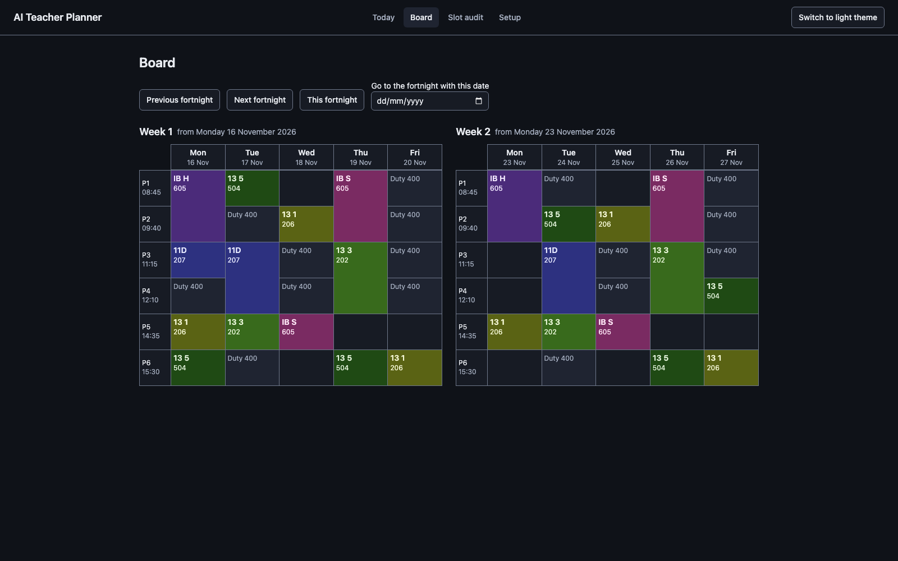 |
| Today: the day's lessons and what is coming up |  |
| Slot audit: lessons per teaching block and group, days off |  |

Milestone M1b (her corrections, cancelled lessons, calendar events, exams, board filter and week view, to-do notes):

| Screen | Screenshot |
|---|---|
| Setup: calendar events she confirms, with possible-disruption markers |  |
| Slot audit: lessons that will not run, last lessons and official exams | 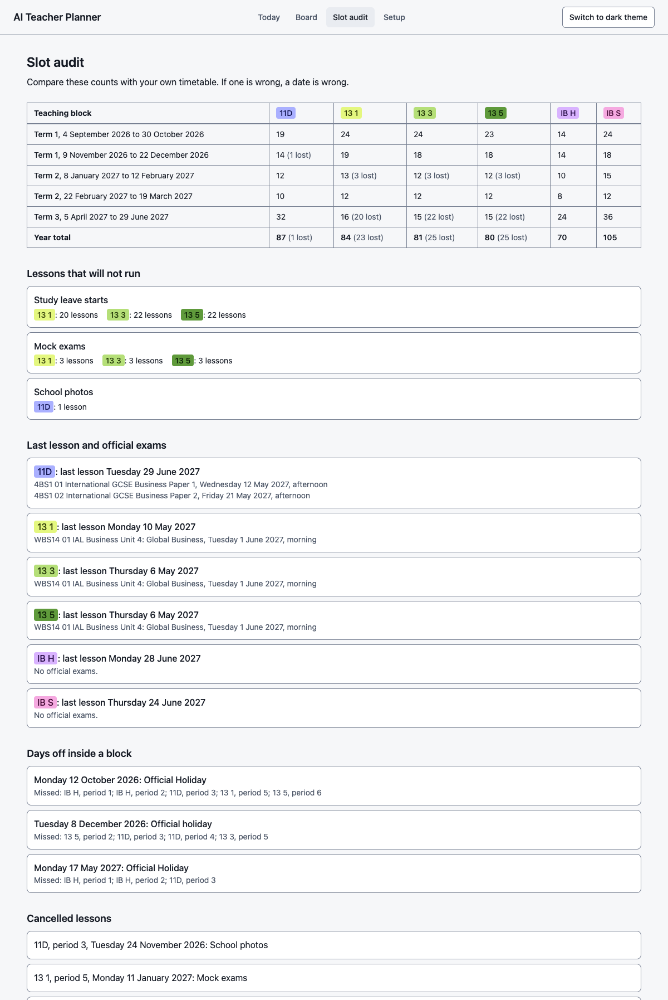 |
| Board: one week, with the class filter |  |
| Today in the dark theme, with to-do notes | 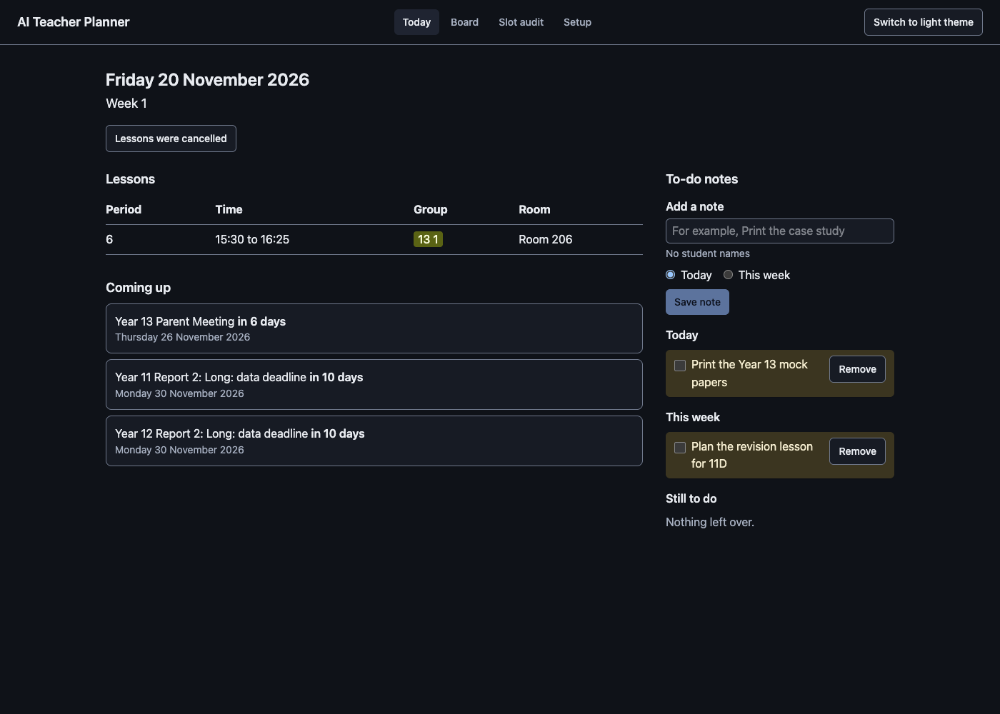 |
