# AI Teacher Planner: architecture at a glance

Twelve diagrams, drawn as code. Read them top to bottom for the whole picture, or jump to the one you need. They show the design agreed in `docs/superpowers/specs/2026-11-19-ai-teacher-planner-design.md`; when the code and a diagram disagree, fix the diagram in the same commit.

**Colour key, the same in every diagram:** blue is our code, green is data that stays on the Mac, amber is a boundary or guard, purple means a model is involved, grey dashed is later work, red dashed is denied.

| # | Diagram | Answers |
|---|---|---|
| 1 | [System context](#1-system-context) | Who and what does the planner touch? |
| 2 | [Containers](#2-containers) | What runs, and where? |
| 3 | [Backend components](#3-backend-components) | How is the API put together? |
| 4 | [Frontend screens](#4-frontend-screens) | Which screens exist, and which are still to come? |
| 5 | [Domain model](#5-domain-model) | What is stored and what is derived? |
| 6 | [Scheduling pipeline](#6-scheduling-pipeline) | How does a calendar become an accepted plan? |
| 7 | [AI flow](#7-ai-flow) | What happens when Gemma clicks an AI action? |
| 8 | [Data and privacy](#8-data-and-privacy) | What stays on the Mac, and what is denied? |
| 9 | [Tech stack](#9-tech-stack) | Which tools, at which versions? |
| 10 | [Roadmap](#10-roadmap) | What comes in v1, v2 and after? |
| 11 | [What reaches the model](#11-what-reaches-the-model) | Which data can leave for the model, and which never does? |
| 12 | [Frontend shared pieces](#12-frontend-shared-pieces) | Which pieces does every screen reuse? |

## 1. System context

Look for the dashed box: everything v1 uses sits on Gemma's Mac, and a single purple arrow leaves it.

## 2. Containers

Look for the two things that import the engine (the web app and the API), the one route to a model, through the AiProvider port, and the exporters package, which turns the head plan into an Excel fortnight or Teams text and leaves out AI items she has not reviewed.

## 3. Backend components

Look for the direction of the arrows: use cases call ports, while disk, files and the model sit behind adapters at the edge. The M1b routes and tables (disruptions, corrections, events, exams, to-do notes) and the M2 ones (courses, scheme, positions, plans, check-in) and the two export routes (the fortnight as Excel, a group's week as Teams text, each with the warning for AI items left out) all live in the same routes, use cases and repository box; curriculum packs are JSON files behind the PackStore, with only the locked hash in SQLite.

![Backend components: HTTP routes (today with the plan's lesson and assessment for each slot, calendar, corrections, events, disruptions, exams, todos, lesson notes and materials uploads, AI jobs and review; courses, packs, scheme, import preview and suggest-counts, positions, plans with the lessons that lost their slot, placements with declared topics, check-in, export), use cases (loadPlanInputs, propose, accept, undo, check-in, export data, seedM2), job queue, engine, driven adapters (importers read calendar, specification PDF text, planning sheets and assessment schedules; exporters write the Excel fortnight and Teams text) with migrations 0001-0011, the MaterialStore for uploads and the PackStore, ResourceGateway (finds planning files under Planning/ only), SQLite file and pack files, AI providers](03-backend-components.svg)

## 4. Frontend screens

Look for the split: six screens are built after M2 (Today, the fortnight board, the scheme of work, the slot audit, Setup, and Curriculum with its pack review) and the purple ones are where AI shows up. The five grey dashed screens (Parity, the IB HL helper, Coverage, Assessments, Resources) belong to M3 to M7 and are not built. The scheme-of-work screen computes its fit totals in the browser from her unsaved edits, with the same engine rule the API uses. Today's weekly check-in asks "did these happen as planned?" once per group and week, and writes the lesson log; the board's export menu offers the fortnight as Excel and a group's week as Teams text.

## 5. Domain model

Look for the colour split: green is stored, blue is worked out by the engine each time and never stored. Her M1b corrections and confirmations are green rows that survive a new import. An official exam becomes the plan's last checkpoint, named by its code. A course record carries the exam board and the revision weeks its plan keeps. A proposal (candidate, diff and before-and-after metrics) is never stored; accepting it adds an immutable revision to the plan's chain, only if the head and the candidate are still the ones she saw, and undo moves the head back to the parent.

![Domain model: calendar and timetable, courses (exam board, revision weeks), curriculum pack (a JSON file; units, chapters, spec points, hash lock in SQLite), her decisions (disruptions, label corrections, event confirmations, official exams, to-do notes), scheme items with group overrides and assessment details, positions and the lesson log, pins and merges, derived slots, lessons, placements, assessment anchors, checkpoints (assessment, block end, revision, official exam), overflow, absorbed buffers and conflicts, spare lessons, proposals with metrics, plan chain and revisions, provenance with review state, stored AI runs and items](05-domain-model.svg)

## 6. Scheduling pipeline

Look for the amber gates: a candidate revision becomes the head revision only when Gemma accepts the diff, and the accept is refused when the head or the candidate changed after the preview. Before that, the pace line keeps parallel groups level at each checkpoint and turns their free slots into spare lessons. The board, the check-in and the "up to date?" check read the head. The check-in is the one reader that also writes: her answer (taught, cover, skipped or homework) is appended to the lesson log, never to the head, and for a lesson answered twice the latest entry wins.

![Scheduling pipeline: calendar workbook to calendar days, slots, scheme expanded to lessons, history and the freeze horizon (the latest log entry for a lesson wins; buffer lessons that absorbed a loss stay used), per-group sequencing with official exams and the revision block, the pace line for parallel groups, candidate revision, diff with metrics and accept (lessons that lost their slot, cancelled or gone, listed first; skips and changed answers as corrections; refused when stale), head revision, read by the board's and Today's placements, the check-in (which appends her answers to the lesson log), the up-to-date check, parity, coverage and reminders](06-scheduling-pipeline.svg)

## 7. AI flow

Look for what crosses to the model (extracted text, or one timetable picture from data/uploads) and what comes back (JSON), the Claude Code adapter that starts `claude -p` and checks the answer against the schema, then the review step at the end. The job queue runs one job at a time, asks the provider whether it is available before each one, and tells the browser only plain-word progress; a suggestion is applied once, with its provenance, only after Gemma accepts or edits it.

## 8. Data and privacy

Look for the red dashed arrows: each one ends at a guard. Files she attaches to a lesson are checked on the way in, kept in their own folder and never read by a model. Her timetable picture goes to its own folder and is deleted when its job ends.

## 9. Tech stack

Look for the exact versions: every library built in milestones M1 and M2 is pinned (the Excel writer and the assessment-schedule reader included), and the Word and PowerPoint writers are marked "later".

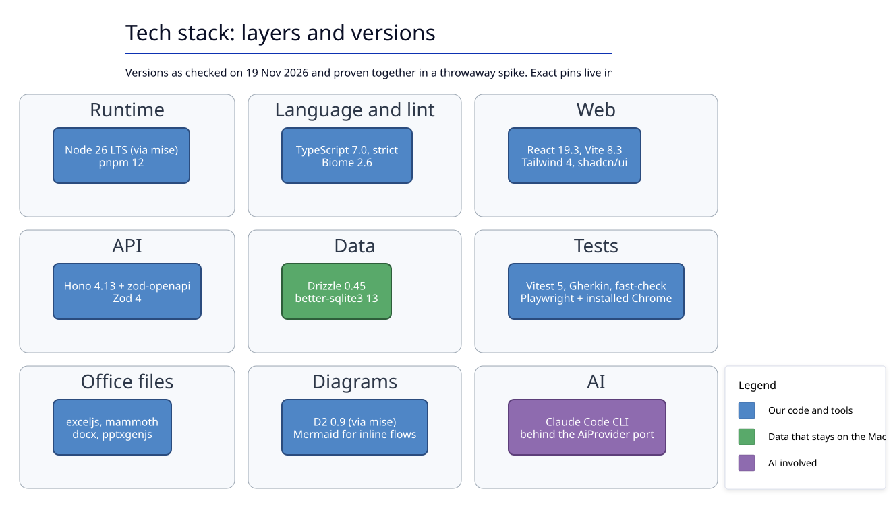

## 10. Roadmap

Look for the order inside v1: one course end to end at a time, before any logins or hosting. M2 is built; M3 (disruptions, reflow, parity) is next.

## 11. What reaches the model

Look for the three purple boxes: extracted text of allowlisted files, what she types, and one timetable picture read only from `data/uploads/`. The red dashed arrow is the lesson materials, which no model reads.

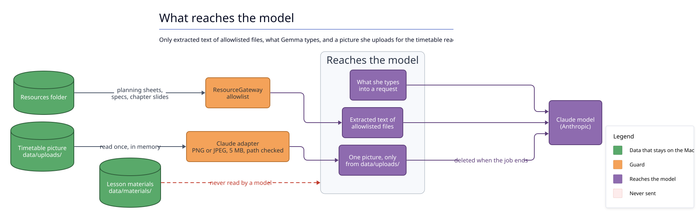

## 12. Frontend shared pieces

Look for the seven shared pieces every screen reuses; the purple ones are where AI shows up in the GUI: the badge and its popover, the activity drawer with the header job chip and review buttons, and the legend. Engine output carries no badge. Every change to a plan (a first plan from her positions in Setup, or "See what changes" when the plan is out of date on the board, Today or the scheme) opens the one proposal dialog; the board draws the plan with lesson cards whose state is written in words.

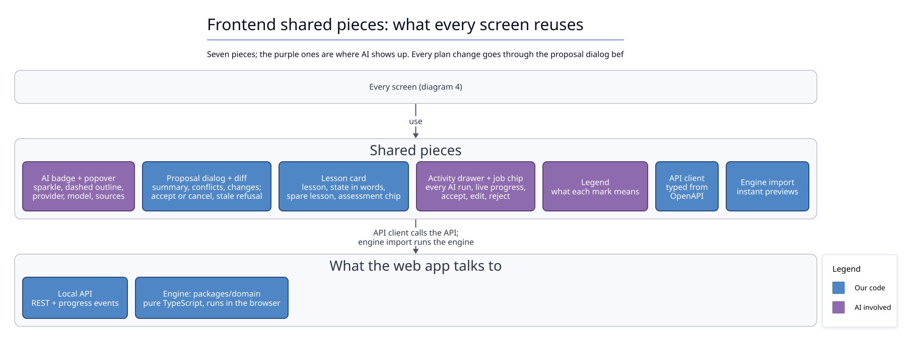

## How to update

If you are Claude, follow the `architecture-visual-docs` skill (`.claude/skills/architecture-visual-docs/SKILL.md`): it says which diagrams a given change touches and what to report. In short:

1. Edit the `.d2` file in `src/`. Shared colours and edge styles live in `src/_style.d2`; the full colour legend is `src/_legend.d2`.
2. Run `sh docs/design/render.sh` from the repo root. D2 comes from `mise.toml` (`mise install` once).
3. Open the SVG and look at it. Check for overlapping labels and text too small to read.
4. Commit the source and the SVG together.

`sh docs/design/render.sh --check` re-renders and fails if any committed SVG differs from its source. CI uses it to catch stale diagrams. Rendering is deterministic, so an unchanged source always gives an identical SVG.

Layout: ELK is the default. Diagrams 01, 03, 05 and 06 set `layout-engine: tala` at the top of the file because it gave a more compact result. Diagram 08 sets `layout-engine: elk` because its tala layout changed on every render. Keep each diagram to about twelve nodes; split it if it needs more.

## Screenshots

Real screenshots from browser validation live in `screens/`, named `mN-screen-name.png`. All of them show the synthetic school year, never real data.

Milestone M1 (calendar, timetable, slots, Setup, board, Today, slot audit):

| Screen | Screenshot |
|---|---|
| Setup: calendar import with its findings, terms, timetable | 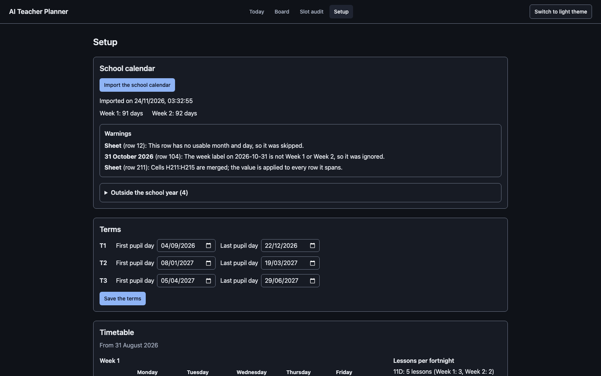 |
| Board: one fortnight, Week 1 beside Week 2 |  |
| Today: the day's lessons and what is coming up | 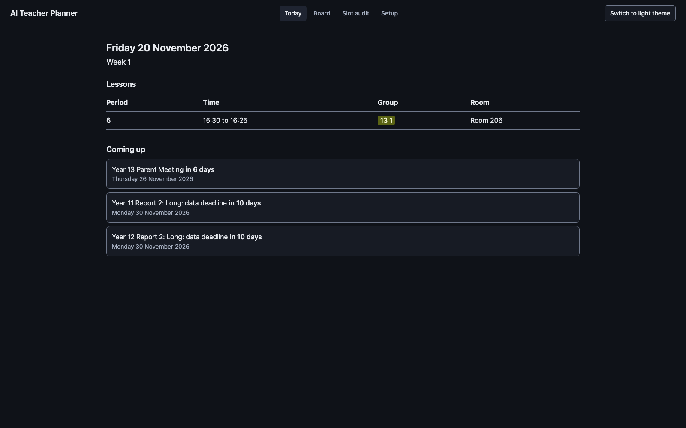 |
| Slot audit: lessons per teaching block and group, days off | 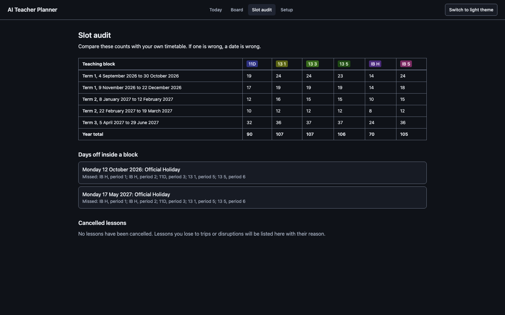 |

Milestone M1b (her corrections, cancelled lessons, calendar events, exams, board filter and week view, to-do notes):

| Screen | Screenshot |
|---|---|
| Setup: calendar events she confirms, with possible-disruption markers | 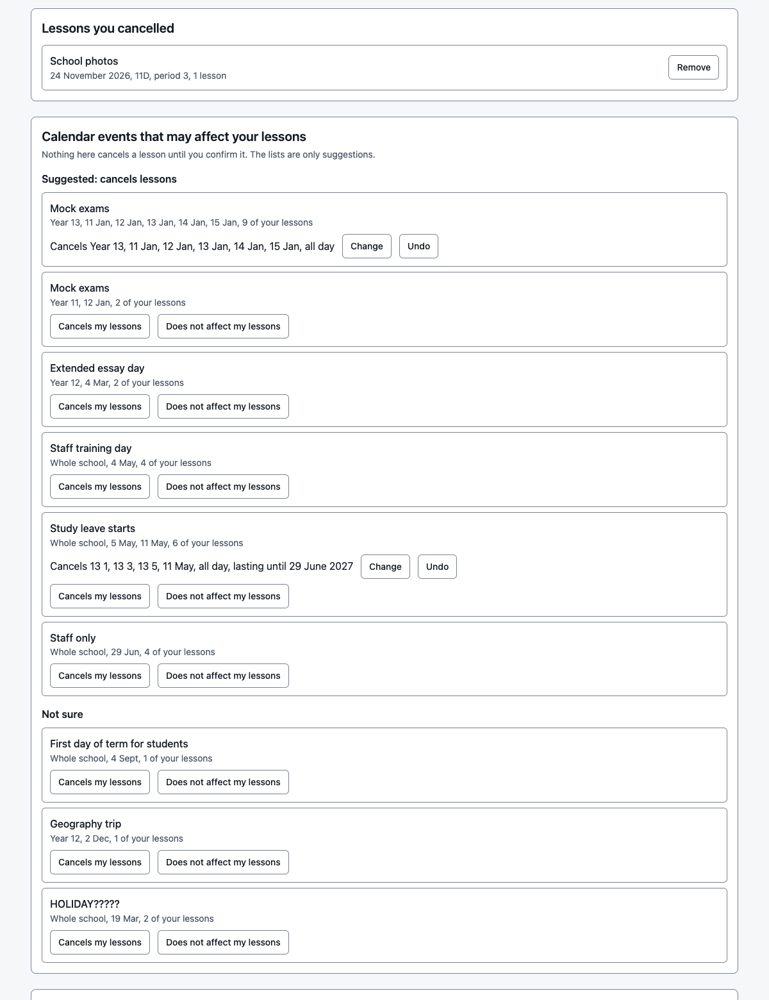 |
| Slot audit: lessons that will not run, last lessons and official exams |  |
| Board: one week, with the class filter | 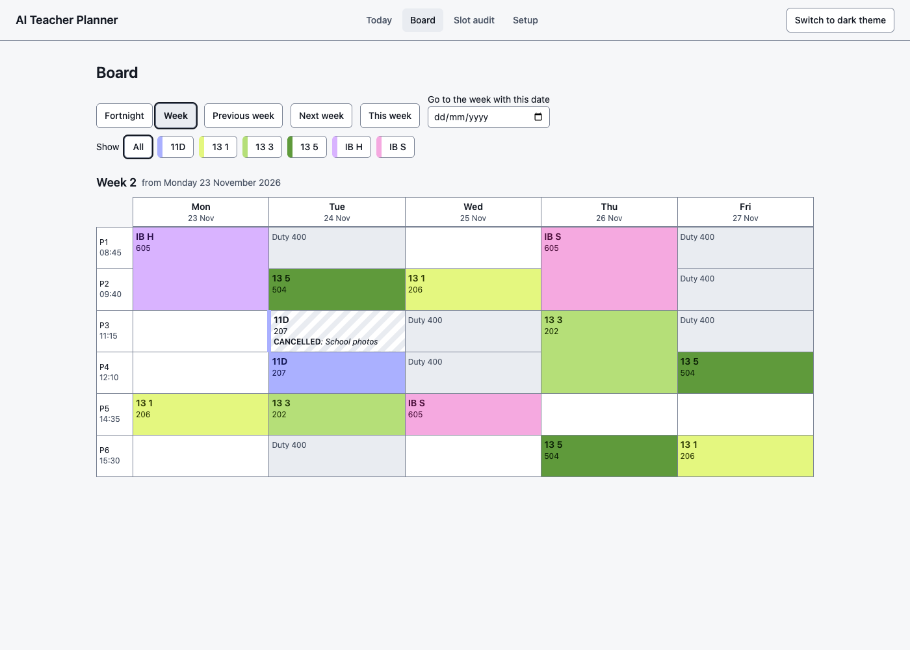 |
| Today in the dark theme, with to-do notes |  |

Milestone M2 (pack review, scheme of work, plan proposals, check-in), all from synthetic data in the dark theme:

| Screen | Screenshot |
|---|---|
| Pack review: a draft with the AI badge, the AI's doubts and the lock panel | 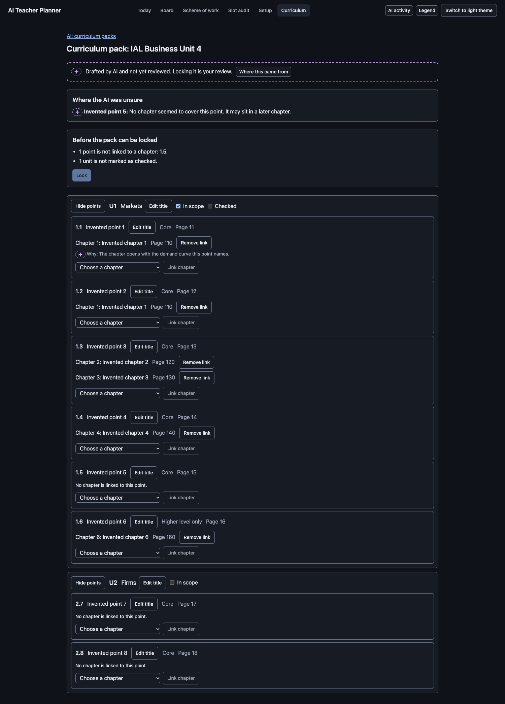 |
| Scheme of work: lesson counts with live totals for each group | 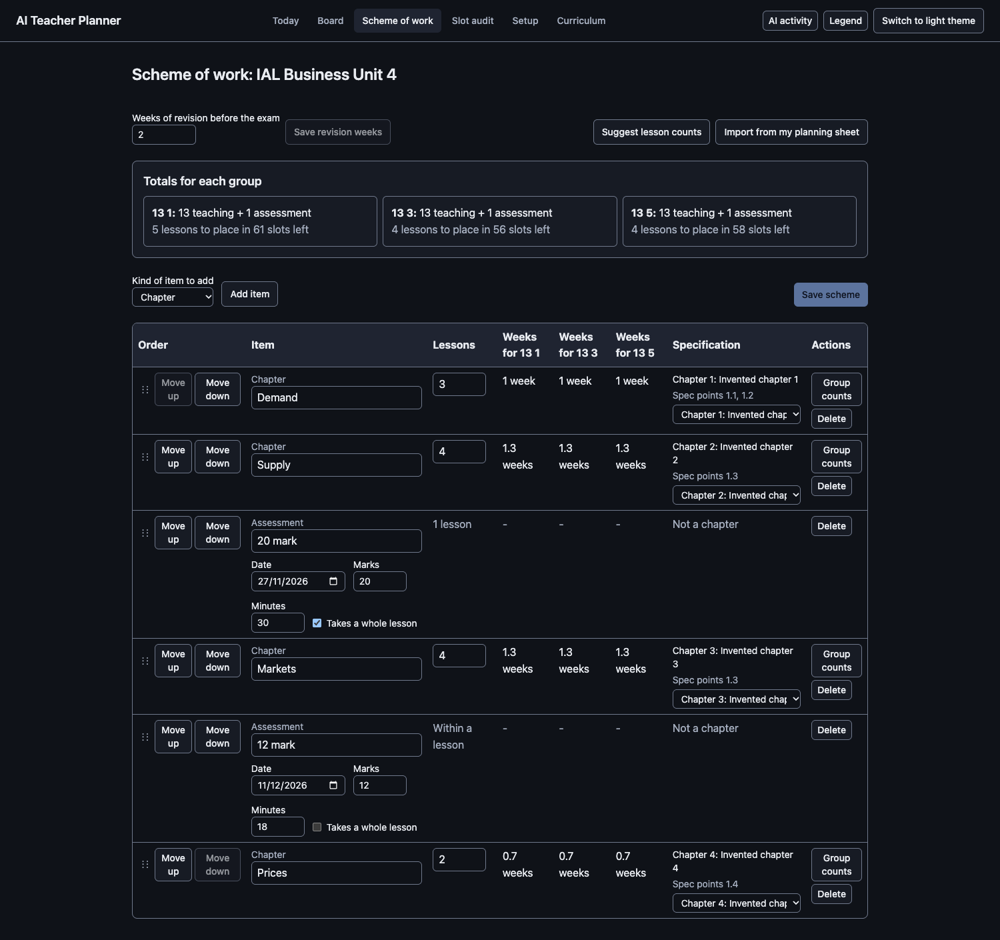 |
| Board: the fortnight with the plan's lessons, a spare lesson and assessments | 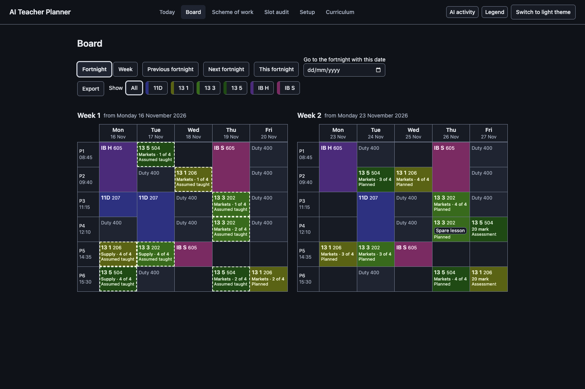 |
| Proposal: what moves and why, before she accepts | 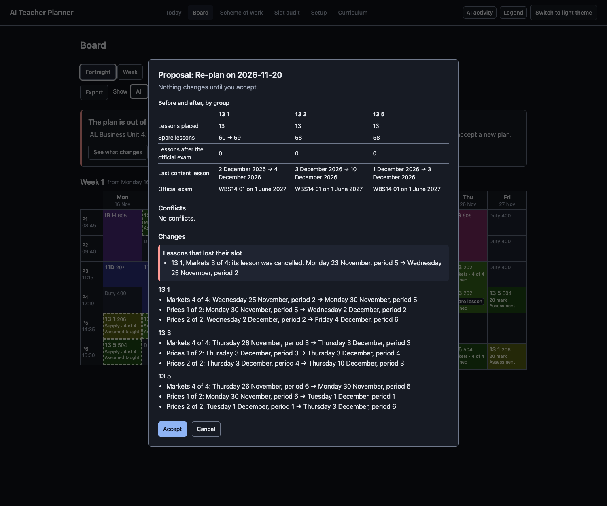 |
| Today: the weekly check-in, one click for each group | 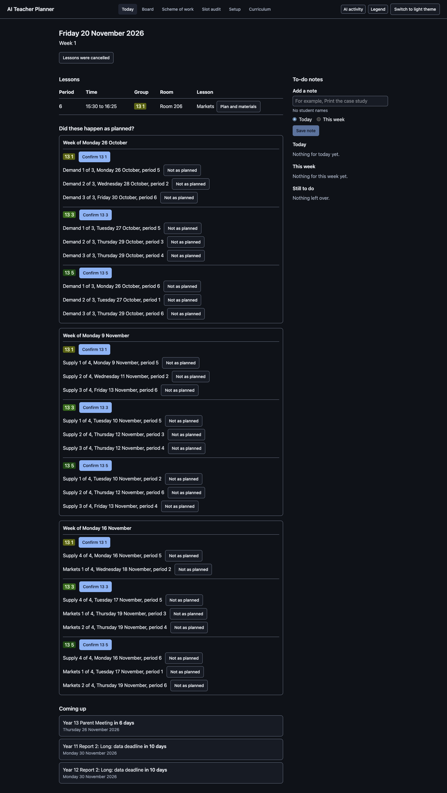 |
