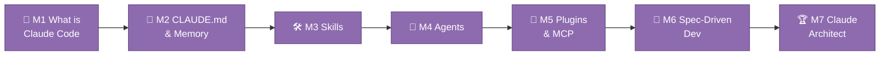

# 🤖 How to Learn Claude — Your Path to Claude Architect

Welcome to the second pillar of your course, Gemma. You've graduated the
Python course — eight green ticks, one capstone `Gradebook`, and a real
understanding of variables, loops, functions, and tests. But every single
lesson along the way, Claude was the one writing the files, running the
tests, and explaining the errors. This pillar turns around and teaches you
*that* tool, properly: not as a chatbot you type questions into, but as an
agentic collaborator that reads your codebase, edits files, runs commands,
and — once you've finished this course — takes instructions from skills and
agents *you* designed.

Seven modules stand between here and that. They're shorter than the Python
modules — no `lesson_*.py` files to run, no `-m homework` tests to turn
green — because every exercise happens directly against this repo, in a real
`claude` session, right now. You'll ask Claude to explain code you already
know, edit `CLAUDE.md` and watch behaviour shift, invoke a skill, delegate to
an agent, peek at plugins and MCP, write a spec, and — in the final module —
design, build, test, and ship a skill of your own. That last one isn't a
practice exercise. It's a real tool your department will use.

## 🗺️ Your path through the Claude course

Work through them in order, left to right — each one builds a concept the
next one leans on. Module 04 assumes you can already invoke a skill from
Module 03; Module 07's capstone assumes everything before it.

## 📚 The seven modules

| # | Module | What it covers | Hands-on exercise |
|---|---|---|---|
| 01 | [What is Claude Code](../claude_course/module_01_what_is_claude_code/INDEX.md) | Terminal REPL, permission prompts, plan mode, `/help`, `/clear` | Ask Claude to explain `lesson_01_your_first_program.py` line by line |
| 02 | [CLAUDE.md & Memory](../claude_course/module_02_claude_md_memory/INDEX.md) | What `CLAUDE.md` does, memory scopes, context windows | Add a personal preference line to `CLAUDE.md` and observe the change |
| 03 | [Skills](../claude_course/module_03_skills/INDEX.md) | `SKILL.md` anatomy, auto-invocation vs. `/skill-name` | Invoke the lesson-creator skill on a bonus lesson |
| 04 | [Agents](../claude_course/module_04_agents/INDEX.md) | Subagents as colleagues with fresh context | Run the homework-checker agent on your Module 02 homework |
| 05 | [Plugins & MCP](../claude_course/module_05_plugins_mcp/INDEX.md) | Plugins, marketplaces, MCP as a socket for external tools | Run `/plugin` and inspect what's installed in this repo |
| 06 | [Spec-Driven Dev](../claude_course/module_06_spec_driven_dev/INDEX.md) | Brainstorm → spec → plan → build, ADRs, TDD with Claude | Write a mini-spec for a "parent email draft" script |
| 07 | [Claude Architect Capstone](../claude_course/module_07_claude_architect_capstone/INDEX.md) | Building your own skill, testing it, opening your first PR | Ship `.claude/skills/parent-email-drafts/SKILL.md` |

## 🔌 Plugins, in one paragraph

You'll meet this properly in Module 05, but here's the shape of it early.
Skills (Module 03) and agents (Module 04) can live loose in a project's
`.claude/` folder — that's what this repo does today. A **plugin** is a
bundle of skills, agents, hooks, and even MCP servers, packaged together so
they can be shared, versioned, and installed as one unit. A **marketplace**
is just a catalog you point Claude Code at with `/plugin marketplace add`,
so you can browse and install plugins from it. This repo doesn't currently
install any team-level plugins of its own — the point of Module 05 isn't a
long list, it's understanding the mechanism, so that when your department
*does* want to share tooling across multiple teachers' repos one day, you
already know how.

## 🏛 What is a Claude Architect?

A **Claude Architect** doesn't just use Claude Code to get their own work
done — they design how it works *for other people*. That means writing
skills that package a repeatable procedure so a colleague doesn't have to
re-explain it every time, building agents that review work consistently and
kindly, and thinking in specs and ADRs so decisions survive past the moment
they're made.

By the end of Module 07, you'll have done exactly that: a real skill,
`.claude/skills/parent-email-drafts/SKILL.md`, built for your department —
not just for you. Your department is the first client of the Claude
Architect you're about to become. It won't be the last.
