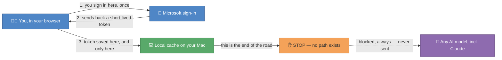
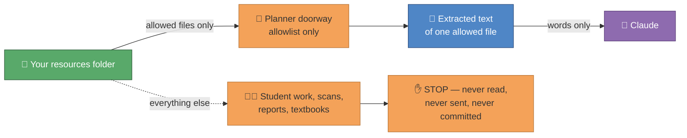

# 🔒 Security — how your secrets stay safe

You will never type a password or paste a token into a chat with Claude. This page explains why, in plain language — three separate safety nets, each one enough on its own.

## 🛡️ The three layers

**1. `.gitignore` blocks git.** Files like `.env`, anything inside a `secrets/` folder, and any file with `token_cache` or `msal_cache` in its name are listed in `.gitignore`. Git — the tool that saves your work and pushes it to GitHub — is told to pretend these files don't exist. They can never be committed, and they can never be pushed.

**2. Deny rules block Claude's eyes.** `.claude/settings.json` tells Claude Code, in writing, that it is *not allowed* to open those same files — even if you asked it to, even by accident. This isn't a polite request; it's a permission the tool enforces before Claude ever sees the file content.

**3. Device-code sign-in keeps tokens on your Mac only.** When an automation needs to talk to Microsoft (Teams, OneDrive, SharePoint), you sign in yourself, in your own browser, the normal way you already sign into Microsoft 365. Microsoft hands back a token — a temporary "yes, this is Gemma" pass — and that token is saved only in a local cache file on your Mac. It is never typed, pasted, or shown to Claude or any other AI model.

## 🗺️ Where a token goes (and where it never goes)

The token's whole journey is: **your browser → Microsoft → your Mac's local cache.** There is no arrow, anywhere in this repo's code, from that cache to Claude or to any other AI model. The amber ✋ node is a wall, not a door.

## 📁 Your teaching resources folder

`prototypes/resources/` is a copy of your OneDrive teaching folder. The AI Teacher Planner needs some of it: the school calendar, the specifications, your planning sheets and your chapter PowerPoints. But the same folder also holds things no AI and no GitHub repository should ever see: students' essays and internal assessments in folders named after them, scanned exams, reports, and whole copyrighted textbooks.

So that folder gets its own four safety nets, on top of the three above:

**1. Git ignores the whole folder.** Nothing inside `prototypes/resources/` can be committed or pushed. (For a few days the ignore line had a typo and protected nothing. That is fixed, and the four files that had slipped onto GitHub are no longer tracked.)

**2. Deny rules block Claude's eyes on the student folders.** `.claude/settings.json` names the folders that hold student work, and Claude Code refuses to open anything in them. We tested this: Claude was refused before it could even check whether a file existed.

**3. The planner only opens a short allowlist.** The app reads files through one doorway, the `ResourceGateway`, which accepts your Planning folders, the three specification PDFs, your chapter PowerPoint folders and your per-topic exam practice. Everything else is refused, and a test proves it.

**4. The AI gets text, never the folder.** When the planner asks Claude for help, it first pulls the words out of the one file involved (say, the slide text of a chapter PowerPoint) and sends only those words. Claude is given no way to browse your files. The one exception is a picture you choose to upload of your own timetable: it is saved in `data/uploads`, checked (PNG or JPG, up to 5 MB) and read only from there, shown to Claude as an image, and deleted as soon as the job ends. See the ADR-007 amendment.

Two things to remember:

- **If you add a new folder of student work,** tell Alberto or ask Claude to "add a deny rule for this folder". The allowlist already keeps the planner out, but the deny rule is what stops a normal Claude session from opening it.
- **The planner stores no student data at all.** No names, no marks. If a future feature ever needs them, that is a new decision with its own ADR, not a quiet change.

The full reasoning is in [ADR-011](adr/011-resources-data-boundary.md).

## 🚨 If you think a secret leaked

If you ever accidentally paste a password or token somewhere it shouldn't be (a chat, a commit, a screenshot you shared) — don't panic, and don't try to quietly fix it yourself:

> **1. Rotate it.** Change that password (or, for Microsoft, sign out and back in to invalidate the old token) straight away — before anything else.
> **2. Tell Alberto.** A two-line message is all it takes: what leaked, and where. He'd rather get that message than have you spend an evening worrying about it alone.

Acting fast matters more than getting it perfect. A rotated secret is a non-event; a secret nobody rotated is the only real problem.
