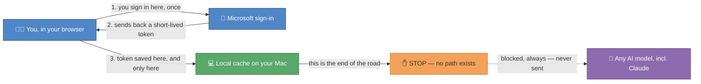

# 🔒 Security — how your secrets stay safe

You will never type a password or paste a token into a chat with Claude. This page explains why, in plain language — three separate safety nets, each one enough on its own.

## 🛡️ The three layers

**1. `.gitignore` blocks git.** Files like `.env`, anything inside a `secrets/` folder, and any file with `token_cache` or `msal_cache` in its name are listed in `.gitignore`. Git — the tool that saves your work and pushes it to GitHub — is told to pretend these files don't exist. They can never be committed, and they can never be pushed.

**2. Deny rules block Claude's eyes.** `.claude/settings.json` tells Claude Code, in writing, that it is *not allowed* to open those same files — even if you asked it to, even by accident. This isn't a polite request; it's a permission the tool enforces before Claude ever sees the file content.

**3. Device-code sign-in keeps tokens on your Mac only.** When an automation needs to talk to Microsoft (Teams, OneDrive, SharePoint), you sign in yourself, in your own browser, the normal way you already sign into Microsoft 365. Microsoft hands back a token — a temporary "yes, this is Gemma" pass — and that token is saved only in a local cache file on your Mac. It is never typed, pasted, or shown to Claude or any other AI model.

## 🗺️ Where a token goes (and where it never goes)

The token's whole journey is: **your browser → Microsoft → your Mac's local cache.** There is no arrow, anywhere in this repo's code, from that cache to Claude or to any other AI model. The amber ✋ node is a wall, not a door.

## 🚨 If you think a secret leaked

If you ever accidentally paste a password or token somewhere it shouldn't be (a chat, a commit, a screenshot you shared) — don't panic, and don't try to quietly fix it yourself:

> **1. Rotate it.** Change that password (or, for Microsoft, sign out and back in to invalidate the old token) straight away — before anything else.
> **2. Tell Alberto.** A two-line message is all it takes: what leaked, and where. He'd rather get that message than have you spend an evening worrying about it alone.

Acting fast matters more than getting it perfect. A rotated secret is a non-event; a secret nobody rotated is the only real problem.
