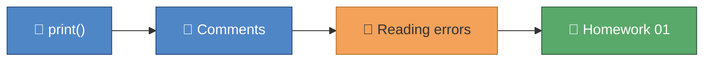

# Agentic AI Masters for Education — Foundation Pass Implementation Plan

> **For agentic workers:** REQUIRED SUB-SKILL: Use superpowers:subagent-driven-development (recommended) or superpowers:executing-plans to implement this plan task-by-task. Steps use checkbox (`- [ ]`) syntax for tracking.

**Goal:** Build the full learning repo — tooling foundation, Python course (8 modules), Claude course (7 modules), Claude skills/agents, and 4 prototype scaffolds — pushed to `main` so Gemma can `git pull` and start module 01 unaided.

**Architecture:** uv workspace monorepo. `python_course/` modules are flat script folders (tests beside homework, pytest prepend-import). `prototypes/` are proper src-layout uv workspace packages. `.claude/` carries the meta-layer (skills, agents, deny rules). Spec: `docs/superpowers/specs/2026-08-04-agentic-ai-masters-for-education-design.md`.

**Tech Stack:** Python 3.12, uv, pytest, ruff, pre-commit, GitHub Actions, openpyxl (planner), msal (automation), mermaid.

## Global Constraints

- Python `>=3.12`; uv is the only package/env manager; free tooling only.
- No secret, credential, or token in code, git, or any AI context — three-layer enforcement (.gitignore, `.claude/settings.json` deny rules, device-code flow docs).
- Student data anonymized: `student1_YYYY_MM_DD_SUBJECT.png` pattern; no real names.
- Every commit message: conventional commits + `Co-Authored-By: Claude Fable 5 <noreply@anthropic.com>`; push to `origin main` after each task.
- All examples Business/Economics-themed.
- External links policy: official docs (docs.python.org, code.claude.com/docs) linked directly; YouTube links must be canonical well-known videos, verified with WebFetch when possible; if unverifiable use `https://www.youtube.com/results?search_query=...` URLs (never 404). Images: prefer mermaid diagrams (per House Style palette); embed external images only from stable sources.
- `uv run pytest` and `uv run ruff check .` must pass at the end of every task.

## House Style Contract (governs ALL course content tasks)

### Lesson file anatomy (every `lesson_*.py`)

```python
"""
🎓 LESSON X.Y — <Title>
=======================

WHAT YOU WILL LEARN
-------------------
- <bullet>
- <bullet>

RESOURCES (open these!)
-----------------------
📖 Docs   : <official docs URL>
🎬 Video  : <YouTube URL per links policy>
🖼 Visual : see INDEX.md concept map

HOW TO RUN ME
-------------
    uv run python python_course/module_XX_<name>/lesson_XX_<name>.py
"""

# ── 1. <CONCEPT NAME> ──────────────────────────────────────────
# <comment explaining WHY, naming the concept in plain English,
#  with a teaching analogy from Gemma's world (marks, registers, prices)>
<code>

# 🧪 TRY IT: <one-line experiment instruction — change something and re-run>
```

Rules: every code line group has a comment naming the concept; analogies from teaching/economics; `# 🧪 TRY IT` at least twice per lesson; lessons runnable top-to-bottom with `print()` output that tells a story.

### Homework anatomy (`homework_XX.py`)

```python
"""
📝 HOMEWORK XX — <Title>
Complete each function where you see TODO.
Check your work:   uv run pytest python_course/module_XX_<name> -v
Stuck? Ask the homework-checker agent (see INDEX.md) — it hints, never spoils.
"""

def function_name(param: type) -> type:
    """<one-line task description in teacher language>

    Example:
        >>> function_name(example)
        expected
    """
    # TODO: <specific instruction>
    return ...
```

### Test anatomy (`test_homework_XX.py`, same folder as homework)

Every assert carries a `💡 Hint:` message that guides without revealing the answer. Import the homework module at top level (stubs exist, so import succeeds).

### INDEX.md anatomy (every module)

Sections in order: `# 🎓 Module XX — <Title>`, `## 🎯 What you'll learn`, `## 🗺️ Concept map` (one mermaid flowchart, emoji in every node, palette below), `## 📚 Lessons` (table: file | concept | 📖 docs | 🎬 video), `## 📝 Homework` (exact pytest command), `## ✅ Progress checklist` (checkboxes), `## 🆘 When you're stuck` (1. re-read lesson comments, 2. homework-checker agent, 3. ask Claude to explain — never to solve).

### Mermaid palette (identical everywhere)

```
classDef concept fill:#4F86C6,color:#fff,stroke:#2B4C7E     %% blue = concept
classDef win     fill:#59A96A,color:#fff,stroke:#2E5E3A     %% green = homework/win
classDef warn    fill:#F4A259,color:#333,stroke:#B87333     %% amber = pitfalls/errors
classDef ai      fill:#8E6BAF,color:#fff,stroke:#5D3F7A     %% purple = Claude/AI
```

### Claude-course lesson anatomy (`claude_course/module_XX/INDEX.md`)

Same INDEX sections, plus `## 🛠 Hands-on exercise` (a concrete task against THIS repo) and `## 🧭 You know you've got it when…` (observable outcomes). Docs links point to https://code.claude.com/docs/.

---

### Task 1: Tooling foundation

**Files:**
- Create: `.gitignore`, `pyproject.toml`, `.pre-commit-config.yaml`, `.github/workflows/ci.yml`, `.claude/settings.json`, `tests/test_setup.py`

**Interfaces:**
- Produces: uv workspace root all later tasks install into; pytest `testpaths = ["tests", "python_course", "prototypes"]`; ruff line-length 120.

- [ ] **Step 1: Write `.gitignore`**

```gitignore
# Python
__pycache__/
*.py[cod]
.venv/
*.egg-info/
.pytest_cache/
.ruff_cache/
dist/

# IDE / OS
.idea/
.vscode/
.DS_Store

# ── SECURITY: secrets NEVER enter git ──
.env
.env.*
**/secrets/
**/*token_cache*
**/.msal_cache*

# Real student data never enters git — mock_data/ only
prototypes/*/real_data/

# Local session notes
.remember/
```

- [ ] **Step 2: Write root `pyproject.toml`**

```toml
[project]
name = "python-for-gemma"
version = "0.1.0"
description = "Agentic AI Masters for Education — Gemma's learning repo"
requires-python = ">=3.12"
dependencies = [
    "ai-teacher-planner",
    "automation-flows",
    "ai-homework-companion",
    "ai-examiner",
]

[dependency-groups]
dev = ["pytest>=8.0", "ruff>=0.4", "pre-commit>=3.7"]

[tool.uv.workspace]
members = ["prototypes/*"]

[tool.uv.sources]
ai-teacher-planner = { workspace = true }
automation-flows = { workspace = true }
ai-homework-companion = { workspace = true }
ai-examiner = { workspace = true }

[tool.pytest.ini_options]
testpaths = ["tests", "python_course", "prototypes"]

[tool.ruff]
line-length = 120

[tool.ruff.lint]
select = ["E", "F", "I"]
```

NOTE: the four workspace deps don't exist until Tasks 10–13. To keep `uv sync` green from Task 1, ALSO create the four minimal package stubs now (see Step 3) — Tasks 10–13 then fill them in.

- [ ] **Step 3: Create 4 minimal prototype package stubs**

For each of `ai_teacher_planner` (pkg `ai-teacher-planner`, deps `["openpyxl>=3.1"]`), `automation_flows` (pkg `automation-flows`, deps `["msal>=1.28"]`), `ai_homework_companion` (pkg `ai-homework-companion`, no deps), `ai_examiner` (pkg `ai-examiner`, no deps) — create `prototypes/<dir>/pyproject.toml`:

```toml
[project]
name = "<pkg-name>"
version = "0.1.0"
description = "<one line>"
requires-python = ">=3.12"
dependencies = [<deps>]

[build-system]
requires = ["hatchling"]
build-backend = "hatchling.build"

[tool.hatch.build.targets.wheel]
packages = ["src/<dir>"]
```

and `prototypes/<dir>/src/<dir>/__init__.py` containing a one-line docstring.

- [ ] **Step 4: Write `.pre-commit-config.yaml`**

```yaml
repos:
  - repo: https://github.com/astral-sh/ruff-pre-commit
    rev: v0.4.10
    hooks:
      - id: ruff
        args: [--fix]
      - id: ruff-format
```

- [ ] **Step 5: Write `.github/workflows/ci.yml`**

```yaml
name: CI
on:
  push:
    branches: [main]
  pull_request:

jobs:
  test:
    runs-on: ubuntu-latest
    steps:
      - uses: actions/checkout@v4
      - uses: astral-sh/setup-uv@v5
      - run: uv sync --all-packages
      - run: uv run ruff check .
      - run: uv run ruff format --check .
      - run: uv run pytest -v
```

- [ ] **Step 6: Write `.claude/settings.json`**

```json
{
  "permissions": {
    "deny": [
      "Read(./.env)",
      "Read(./.env.*)",
      "Read(**/.env)",
      "Read(**/.env.*)",
      "Read(**/secrets/**)",
      "Read(**/*token_cache*)",
      "Read(**/.msal_cache*)",
      "Read(~/.azure/**)"
    ]
  }
}
```

- [ ] **Step 7: Write failing smoke test `tests/test_setup.py`**

```python
"""Smoke test: proves the toolchain works. Gemma's very first green tick. ✅"""

import sys


def test_python_is_modern_enough():
    assert sys.version_info >= (3, 12), "💡 Hint: run 'uv sync' — uv installs the right Python."
```

- [ ] **Step 8: Run `uv sync --all-packages` then `uv run pytest tests -v`** — Expected: 1 passed.
- [ ] **Step 9: Run `uv run ruff check .`** — Expected: clean.
- [ ] **Step 10: Commit `chore: uv workspace, CI, pre-commit, security deny rules` and push.**

### Task 2: Docs pack (CLAUDE.md, README, ADRs, security, questionnaire)

**Files:**
- Create: `CLAUDE.md`, `README.md` (overwrite), `QUESTIONS_FOR_GEMMA.md`, `docs/adr/template.md`, `docs/adr/001-prototype-build-order.md`, `docs/adr/002-claude-code-agents-as-ai-engine.md`, `docs/adr/003-python-msgraph-automation-stack.md`, `docs/adr/004-first-pass-scope.md`, `docs/security.md`

**Interfaces:**
- Consumes: repo layout from spec §4. Produces: the docs every later INDEX.md links to (`docs/security.md`, ADR paths).

- [ ] **Step 1: Write `CLAUDE.md`** (< 60 lines) containing exactly these sections: *What this repo is* (2 lines: Gemma's Agentic AI Masters; packages = modules, lessons = commented files); *Map* (5 bullet lines: python_course, claude_course, prototypes, docs, .claude); *Commands* (`uv sync --all-packages`, `uv run pytest`, `uv run pytest python_course/module_XX -v`, `uv run ruff check .`); *House style* (pointer: "All course content follows the House Style Contract in docs/superpowers/plans/2026-08-04-agentic-ai-masters-foundation.md — lesson anatomy, homework TODO+tests, INDEX.md with mermaid palette"); *Security — NON-NEGOTIABLE* (never read/print/commit `.env*`, `secrets/`, token caches; deny rules in `.claude/settings.json`; anonymized student filenames only); *Teaching tone* (visual, encouraging, hint-don't-solve for homework; when Gemma asks for homework help, explain concepts, never write her answers); *Engineering conventions* (spec → plan → build in docs/superpowers/; ADR per significant decision in docs/adr/; TDD; conventional commits; feature branches + PRs after module 08).

- [ ] **Step 2: Write `README.md`** — Gemma's home page: title + one-para welcome; "🚀 Start here" numbered list (1. install uv via curl one-liner, 2. `git clone`, 3. `uv sync --all-packages`, 4. `uv run pytest tests -v` to see first green, 5. open `python_course/module_01_hello_python/INDEX.md`); a mermaid learning map (Python course → Claude course → prototypes, palette per House Style, one node per module/prototype); "The four pillars" table; link to `QUESTIONS_FOR_GEMMA.md` + `docs/how_to_learn_claude.md` + `docs/security.md`.

- [ ] **Step 3: Write `docs/adr/template.md`** (`# ADR-NNN: Title` / Date / Status / Context / Decision / Consequences — each a short section) and the four ADRs recording spec §3 decisions, 10–20 lines each, Status: Accepted.

- [ ] **Step 4: Write `docs/security.md`** — teacher-language explanation of the three layers (gitignore blocks git, deny rules block Claude's eyes, device-code flow keeps tokens in the local MSAL cache); one mermaid sequence/flow diagram showing a token flowing ONLY between her browser, Microsoft, and her Mac's cache (red ✋ node between "Your Mac" and "any AI model"); a "what to do if you think a secret leaked" box (rotate password, tell Alberto).

- [ ] **Step 5: Write `QUESTIONS_FOR_GEMMA.md`** — intro ("answering this file IS your first git exercise: edit, commit, push — module 08 shows you how, or ask Claude"); grouped questions each followed by `> ✍️ Your answer:` block. Groups & questions: **A. Teacher Planner** (A1 can you open the school calendar xlsx from your Mac + can you copy it into this repo's `prototypes/ai_teacher_planner/real_data/`?, A2 what tabs/columns does it have — screenshot ok, A3 your timetable: classes, year groups, periods/week per class, A4 term dates 2025-26, A5 preferred planner output: Excel / Word / Markdown / OneNote?); **B. Examiner** (B1 can you get 2–3 anonymized sample scans per paper type, B2 which papers first: IB Business? IAL Business Unit 1–4? IGCSE?, B3 where do official mark schemes live for you (Examwizard?), B4 how do you annotate today (pen on paper? PDF?), B5 what should a correction output look like to feel trustworthy?); **C. Practice Companion** (C1 which units/topics do students struggle with most, C2 which question sizes matter most (4/8/10/12/20 mark?), C3 how long should a case study be?); **D. Automations** (D1 list your top-3 most repetitive weekly tasks with rough minutes each, D2 SIMS: what exactly do you do in the VM weekly?, D3 Cognita Connect: web app or desktop?, D4 does school IT allow signing into Microsoft from a Python app on your Mac (device-code login)? If unsure, who can we ask?, D5 which Teams channel holds the staff calendar file?); **E. You** (E1 hours/week for this course, E2 best learning time slots, E3 anything about the course style you want changed after module 01?).

- [ ] **Step 6: Run `uv run ruff check .` (clean) — markdown-only task, then commit `docs: CLAUDE.md, README learning map, ADRs 001-004, security model, Gemma questionnaire` and push.**

### Task 3: Module 01 exemplar (house style reference implementation)

**Files:**
- Create: `python_course/module_01_hello_python/INDEX.md`, `lesson_01_your_first_program.py`, `lesson_02_reading_errors.py`, `homework_01.py`, `test_homework_01.py`

**Interfaces:**
- Produces: THE exemplar all module tasks copy. Homework functions: `greet_the_class() -> str`, `school_motto() -> str`, `fixed_price_label() -> str`.

- [ ] **Step 1: Write failing tests `test_homework_01.py`**

```python
"""✅ Homework 01 checker. Run me:  uv run pytest python_course/module_01_hello_python -v"""

import homework_01


def test_greet_the_class():
    assert homework_01.greet_the_class() == "Hello, Year 12 Business!", (
        "💡 Hint: return (don't print!) the exact text — capitals and the '!' matter."
    )


def test_school_motto():
    assert homework_01.school_motto() == "Learn together, grow together", (
        "💡 Hint: check the spelling and the comma. Strings must match EXACTLY."
    )


def test_fixed_price_label():
    assert homework_01.fixed_price_label() == "Price: £9.99", (
        "💡 Hint: there is a space after the colon, and the £ sign comes before the number."
    )
```

- [ ] **Step 2: Run `uv run pytest python_course/module_01_hello_python -v`** — Expected: FAIL (module `homework_01` not found).
- [ ] **Step 3: Write `lesson_01_your_first_program.py`** — full House Style lesson covering `print()`, strings in quotes, comments with `#`, why comments matter for teachers-as-coders; TRY IT: change the printed class name; TRY IT: print a 3-line register. Resources: 📖 https://docs.python.org/3/tutorial/introduction.html, 🎬 Mosh "Python for Beginners" https://www.youtube.com/watch?v=_uQrJ0TkZlc (verify via WebFetch; else search URL fallback).
- [ ] **Step 4: Write `lesson_02_reading_errors.py`** — walkthrough of a traceback anatomy (read bottom-up: error type → message → line number) using a commented-out `NameError` and `SyntaxError` example; explains that red text is feedback, not failure (growth-mindset framing a teacher will recognize); TRY IT: un-comment the broken line, read the traceback, fix it. Resources: 📖 https://docs.python.org/3/tutorial/errors.html, 🎬 search-URL for "python how to read error messages".
- [ ] **Step 5: Write `homework_01.py`** per Homework anatomy — the three functions with docstring examples and `# TODO`, each `return ...`.
- [ ] **Step 6: Run tests** — Expected: 3 FAIL with 💡 hints visible. Then write the *reference solutions inline in a comment block at the bottom of the test file? NO* — solutions are never committed; instead manually verify each test passes when the TODO is correctly done (temporarily fill, run, revert to `return ...`). Expected during verification: 3 PASS; committed state: 3 FAIL is WRONG — committed homework stubs must fail. **Correction:** committed state = stubs failing would break CI. Resolution (this governs ALL modules): homework tests are marked `@pytest.mark.homework` and root `pyproject.toml` gets `addopts = "-m 'not homework'"` so CI stays green while `uv run pytest python_course/module_01_hello_python -v -m homework` runs her checks. Add to Task 1's pytest config (do it in this task):

```toml
[tool.pytest.ini_options]
testpaths = ["tests", "python_course", "prototypes"]
markers = ["homework: Gemma's exercises — excluded from CI, run per-module"]
addopts = "-m 'not homework'"
```

Decorate every homework test with `@pytest.mark.homework` (import pytest). Homework run command everywhere (INDEX, docstrings): `uv run pytest python_course/module_XX_<name> -v -m homework`.

- [ ] **Step 7: Write `INDEX.md`** per INDEX anatomy with concept map:



- [ ] **Step 8: Verify: `uv run pytest` (green, homework excluded), `uv run pytest python_course/module_01_hello_python -v -m homework` (3 helpful FAILs), `uv run ruff check .` clean.**
- [ ] **Step 9: Commit `feat: module 01 hello python — house-style exemplar` and push.**

### Task 4: Modules 02–04

**Files:** per module M in {02_variables_types, 03_collections, 04_control_flow}: `python_course/module_M/INDEX.md`, 2 lesson files, `homework_M.py`, `test_homework_M.py`.

**Interfaces:**
- Consumes: House Style Contract + module 01 exemplar + homework marker convention.
- Produces (exact homework signatures; tests in-plan are the contract):

Module 02 (`homework_02.py`) — lessons: `lesson_01_variables_and_types.py` (str/int/float/bool, type(), naming), `lesson_02_f_strings_and_input.py`:

```python
@pytest.mark.homework
def test_full_mark_message():
    assert homework_02.full_mark_message("Amelia", 17, 20) == "Amelia scored 17/20 (85.0%)", (
        "💡 Hint: use an f-string; percentage = score / total * 100, shown with one decimal via :.1f."
    )

@pytest.mark.homework
def test_price_with_vat():
    assert homework_02.price_with_vat(100.0) == 120.0, "💡 Hint: UK VAT is 20% — multiply by 1.2."

@pytest.mark.homework
def test_is_pass():
    assert homework_02.is_pass(45) is True and homework_02.is_pass(39) is False, (
        "💡 Hint: pass mark is 40. Return the comparison itself — no if needed!"
    )
```

Module 03 (`homework_03.py`) — lessons: `lesson_01_lists_and_tuples.py` (index, slice, append; register examples), `lesson_02_dicts_and_sets.py` (gradebook dict, unique subjects):

```python
@pytest.mark.homework
def test_first_three():
    assert homework_03.first_three(["Ana", "Ben", "Cai", "Dev"]) == ["Ana", "Ben", "Cai"], (
        "💡 Hint: slicing — list[start:stop], stop is NOT included."
    )

@pytest.mark.homework
def test_top_student():
    assert homework_03.top_student({"Ana": 61, "Ben": 74, "Cai": 68}) == "Ben", (
        "💡 Hint: max() accepts key=grades.get."
    )

@pytest.mark.homework
def test_unique_subjects():
    assert homework_03.unique_subjects(["Business", "Econ", "Business"]) == {"Business", "Econ"}, (
        "💡 Hint: a set() keeps one of each — perfect for de-duplicating."
    )
```

Module 04 (`homework_04.py`) — lessons: `lesson_01_if_elif_else.py` (grade boundaries), `lesson_02_loops.py` (for/while/range, attendance):

```python
@pytest.mark.homework
def test_grade_from_score():
    cases = {95: "A*", 82: "A", 74: "B", 65: "C", 40: "U"}
    for score, grade in cases.items():
        assert homework_04.grade_from_score(score) == grade, (
            f"💡 Hint: boundaries — A*≥90, A≥80, B≥70, C≥60, else U. Check score {score}."
        )

@pytest.mark.homework
def test_attendance_rate():
    assert homework_04.attendance_rate(19, 20) == 95.0, "💡 Hint: present / total * 100."

@pytest.mark.homework
def test_count_passes():
    assert homework_04.count_passes([35, 62, 41, 78, 39], 40) == 3, (
        "💡 Hint: loop over scores, count the ones >= pass_mark."
    )
```

- [ ] **Step 1: For each module (in order 02, 03, 04): write the test file above → run (expect import FAIL) → write lessons + homework stubs → run homework marker (expect helpful FAILs) → temporarily solve, verify PASS, revert stubs.**
- [ ] **Step 2: Write each INDEX.md** (concept map per palette; links: docs.python.org tutorial sections 3.1 (M02), 3.1.3+5.5 datastructures (M03), 4.1–4.3 controlflow (M04); videos per links policy — Corey Schafer strings/lists/dicts/loops or search URLs).
- [ ] **Step 3: `uv run pytest` green, ruff clean. Commit `feat: modules 02-04 — variables, collections, control flow` and push.**

### Task 5: Modules 05–06

Same shape. Signatures/tests contract:

Module 05 (`homework_05.py`) — lessons: `lesson_01_defining_functions.py` (def/params/return/scope), `lesson_02_dry_and_composition.py` (functions calling functions; DRY = write once, reuse):

```python
@pytest.mark.homework
def test_percentage():
    assert homework_05.percentage(15, 20) == 75.0, "💡 Hint: score / total * 100 — return a float."

@pytest.mark.homework
def test_apply_curve():
    assert homework_05.apply_curve([58, 63], 2) == [60, 65], (
        "💡 Hint: build a NEW list adding bonus to each score (a loop or list comprehension)."
    )

@pytest.mark.homework
def test_format_report():
    assert homework_05.format_report("Ana", [15, 18], 20) == "Ana: 15/20 (75.0%), 18/20 (90.0%)", (
        "💡 Hint: DRY — call your percentage() function inside, join pieces with ', '."
    )
```

Module 06 (`homework_06.py`) — lessons: `lesson_01_reading_writing_files.py` (pathlib, read_text/write_text, CSV by hand with .split(',')), `lesson_02_exceptions.py` (try/except, why crashes are prevented not feared). Tests use `tmp_path`:

```python
@pytest.mark.homework
def test_read_register(tmp_path):
    f = tmp_path / "register.txt"
    f.write_text("Ana\nBen\nCai\n")
    assert homework_06.read_register(f) == ["Ana", "Ben", "Cai"], (
        "💡 Hint: read_text() then .splitlines() — watch out for the empty last line if you split on '\\n'."
    )

@pytest.mark.homework
def test_save_marks(tmp_path):
    f = tmp_path / "marks.csv"
    homework_06.save_marks(f, {"Ana": 17, "Ben": 14})
    assert f.read_text() == "Ana,17\nBen,14\n", "💡 Hint: one 'name,mark' line each, newline after every line."

@pytest.mark.homework
def test_safe_average():
    assert homework_06.safe_average([10, 20]) == 15.0
    assert homework_06.safe_average([]) == 0.0, (
        "💡 Hint: dividing by zero raises ZeroDivisionError — catch it with try/except and return 0.0."
    )
```

- [ ] **Steps: same TDD cycle per module; INDEX links: pathlib/io tutorial 7.2, errors tutorial 8; commit `feat: modules 05-06 — functions, files, exceptions` and push.**

### Task 6: Modules 07–08

Module 07 (`homework_07.py`) — lessons: `lesson_01_your_first_class.py` (class, __init__, attributes, methods — Student), `lesson_02_classes_working_together.py` (Exam + Rubric; objects as school nouns; note: "these classes are baby versions of the AI Examiner's brain"):

```python
@pytest.mark.homework
def test_student_average():
    s = homework_07.Student("Ana", [15, 18, 12])
    assert s.name == "Ana"
    assert s.average() == 15.0, "💡 Hint: sum(self.scores) / len(self.scores)."

@pytest.mark.homework
def test_student_best_score():
    assert homework_07.Student("Ben", [15, 18, 12]).best_score() == 18, "💡 Hint: max()."

@pytest.mark.homework
def test_exam_percentage():
    exam = homework_07.Exam("Business", 90)
    assert exam.percentage(63) == 70.0, "💡 Hint: raw / self.total_marks * 100."

@pytest.mark.homework
def test_rubric_max_marks():
    r = homework_07.Rubric({"knowledge": 4, "application": 6, "evaluation": 10})
    assert r.max_marks() == 20, "💡 Hint: sum(self.criteria.values())."
```

Module 08 (`homework_08.py`) — lessons: `lesson_01_pytest_and_tdd.py` (red-green-refactor as a story; "you've been doing TDD since module 01"), `lesson_02_uv_git_ci.py` (what uv sync does, git add/commit/push/pull, what the GitHub Actions green tick means — heavily visual, mermaid git flow in INDEX). Capstone gradebook:

```python
@pytest.mark.homework
def test_gradebook_capstone():
    gb = homework_08.Gradebook()
    gb.add_student("Ana", [15, 18])
    gb.add_student("Ben", [12, 14])
    assert gb.class_average() == 14.75, "💡 Hint: average of ALL scores from ALL students."
    assert gb.top_student() == "Ana", "💡 Hint: the student whose personal average is highest."
```

INDEX 08 ends with "🎓 Graduation: open docs/how_to_learn_claude.md — and from now on, work on branches + PRs (diagram included)."

- [ ] **Steps: same TDD cycle; INDEX links: classes tutorial 9, pytest docs how-to, uv docs, GitHub flow docs; commit `feat: modules 07-08 — OOP and testing/tooling capstone` and push.**

### Task 7: Claude course (7 modules + index)

**Files:** `docs/how_to_learn_claude.md`; `claude_course/module_01_what_is_claude_code/INDEX.md` … `module_07_claude_architect_capstone/INDEX.md` (one INDEX.md per module, Claude-course anatomy).

**Interfaces:** Consumes House Style (ai purple class for Claude nodes). Content per module (topics + exercise, from spec §6):
1. what_is_claude_code — terminal REPL, permission prompts, plan mode, /help, /clear; exercise: "ask Claude: explain lesson_01_your_first_program.py to me line by line".
2. claude_md_memory — what CLAUDE.md does, memory dirs, context windows in plain words; exercise: add a personal preference line to CLAUDE.md, observe behavior.
3. skills — SKILL.md anatomy, when Claude auto-invokes; exercise: invoke lesson-creator to draft a bonus lesson on rounding numbers.
4. agents — subagents = colleagues with fresh context; exercise: run homework-checker on module 02 homework.
5. plugins_mcp — plugins/marketplaces, MCP = sockets to other tools; exercise: /plugin, list what's installed here.
6. spec_driven_dev — brainstorm→spec→plan→build, ADRs (read docs/adr/001), TDD with Claude; exercise: write a mini-spec for a "parent email draft" script.
7. claude_architect_capstone — build a skill that drafts parent emails (positive + concern templates); exercise: create `.claude/skills/parent-email-drafts/SKILL.md`, test it, PR it. "You know you've got it when Alberto approves your PR without changes 😄".

- [ ] **Step 1: Write the 7 INDEX.md files + `docs/how_to_learn_claude.md`** (index: pillar intro, mermaid path diagram of 7 modules in ai purple, module table with links, plugins section explaining this repo's plugin ecosystem, "Claude Architect = designs skills/agents/workflows for other teachers").
- [ ] **Step 2: ruff clean (md only), commit `feat: claude course — 7 modules to Claude Architect` and push.**

### Task 8: Claude skills (lesson-creator, visual-docs-creator)

**Files:** `.claude/skills/lesson-creator/SKILL.md`, `.claude/skills/visual-docs-creator/SKILL.md`

**Interfaces:** Both must encode the House Style Contract so future content stays consistent.

- [ ] **Step 1: Write `lesson-creator/SKILL.md`** — frontmatter `name: lesson-creator`, `description: Create or extend python_course/claude_course modules and lessons following the house style. Use when asked to add a lesson, module, or homework.`; body: the full lesson/homework/test anatomies (copied from House Style Contract), homework marker convention + run command, links policy, rule "tests written FIRST, stubs must fail with 💡 hints, temporarily solve to verify then revert", Business/Econ theming rule, checklist (INDEX updated? mermaid palette used? links verified? ruff clean? pytest green?).
- [ ] **Step 2: Write `visual-docs-creator/SKILL.md`** — frontmatter `name: visual-docs-creator`, `description: Create INDEX.md files, mermaid concept maps, and visual documentation with the repo palette. Use when asked for diagrams, INDEX files, or visual recaps.`; body: INDEX anatomy, exact palette classDefs, emoji-per-node rule, links policy (verify with WebFetch, search-URL fallback, mermaid > external images), diagram type guide (flowchart LR for concept maps, sequenceDiagram for auth/processes, gitGraph for git lessons).
- [ ] **Step 3: Commit `feat: lesson-creator and visual-docs-creator skills` and push.**

### Task 9: Claude agents (homework-checker, examiner stub)

**Files:** `.claude/agents/homework-checker.md`, `.claude/agents/examiner.md`

- [ ] **Step 1: Write `homework-checker.md`** — frontmatter `name: homework-checker`, `description: Reviews Gemma's homework attempts and gives visual, encouraging hints WITHOUT revealing answers. Use when Gemma asks for homework help or a homework check.`, `tools: Read, Bash, Grep, Glob`; body rules: run the module's homework marker tests, read her code, respond with (1) 🎉 what's right, (2) 💡 one Socratic hint per failing test (never the answer, never corrected code), (3) 📖 pointer to the exact lesson section, (4) a tiny analogous example using DIFFERENT data; forbidden: writing/dictating solution code, editing her homework file.
- [ ] **Step 2: Write `examiner.md` stub** — frontmatter `name: examiner`, `description: STUB — will mark scanned exam answers against BLT rubrics. Not functional yet; completed in the AI_EXAMINER phase.`; body: intended pipeline (read `student1_YYYY_MM_DD_SUBJECT.png` → apply Rubric/MarkScheme models from ai_examiner package → BLT paragraph analysis (Point/Because/Leads to/Therefore/Moreover) → estimated grade + annotated correction + commentary → Gemma signs off, human-in-the-loop); pointer to `prototypes/ai_examiner/README.md`.
- [ ] **Step 3: Commit `feat: homework-checker agent + examiner agent stub` and push.**

### Task 10: ai_teacher_planner scaffold

**Files:** `prototypes/ai_teacher_planner/README.md`, `docs/adr/000-planner-decisions-pending.md` (inside prototype: `prototypes/ai_teacher_planner/docs/adr/000-pending.md`), `src/ai_teacher_planner/models.py`, `src/ai_teacher_planner/calendar_reader.py`, `mock_data/build_mock_calendar.py`, `mock_data/secondary_calendar.xlsx` (generated+committed), `tests/test_calendar_reader.py`

**Interfaces:**
- Produces: `Term(name: str, start: date, end: date)`, `CalendarWeek(week_start: date, label: str, is_teaching: bool)` dataclasses; `read_calendar(path: Path) -> list[CalendarWeek]`.

- [ ] **Step 1: Write failing test**

```python
from pathlib import Path

from ai_teacher_planner.calendar_reader import read_calendar

MOCK = Path(__file__).parent.parent / "mock_data" / "secondary_calendar.xlsx"


def test_reads_mock_calendar():
    weeks = read_calendar(MOCK)
    assert len(weeks) == 6
    assert weeks[0].label == "Teaching"
    assert weeks[0].is_teaching is True
    half_term = [w for w in weeks if w.label == "Half Term"]
    assert len(half_term) == 1 and half_term[0].is_teaching is False
    mock_week = [w for w in weeks if w.label == "Mock Week"]
    assert len(mock_week) == 1 and mock_week[0].is_teaching is False
```

- [ ] **Step 2: Run — FAIL (no module). Write `models.py`** (two frozen dataclasses above with docstrings referencing module 07) **and `calendar_reader.py`**: openpyxl `load_workbook(path)["Calendar"]`, iterate rows (`week_start` date col A, `label` str col B), `is_teaching = label == "Teaching"`.
- [ ] **Step 3: Write `build_mock_calendar.py`** (openpyxl workbook, sheet "Calendar", header row, 6 weeks starting Mon 2025-09-01: 4×Teaching, 1×Half Term, 1×Mock Week) — run it, commit the xlsx it writes.
- [ ] **Step 4: Run test — PASS. Write README.md**: teacher-language functional spec (SoW + weekly planner + 2 formal + 1 summative per term, holiday/mock-week aware; input = the real staff-calendar xlsx from Teams — see QUESTIONS_FOR_GEMMA A1–A5; roadmap: reader ✅ → SoW model → weekly planner → export). ADR-000-pending lists open decisions (output format, real calendar schema).
- [ ] **Step 5: `uv run pytest prototypes -v` green, ruff clean, commit `feat: ai_teacher_planner scaffold — calendar reader + mock xlsx` and push.**

### Task 11: automation_flows scaffold

**Files:** `prototypes/automation_flows/README.md`, `src/automation_flows/graph_auth.py`, `src/automation_flows/flows/__init__.py`, `src/automation_flows/flows/teams_file_download.py`, `tests/test_flows.py`

**Interfaces:**
- Produces: `build_auth_config() -> dict` (reads `GRAPH_CLIENT_ID` from env, placeholder default `"SET-ME-IN-.env"`, authority + device-code scopes for Files.Read, Sites.Read.All); `plan_download(channel: str, filename: str) -> dict` pure function returning `{"graph_url": ..., "local_path": ...}`.

- [ ] **Step 1: Failing test**

```python
from automation_flows.flows.teams_file_download import plan_download
from automation_flows.graph_auth import build_auth_config


def test_auth_config_never_contains_secrets():
    cfg = build_auth_config()
    assert cfg["authority"].startswith("https://login.microsoftonline.com/")
    assert "client_secret" not in cfg, "device-code flow needs NO secret — that's the point"


def test_plan_download_builds_graph_url():
    plan = plan_download("Hastings Secondary Staff", "Tab 2025-26-Secondary Calendar ALL STAFF.xlsx")
    assert "Hastings%20Secondary%20Staff" in plan["graph_url"]
    assert plan["local_path"].endswith("Tab 2025-26-Secondary Calendar ALL STAFF.xlsx")
```

- [ ] **Step 2: Implement both modules.** `graph_auth.py` docstring = mini security lesson (device-code flow, msal SerializableTokenCache saved to `~/.cache/automation_flows/token_cache.json` — NEVER in repo; actual `acquire_token_interactive` left as documented next step, no network in scaffold). `teams_file_download.py`: pure URL planning via `urllib.parse.quote`, download left as documented TODO for the phase proper.
- [ ] **Step 3: README.md** — flows roadmap table (calendar fetch ← planner dependency; SIMS/Cognita/SchoolCloud rows marked "pending D1–D5 answers"), security.md link, "why no n8n" pointer to ADR-003.
- [ ] **Step 4: Tests green, ruff clean, commit `feat: automation_flows scaffold — Graph auth pattern + flow planning` and push.**

### Task 12: ai_homework_companion scaffold

**Files:** `prototypes/ai_homework_companion/README.md`, `src/ai_homework_companion/models.py`, `styles/ib_business.md`, `styles/edexcel_ial_business.md`, `styles/edexcel_igcse_business.md`, `prompts/generate_practice_set.md`, `tests/test_models.py`

**Interfaces:**
- Produces: `PracticeQuestion(command_word: str, marks: int, text: str)`, `PracticeSet(title: str, case_study: str, questions: list[PracticeQuestion])` with `.total_marks() -> int`.

- [ ] **Step 1: Failing test**

```python
from ai_homework_companion.models import PracticeQuestion, PracticeSet


def test_total_marks():
    ps = PracticeSet(
        title="Green Grocers Ltd",
        case_study="Green Grocers Ltd is a family-run...",
        questions=[
            PracticeQuestion("Define", 2, "Define the term 'opportunity cost'."),
            PracticeQuestion("Assess", 12, "Assess whether Green Grocers should expand online."),
        ],
    )
    assert ps.total_marks() == 14
```

- [ ] **Step 2: Implement dataclasses. Write the 3 style guides** (per board: paper structure, command words ladder (Define/Explain/Analyse/Discuss/Assess/Evaluate + IB's Examine/To what extent), mark sizes, case-study conventions, BLT expectations, Unit-4-only real-world rule). **Write `prompts/generate_practice_set.md`**: the prompt template a Claude agent will use (placeholders: board, unit, topic, question sizes; instruction to mirror official case-study register and length; output as PracticeSet-shaped markdown).
- [ ] **Step 3: README** (teacher spec; marked later by AI_EXAMINER; pending C1–C3). Tests green, commit `feat: ai_homework_companion scaffold — models + board style guides` and push.

### Task 13: ai_examiner scaffold

**Files:** `prototypes/ai_examiner/README.md`, `src/ai_examiner/models.py`, `mock_data/student1_2026_03_01_BUSINESS.png`, `mock_data/mock_rubric.md`, `tests/test_models.py`

**Interfaces:**
- Produces: `BLTParagraph(point: str, because: str, leads_to: str, therefore: str, moreover: str | None = None)` with `.completeness() -> float` (fraction of the 4 core elements that are non-empty); `ExamSubmission(student_id: str, exam_date: date, subject: str, image_path: Path)` with classmethod `from_filename(path: Path) -> ExamSubmission` parsing `student1_2026_03_01_BUSINESS.png`; `MarkScheme(levels: dict[int, str], max_marks: int)`.

- [ ] **Step 1: Failing tests**

```python
from datetime import date
from pathlib import Path

from ai_examiner.models import BLTParagraph, ExamSubmission


def test_blt_completeness():
    full = BLTParagraph("Point", "Because...", "Leads to...", "Therefore...")
    assert full.completeness() == 1.0
    weak = BLTParagraph("Point", "Because...", "", "")
    assert weak.completeness() == 0.5


def test_submission_from_filename():
    sub = ExamSubmission.from_filename(Path("student1_2026_03_01_BUSINESS.png"))
    assert sub.student_id == "student1"
    assert sub.exam_date == date(2026, 3, 1)
    assert sub.subject == "BUSINESS"
```

- [ ] **Step 2: Implement models** (docstrings teach the BLT scheme itself — this file doubles as revision material). Mock PNG: write with `python3 -c` from base64 of a 1×1 white PNG (`iVBORw0KGgoAAAANSUhEUgAAAAEAAAABCAYAAAAfFcSJAAAADUlEQVR42mP8z8BQDwAEhQGAhKmMIQAAAABJRU5ErkJggg==`). `mock_rubric.md`: a plausible 12-mark "Assess" level descriptor table (L1 1–3 … L4 10–12) + BLT and application expectations.
- [ ] **Step 3: README** — full pipeline diagram (mermaid, human-in-the-loop sign-off node in green), cloud-portable note (core pure Python; AI behind Claude-agent interface now, Anthropic API on GCP later, generic AWS/Azure), privacy box (anonymized filenames, real scans only ever in gitignored `real_data/`), pending B1–B5.
- [ ] **Step 4: Tests green, ruff clean, commit `feat: ai_examiner scaffold — BLT rubric models + mock data` and push.**

### Task 14: Integration & handover

- [ ] **Step 1: Full local gate: `uv sync --all-packages && uv run ruff check . && uv run ruff format --check . && uv run pytest -v`** — Expected: all green, homework tests deselected.
- [ ] **Step 2: Homework UX check: `uv run pytest python_course/module_01_hello_python -v -m homework`** — Expected: 3 FAILs each showing a 💡 hint.
- [ ] **Step 3: Push, then `gh run watch` the CI run** — Expected: green. If red: fix, recommit, re-watch.
- [ ] **Step 4: Invite Gemma: `gh api repos/albertols/python-for-gemma/collaborators/gemmakelly-clamp -X PUT -f permission=push`** — if it fails, record the manual step in the final report for Alberto.
- [ ] **Step 5: README final check against spec §13 success criteria; fix gaps; commit `chore: integration polish` and push.**

## Self-Review Notes

- Spec coverage: §4 layout → Tasks 1–2; §5 → Tasks 3–6; §6 → Task 7; §7 → Tasks 10–13; §8 → Task 1 (layers 1–2) + Task 2 security.md + Task 11 (layer 3); §9 → Task 1 CI + Task 14; §10 → Task 2; §11 → Task 2; §13 → Task 14. Spec §5 layout amended: tests live beside homework (flat module folders) for pytest prepend-import simplicity — spec updated in same commit as this plan.
- Homework-vs-CI contradiction found and resolved in Task 3 Step 6 (marker + addopts). This convention is part of the House Style Contract.
- Type consistency: homework signatures in Tasks 3–6 match their in-plan tests; prototype interfaces in Tasks 10–13 match their in-plan tests; `from_filename` parses the Global Constraints filename pattern.
