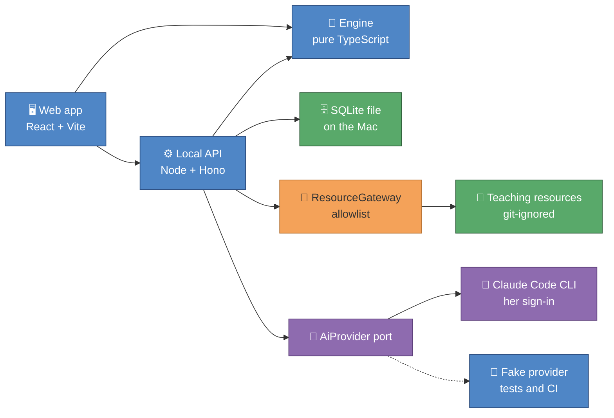
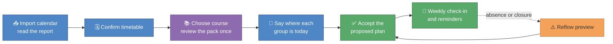
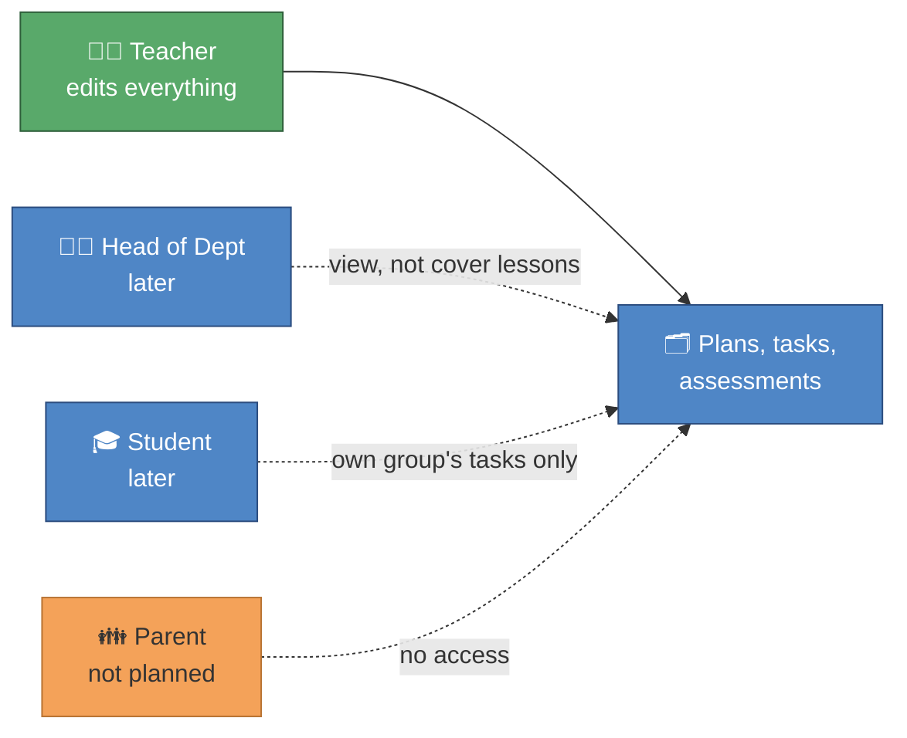

# AI Teacher Planner v1 — Design Spec

**Date:** 2026-11-19
**Status:** Draft for approval (Alberto). No application code is written until this is approved.
**Branch:** `ai-planner-v1`
**Inputs:** `prototypes/ai_teacher_planner/src/ai_teacher_planner/template_prompt.md` (Gemma, Parts 1 to 10) and `master_prompt_for_plan.md` (Alberto, nine delivery points)
**Diagrams:** [`docs/design/ai-teacher-planner/`](../../design/ai-teacher-planner/README.md)
**Decisions:** ADR-006 to ADR-016 in [`docs/adr/`](../../adr/)

Two labels are used throughout, as the template asks. **ASSUMPTION** marks something chosen without Gemma's or Alberto's word; section 22 lists them all. **UNVERIFIED** marks a claim about a product, exam board or tool that could not be checked.

---

## 1. Intent

Gemma teaches Business to six groups across three curricula on a two-week timetable. Every week she rebuilds, by hand, the answer to one question: *what am I teaching each group in each lesson, given the syllabus, the calendar, and what has already happened?* She listed 585 minutes a week of planning pain. Most of it is calendar arithmetic that a computer can do exactly, plus a few judgement calls where a language model helps.

The planner does the arithmetic by fixed rules she can trace, asks Claude only for the judgement calls, and shows her in the interface which parts Claude produced. It runs on her own Mac, costs nothing beyond her existing Claude subscription, and keeps school files on her machine.

## 2. Who it is for, and how we will know it worked

**User in v1:** Gemma, alone, on her laptop. Alberto reviews and maintains.

Her pains, in her ranking, and what v1 does about each:

| Rank | Pain (template 3.2) | Min/week | v1 answer |
|---|---|---|---|
| 1 | Syllabus to scheme of work to timetable | 120 | Sequencing onto real lesson slots (M2) |
| 2 | Planning the IB HL-only lessons | 90 | HL helper: teachable now, unlocks on a date, blocked (M4) |
| 3 | Keeping three parallel IAL groups in sync | 60 | Shared pace line, parity tracker (M2, M3) |
| 4 | Realigning after missed lessons | 70 | Reflow preview and catch-up options (M3) |
| 5 | Planning around holidays | 45 | The calendar drives every date (M1) |
| 6 | Keeping resources current | 40 | Resource refresher (M7) |
| 7 | Compromised past papers | 40 | Out of scope: AI Examiner prototype |
| 8 | AI-resistant activities | 120 | Partly: independent-task skill (M7) |

v1 addresses ranks 1 to 6, about 425 of 585 minutes.

**Success measures** (ASSUMPTION: proposed targets for Gemma to confirm):

- Planning the next fortnight for all six groups takes under 15 minutes.
- "What can I teach IB H next?" is answered in under a minute.
- After an absence, the replanned fortnight is accepted in under 5 minutes.
- The slot audit screen matches her own timetable count for every half-term, with no wrong date found in class.
- She can check a course's syllabus mapping once, in one sitting, and not again.

## 3. Goals, non-goals, anti-goals

**Goals**

1. A dated lesson plan for every group that respects the school calendar, the two-week cycle and her teaching order.
2. Parallel groups stay level by design, and drift is visible early with ways to fix it.
3. The plan stays true: what was taught is recorded with almost no effort.
4. Every date and count is explainable from her own calendar and timetable.
5. AI help is clearly marked, always reviewed by her, and replaceable by another provider later.
6. The codebase is modular enough to grow into a wider platform for teachers, students and parents.

**Non-goals for v1**

- Logins, hosting, or any user other than Gemma.
- Student, parent or Head of Department views (template 6D).
- Storing student names, marks, or SEND information.
- Microsoft 365, SIMS, Toddle or Teams integration. Teams export is copy-ready text.
- Generating fresh exam papers (feature 11, AI Examiner).
- Activity-idea library (9), differentiation (10), reflection log (14).

**Anti-goals** (it fails if any of these is true, even if everything works)

- She spends longer checking the plan against the syllabus than planning by hand (template 3.4).
- Suggestions are generic, at the wrong level, or repetitive.
- The plan changes without her seeing and accepting the change.
- She cannot tell which parts came from a model.
- A student's name or work reaches a model or a commit.

## 4. Hard rules

These override everything else. If a task conflicts with one, stop and say so.

- **MUST NOT** send credentials, passwords or Microsoft tokens to any model, or commit them.
- **MUST NOT** put real student names or student work in anything a model sees, in fixtures, or in git.
- **MUST NOT** store student personal data in v1.
- **MUST** have Gemma review every AI-generated item before it can be exported or shown to students.
- **MUST NOT** republish exam-board material as the app's own. Board documents may be read locally and cited.
- **MUST NOT** apply any change to a plan without a preview she accepts.
- **MUST NOT** let a model write to disk or to the database. Models return data; the app stores it.
- **MUST** read school files only through the allowlist (section 14).
- **MUST NOT** weaken the deny rules in `.claude/settings.json`.

## 5. Constraints

| Constraint | Source | Effect |
|---|---|---|
| MacBook Air M1, 8 GB RAM, 37 GB free | Measured | No Docker, no database server, no dev server in daily use, one browser-test worker |
| Budget: free | Template 9.3 | AI through her Claude subscription via the Claude Code CLI; no API key |
| TypeScript and React, modular | Template 9.1 (Alberto) | See ADR-006. ADR-005 is reserved for Gemma's own write-up (template 11.1) |
| School files stay on the Mac | Template 9.1, 9.2 | Local-first; resources folder is git-ignored |
| No Homebrew or sudo | Measured | Tools installed with mise into `~/.local` |
| Learnable in 5 to 10 minutes | Template 10.3 | One command to start; first-run tour; the board looks like her timetable |
| Works offline for everything except AI | Template 10.3 | API and data are local; AI features degrade gracefully |
| Subscription sign-in covers personal local use only | Claude Code docs, 19 Nov 2026 | Any shared deployment needs an API-key or other provider adapter (ADR-007) |

## 6. Approaches considered

| Approach | What it is | Trade-off | Verdict |
|---|---|---|---|
| **A. Local full-stack TypeScript** | React app, small local Node API, SQLite file, pure-TS engine shared by both, AI behind a provider port | Needs one local process; most moving parts of the three local options | **Chosen** by Alberto, 19 Nov 2026 |
| B. Browser-only app, AI in a terminal | No backend; data in the browser; AI only by running Claude Code skills by hand | Lightest and best offline, but no AI buttons in the GUI, weak access to the resources folder and Office exports | Rejected: breaks the 5-minute learning goal and delivery point 2 |
| C. Hosted platform from day one | Next.js, Postgres, logins and roles, deployed | Ready for student views, but needs paid API keys, school data-protection sign-off, and is by far the largest build | Rejected: conflicts with "free" and with keeping data on the Mac |

A keeps the door to C open: roles are modelled now, the AI provider is swappable, and storage sits behind repository ports.

## 7. Scope of v1

"Engine" means fixed rules, no model. "AI" items carry the AI badge and need review.

| # | Feature | Template ref | Made by | Milestone |
|---|---|---|---|---|
| 1 | Calendar import with an import report, and a slot audit screen | 2.3, 5 | Engine | M1 |
| 2 | Timetable grid: seeded, editable, optional image upload | 2.2, 4.1 | Engine; AI for image upload | M1 |
| 3 | Today screen: today's lessons, report deadlines, parents' evenings, weekly check-in | 6C #13, 8.5 | Engine | M1, M2 |
| 4 | Scheme of work per course in her order, lessons per topic | 6A #1 | Import; AI suggestions as differences from her numbers | M2 |
| 5 | Sequencing onto real lesson slots per group | Story 1 | Engine | M2 |
| 6 | Fortnight board shaped like her timetable | 6A #3 | Engine | M1 read-only, M5 editing |
| 7 | Parity tracker and catch-up options | 6A #2, story 2 | Engine; AI drafts a chosen task | M3 |
| 8 | Lost-lesson reflow as a preview | 6A #5 | Engine | M3 |
| 9 | IB HL-only helper | Pain 2 | Engine checks; AI proposes the prerequisite map | M4 |
| 10 | Coverage checklist: taught and assessed per spec point | 6A #4 | Engine; mapping AI-assisted, reviewed once | M6 |
| 11 | Assessment calendar, clash warnings, two-per-term rule | 6C #12, 5.2 | Engine | M6 |
| 12 | Resource refresher | 6B #7, story 3 | AI | M7 |
| 13 | Cover lesson | 6A #6 | AI | M7 |
| 14 | AI-resistant independent task | 6B #8 | AI | M7 |
| 15 | Exports: Excel, Word, PowerPoint, Teams-ready text | 6C #15 | Engine | Thin in M2, full in M8 |

## 8. The data v1 starts from

All verified by opening the files on 19 Nov 2026, except where marked.

**Timetable** (`timetable.png`): two weeks, Monday to Friday, six 55-minute periods (P1 08:45, P2 09:40, P3 11:15, P4 12:10, P5 14:35, P6 15:30). Lessons per fortnight: 11D 5 (three in Week 1, two in Week 2); IB H 4; IB S 6; 13 1, 13 3 and 13 5 six each. Some lessons are double periods. Other cells are study-hall duty (`400`), form time, lunch duties or free.

**Calendar** (`2026-27 Secondary Calendar ALL STAFF.xlsx`, sheet `Calendar 2026-27`): one row per day. Columns: Month, Date, Day, `Week1/2`, After school meetings, Dates of importance, Secondary event, then Events / Communication / Assessments for each year group. 91 days are labelled Week 1 and 94 Week 2.

- The label is authoritative. It is not a simple alternation of calendar weeks: 12 Feb is Week 2 and school returns on 22 Feb as Week 1; 21 to 22 Dec is a two-day Week 2; Friday 8 Jan alone is a Week 1.
- Holidays appear as "School Holiday" or "Official Holiday" in Secondary event with a blank label.
- Staff-training days before 4 Sept carry a label although pupils are absent.
- The data has noise: an `x` in the label column, a row with the wrong weekday, and report dates whose weekday or year is wrong.
- The school edits this workbook during the year.

**Other tabs:** `Report deadlines` (by year group and, for Years 12 and 13, by programme: report name, SIMS columns, teacher data deadline, HoD review, sent home), `Parents eves`, `AssRep 26_27` (one row per week with cycle number; a cross-check on the labels). `IBDP calendars` only names two workbooks that are not in the folder.

**Terms:** 4 Sep to 22 Dec 2026; 8 Jan to 19 Mar 2027; 5 Apr to 29 Jun 2027.

**Planning sheets:** IAL Unit 4 and IGCSE Y11 each list textbook chapters with a "Number of Classes" (IAL totals 65). Assessment schedules are Word tables of date (no year), chapter, type. The IB outline is prose per unit with week ranges that contradict each other. **None of them records what has been taught.**

**Specifications:** all three PDFs have a text layer. IAL Unit 4 has 16 sub-topics that match textbook chapters 22 to 37 one to one, in order. IGCSE maps several chapters to one spec point. IB marks HL-only content in sub-topic titles and in bold. Only the IB content folders are named by spec code; IAL and IGCSE folders use chapter numbers.

**Teaching order** differs from spec order for IGCSE (Y11: Units 3, 2, 5) and IB (Y12: Units 1, 4, part of 3).

## 9. Architecture

Full-size diagrams: [containers](../../design/ai-teacher-planner/02-containers.svg), [backend](../../design/ai-teacher-planner/03-backend-components.svg), [frontend](../../design/ai-teacher-planner/04-frontend-components.svg).



A pnpm workspace under `prototypes/ai_teacher_planner/`. The existing Python package beside it (`calendar_reader.py`, `models.py`, its test) is untouched.

| Path | Role |
|---|---|
| `packages/domain` | The engine: types, calendar, slots, sequencing, revisions, parity, reflow, coverage, HL eligibility, reminders, permission matrix. Pure. |
| `packages/importers` | Calendar workbook, planning sheets, assessment schedules, resource index, text extraction |
| `packages/exporters` | Excel, Word, PowerPoint, Teams text |
| `packages/ai` | `AiProvider` port, Claude CLI adapter, fake adapter, skill registry |
| `packages/content-creator` | Resource refresher, cover lesson, independent task (ADR-015) |
| `apps/api` | HTTP routes, use cases, SQLite repositories, job queue, `ResourceGateway`; serves the built web app |
| `apps/web` | React app |
| `features/` | Gherkin scenarios |
| `fixtures/` | Synthetic calendar, timetable and curriculum; the deny-rule canary |
| `e2e/` | Browser tests |
| `data/` | Git-ignored: database, backups, curriculum packs, uploads |

**Rules the code must keep**

1. **The engine is pure.** Dates are `YYYY-MM-DD` strings; `today` is an argument; no clock, randomness, disk or network. The package declares no IO dependencies and no DOM or Node types, and a lint rule blocks such imports.
2. **Models never write and never read school folders.** They receive text and return JSON, which the API validates and stores.
3. **Files are read only through `ResourceGateway`.**
4. **Nothing is applied silently.** Every plan change is a proposal with a diff.
5. **The API binds to 127.0.0.1 only.**

**Stack** (versions seen and, where marked, proven by spike on 19 Nov 2026; pinned exactly at install):

| Layer | Choice |
|---|---|
| Runtime | Node 26 LTS through mise; pnpm 12 (spike) |
| Language | TypeScript 7.0, strict; Biome for lint and format (spike) |
| Web | React 19, Vite 8 (spike), Tailwind 4, shadcn/ui, TanStack Query. Router left to the builder |
| Moving cards | Keyboard "Move to…" first; pointer drag with `@dnd-kit/react` behind one adapter |
| API | Hono 4 with `@hono/zod-openapi`, Zod 4 (spike) |
| Data | SQLite through better-sqlite3 and Drizzle 0.45 (spike) |
| Tests | Vitest 5, `@amiceli/vitest-cucumber`, fast-check (spike); Playwright on the installed Chrome, playwright-bdd, axe |
| Office files | exceljs, mammoth, fflate + fast-xml-parser, `docx`, pptxgenjs. The npm `xlsx` package is excluded: two unpatched high advisories |
| Diagrams | D2 0.9 through mise (proven) |

## 10. The engine

Diagrams: [domain model](../../design/ai-teacher-planner/05-domain-model.svg), [scheduling pipeline](../../design/ai-teacher-planner/06-scheduling-pipeline.svg).

### 10.1 Calendar

- Read the `Week1/2` label **per date**. Never compute it.
- Find columns by header text, not position.
- Rebuild each date by continuity (each row is the previous day plus one), starting from the academic year in the sheet title. Take the weekday from the date, not the Day column.
- A day is a **pupil day** when it has a label, falls inside a term, and is not marked staff-only.
- Within one Monday-to-Friday week every labelled day must share one label, and labelled weeks must alternate. A breach is reported.
- Everything odd goes into an **import report** the teacher sees: unknown tokens, wrong weekdays, merged cells, dates that disagree with their weekday. Nothing is guessed.
- `AssRep 26_27` is read as a cross-check on the labels.

### 10.2 Slots

For each pupil day, the timetable version active on that date gives each group's periods for that label and weekday. A **slot** is one group, one date, one period.

**Disruptions** remove or change slots. Scope: whole school, year group, group, or teacher. Effect: `cancelled` or `cover`. Each keeps its reason and source (the calendar row text, or "entered by teacher"). Cancelled slots are still emitted, so the board and the audit screen can show every lost lesson and why.

One period is one unit. A double period is two adjacent units, drawn joined. (ASSUMPTION, open question 1.)

Year-group events in the calendar (mocks, trips, study leave) are free text. Fixed keyword rules pre-sort them and a skill suggests the rest, but an event cancels lessons **only after Gemma confirms it**. Each distinct wording is asked once and remembered. Unconfirmed events show as a "possible disruption" marker on the board.

### 10.3 Lessons, slots, placements

- A **scheme-of-work item** is a chapter or topic with a number of lessons, or an assessment, revision or buffer item.
- A **lesson** is "item 4, lesson 2 of 6". Parallel groups share lesson identities; that is what makes parity measurable.
- A **placement** puts one lesson in one slot with a state: `planned`, `declared`, `taught`, `cover`, `homework`, `skipped`.
- Two lessons may be **merged** into one slot. A group may have a per-item override ("13 3 does chapter 26 in five lessons").

### 10.4 What is stored

Her **decisions** are rows: scheme of work, pins, overrides, disruptions, confirmed events, positions. **Placements are derived** from them by the engine.

Each accepted plan is saved as an **immutable revision**: a snapshot of placements with a pointer to its parent. Preview, diff, undo and audit all come from this. A year is about 1,200 placements, so snapshots are cheap. (ADR-010.)

### 10.5 Sequencing

From each group's current position:

1. Freeze the past and the **freeze horizon** (today and the next teaching day).
2. Place **anchors**: dated assessments, pinned lessons, "not after" deadlines.
3. Stream the remaining lessons, in scheme order, into the remaining slots.
4. **Buffer** items absorb lost lessons, so one lost lesson changes nothing beyond the next buffer.
5. Anything that does not fit is listed as **overflow** at its checkpoint, with a count.

An anchor that cannot be honoured is a **conflict** shown to her, never a silent move. Moving a card by hand creates a pin and re-sequences the rest; that is how her edits survive.

The same inputs always give the same plan.

### 10.6 Parallel groups: the pace line

A **checkpoint** is a dated assessment, a unit end or a half-term. Between two checkpoints, shared content is planned to the slot count of the group with the fewest lessons. Other groups' spare slots become explicit **flex lessons** (exam practice, PBLT paragraphs). Parity is then built in instead of repaired, and each group's totals for the year are known in September.

For 11D, her two colleagues' classes act as a virtual group defined by the department's assessment dates.

### 10.7 Parity

Groups overtake each other inside any fortnight, so a raw daily gap is noise. The tracker reports:

- **Slack before each checkpoint:** slots available minus lessons required, per group. Example: "before 13 Nov: 13 1 +1, 13 3 −2, 13 5 0".
- **Gap at checkpoints**, and between them only when it exceeds the timetable's normal **jitter** (the largest gap an undisrupted cycle produces).
- **Teacher-led lessons missed per unit.** In her own example (template 3.3) the two absent groups nominally covered the chapter through cover work. What they lost was her support and the exam practice. Position alone would have hidden that.

**Catch-up options** are computed, each as a candidate revision with before-and-after numbers: use a buffer; hold the leading groups on consolidation; merge two lessons; set one as flipped work or homework; or wait, with the date the timetable closes the gap by itself. A model only writes the content for an option she has already chosen.

### 10.8 Reflow

A change (a disruption, a pin, a new count, a re-import) produces a **proposal**: candidate revision, diff, metrics before and after, conflicts. Accepting swaps the head revision if nobody changed it in the meantime. Rejecting discards it. Undo returns to the parent.

Never in a diff: taught or declared history, the freeze horizon, pinned slots, dated assessments, other courses. A back-dated absence shows as a correction to history, clearly labelled.

### 10.9 The past, and keeping it true

No file records what she has taught since September. Inventing dates for each past lesson would be false precision. Instead:

- Per group she gives a **position** (the next lesson) and a **done-list** for anything taught out of order, such as the HL topics already covered.
- Sat assessments from her schedules are dated facts.
- The past is drawn as topic bands marked **declared**, visibly different from lessons she later logs.
- A **weekly check-in** on the Today screen asks "did these happen as planned?" with one click per group, and a quick way to say what changed.

Without the check-in, parity and coverage drift from reality.

### 10.10 IB: core and HL extension

One course, two tracks, two slot streams: IB S (everyone, common content) and IB H (HL students, HL-only content).

- HL-only items carry **prerequisites** on core items. An item is **eligible** for an IB H slot when all its prerequisites finish in IB S before that slot.
- Outputs: a ranked **"teachable now, and why"** list; an **"unlocks on"** date for each blocked item; a **runway** figure comparing eligible lessons with the next fortnight's four IB H slots.
- A **fallback pool** (prerequisite-free HL topics, IA preparation from February, exam skills) fills slots when nothing is eligible.
- When IB S slips, the affected IB H lessons are flagged with alternatives.
- v1 proposes a draft fill per fortnight that she confirms.

The prerequisite map is curated content, not code: a skill proposes it with reasons, she reviews it once, and it is locked.

### 10.11 Coverage

Spec points link to scheme-of-work items, many to many; each link is reviewed once.

- **Taught:** none, partial (m of n linked items), or taught. The basis is shown: declared, logged, or cover.
- **Assessed:** a sat assessment that names a linked chapter, labelled "chapter-level", because one 20-mark question does not assess a chapter.
- A spec point with no link is **unmapped**, never "not taught". A course cannot be used until nothing is unmapped.
- Units taught in other years are **out of scope**, so they are not shown as gaps.
- "Taught, never assessed" is raised at unit end, not before.

### 10.12 Curriculum packs

One JSON file per course: units, topics, spec points, HL-only flags, chapter links, page references. Built once with AI help, reviewed by Gemma, validated against a schema, hashed and locked. No general PDF parser is built; only the calendar gets a repeatable importer, because only the calendar changes during the year. Packs live in `data/` and are not committed (ADR-016).

### 10.13 Re-import

Imported rows are stored by date with a hash. Her confirmations and disruptions sit in a separate layer. A re-import is a three-way comparison (last import, new import, her layer) whose slot changes go through reflow. Importing the same file twice changes nothing.

### 10.14 Invariants (each becomes a property test)

- No slot on an unlabelled or non-pupil day.
- An undisrupted full week yields exactly the timetable's count for its label.
- Adding a disruption never adds a slot; disruption order does not matter.
- Each lesson is placed at most once; one lesson per slot unless merged.
- Unpinned lessons keep scheme order; every pin is honoured or reported.
- Placed plus overflow equals the total.
- History is identical before and after any reflow.
- Undo after accept restores the previous plan exactly.
- Delaying core content never makes an HL item eligible earlier.
- Every in-scope spec point is in exactly one coverage state.

## 11. The AI layer

Diagram: [AI flow](../../design/ai-teacher-planner/07-ai-flow.svg).

**Provider port.** `run(task)` takes a skill id, a JSON input, extracted text, a Zod schema and a tool list. It returns validated data and metadata: provider, model, duration, sources.

**Claude adapter.** Proven by spike on 19 Nov 2026 with Claude Code 2.1.326:

```
claude -p "<inlined skill prompt + input>" --model <alias> \
  --tools "" --setting-sources "" --strict-mcp-config --disallowedTools "mcp__*" \
  --permission-mode dontAsk --output-format stream-json --verbose \
  --json-schema '<schema>' --no-session-persistence  < /dev/null
```

with `ANTHROPIC_API_KEY` and `ANTHROPIC_AUTH_TOKEN` removed from the environment, so a stray key can never turn a free run into a billed one.

- It signed in with her subscription, loaded none of this repo's ten plugins or their hooks, exposed only the structured-output tool, and returned schema-valid JSON.
- Measured: about 3 seconds with no tools; about 30 seconds with web search.
- `claude auth status` returns JSON the adapter uses to check sign-in at start-up.
- One job at a time. Progress is streamed to the GUI.
- Every engine feature works when AI is unavailable.

**Known risk.** The docs say `--bare` will become the default for `-p`, and bare mode ignores the subscription sign-in. No opt-out is documented yet (UNVERIFIED how a subscription run will continue to work). The port isolates this to one file.

**Skills** live in `.claude/skills/`. Each has a prompt, an output schema and examples. The adapter inlines the prompt, so the same skill works from the GUI, in a terminal session, and later with another provider.

| Skill | Purpose | Tools in headless runs |
|---|---|---|
| `planner-import-timetable` | Timetable image to grid | Image passed as input; no folder access |
| `planner-build-curriculum-pack` | Spec text to units, topics, spec points, HL-only flags, chapter links | none |
| `planner-classify-calendar-events` | Which event wordings cancel which groups' lessons | none |
| `planner-suggest-lesson-counts` | Counts and tricky-topic flags, as differences from her sheet | none |
| `planner-hl-prerequisites` | Prerequisite map and pairings for HL-only topics, with reasons | none |
| `content-refresh-resource` | Current-event slide suggestions with sources and insertion points | WebSearch, WebFetch |
| `content-cover-lesson` | Independent work towards the missed lesson's objectives | none |
| `content-independent-task` | AI-resistant task by year-group policy, PBLT structure | none |

**Standing rule** (delivery point 1): when a teacher-side AI action has been done by hand more than twice, promote it to a skill with a schema and register it.

**Quality rules for every skill**

- Use the right exam board's vocabulary, command words and assessment objectives. Generic output is a defect.
- Cite a source for every factual claim about the world; label anything not opened as unverified.
- Never include a student's name or invent one.
- For the refresher: prefer the last twelve months; pass in what was suggested before, so nothing repeats; never alter the original file.

**Provenance.** Every stored item records its origin: `engine`, `ai`, `teacher`, or `import`. AI items also record provider, model, skill, time, sources and a review state: `suggested`, `accepted`, `edited`, `rejected` (ADR-008).

## 12. The interface

Diagram: [frontend](../../design/ai-teacher-planner/04-frontend-components.svg).

**Design language:** dark by default with a light option; calm and spacious; laptop first. Cards are coloured by group, taking the colours from her timetable and adjusting them for contrast. References she chose: Planboard's week view and day/week/month switch, Trello's cards, Notion's calm pages. Not SIMS.

**Screens**

| Screen | What she does there |
|---|---|
| **Today** (first screen) | Today's lessons with times and rooms; this week's reminders; the weekly check-in; "a lesson was lost" shortcut |
| **Fortnight board** | Week 1 and Week 2 side by side, laid out exactly like `timetable.png`, with real dates. Also day, week, month and unit views |
| **Scheme of work** | Topics in her order with lesson counts; totals against available slots per group, recalculated as she types |
| **Parity** | Slack per checkpoint, gaps, teacher-led lessons missed, catch-up options |
| **Slot audit** | Lessons per group per half-term, and every lost lesson with the calendar text that caused it |
| **IB HL helper** | Teachable now, unlocks on, blocked; runway; draft fill |
| **Coverage** | The spec tree with taught and assessed states |
| **Assessments and reports** | All groups' assessments, clashes, report deadlines, parents' evenings |
| **Resources** | Chapters and their PowerPoints; refresher suggestions awaiting review |
| **Setup** | Calendar import and report, timetable grid, courses and packs, positions |

**The fortnight.** A fortnight is a Week 1 calendar week and the Week 2 week that follows it. Holiday weeks between them appear as a thin divider. Days outside term or without a label are greyed.

**How AI shows up** (delivery point 2)

- AI content awaiting review: a sparkle icon and a dashed outline. Accepted: a small sparkle. Edited by her: sparkle and pencil. The icon carries the meaning, not colour alone.
- A popover names the provider, model, skill, time and sources.
- Engine output has no badge. The legend says: *everything without the sparkle is calculated from your calendar and timetable.* A "Why is this here?" popover on any lesson shows the rule and its inputs.
- "Declared" and "logged" history look different.
- An activity drawer lists every AI run. A header chip shows a running job and its progress.
- Unreviewed AI items are left out of exports, with a warning that says so.

**Moving lessons.** A keyboard "Move to…" command is the primary path; pointer drag is the second. Any move shows its effect as a proposal before it is applied.

**Accessibility:** keyboard access to everything, visible focus, contrast of at least 4.5 to 1, no meaning carried by colour alone, automated axe checks on every screen.



## 13. Roles and permissions

v1 has one user. The permission matrix from template Part 7 is still built into the engine and tested, with a fixed teacher principal, so logins can be added without redesign.

| Feature or data | Teacher | Student | Parent | Admin | Head of Dept |
|---|---|---|---|---|---|
| Scheme of work | Edit | – | – | – | Edit |
| Lesson plans and cards | Edit | – | – | – | View |
| Chapter PowerPoints | Edit | – | – | – | – |
| Independent tasks | Edit | View (own group only) | – | – | – |
| Assessment calendar | Edit | – | – | – | Edit |
| Report calendar | Edit | – | – | – | View |
| Exam practice questions | Edit | – | – | – | – |
| Mark schemes | Edit | – | – | – | – |
| Parity and coverage | Edit | – | – | – | – |
| Cover lessons | Edit | – | – | – | – (never before the absence is notified) |
| Accounts and roles | Edit | – | – | Edit | – |

ASSUMPTION: the cells Gemma marked ⚠️ or left blank are treated as no access.



## 14. Data boundary, privacy and copyright

Diagram: [data and privacy](../../design/ai-teacher-planner/08-data-and-privacy.svg). Decision: ADR-011.

- **`prototypes/resources/` never enters git.** It is 5 GB and 2,661 files, and it includes student work in folders named after students, scanned exams and reports. The ignore rule is fixed and the four files that had been pushed are no longer tracked.
- **App allowlist.** `ResourceGateway` reads only: the `Planning` folders; the three specification PDFs; `1. Content/**/PP`; the per-topic exam-practice folders. A test proves a path outside the list cannot be read.
- **Models receive extracted text only**, never a folder path and never a whole textbook.
- **Deny rules** in `.claude/settings.json` stop interactive Claude sessions opening the student-work folders. Tested on 19 Nov 2026: a canary path with spaces and an ampersand was refused, as were probes into three of the real folders. A deny rule stops Claude's file tools, not a script, which is why the allowlist is the real guard.
- **No student data in v1.** An assessment stores a status and an optional class-level note such as "evaluation weak on the 20-marker".
- **Copyright.** Curriculum packs are built locally from her own copies and stay in `data/`. Tests use a synthetic curriculum. Exports cite sources.
- **Uploads** (a timetable image) go to `data/uploads/`.
- **Backups.** The database is copied automatically before each migration and daily, with a few generations kept.

## 15. Exports

| Format | Content |
|---|---|
| Excel | The fortnight in her timetable's shape; the scheme of work with dates per group; the coverage checklist |
| Word | A weekly plan; a cover-lesson sheet |
| PowerPoint | Accepted refresher slides, with sources in the notes and "insert after slide N". The original file is never changed |
| Teams | Copy-ready text for a class post |

A thin Excel week and the Teams text ship in M2, because she lives in Office all day. Every export states which items came from AI and when she reviewed them.

## 16. Non-functional requirements

| Quality | Requirement |
|---|---|
| Speed | Everyday actions feel instant: the engine also runs in the browser. AI jobs show progress |
| Offline | Everything except AI works with no internet |
| Accessibility | Section 12 |
| Privacy | Section 14 |
| Time to learn | 5 to 10 minutes: one command to start, a first-run tour, a board that looks like her timetable |
| Trust | Every date traceable; nothing applied silently; undo always available |
| Data safety | Automatic backups; migrations; database outside git |
| Footprint | Runs beside Chrome and PyCharm on 8 GB |

## 17. Acceptance scenarios

These become Gherkin files in `features/`. Scenarios 5, 7 and 12 are Gemma's own from template Part 10, made concrete.

1. **The cycle comes from the calendar.** Given 12 Feb 2027 is labelled Week 2 and 15 to 19 Feb are school holidays, when I open the week of 22 Feb, then it is Week 1 and each group has its Week 1 lessons.
2. **A two-day week.** Given 21 and 22 Dec 2026 are labelled Week 2, then only the Monday and Tuesday Week 2 lessons exist that week.
3. **A one-day week.** Given Friday 8 Jan 2027 alone is labelled Week 1, then 13 1 has one lesson that week, in period 6, and no other group has any.
4. **Staff days.** Given 1 Sep 2026 is labelled Week 1 and marked staff training, then no group has a lesson that day.
5. **Story 1: a schedule from my documents.** Given the calendar, my timetable and the IAL Unit 4 scheme with my class counts, when I choose 13 1, 13 3 and 13 5 and my teaching order, then I see a dated schedule per group in which every lesson sits on a real lesson of that group, no lesson falls on a holiday, chapter order is kept, each chapter shows its spec reference, and the totals match my sheet.
6. **The worked example.** Given the three groups are planned to finish a topic before a dated assessment, and 13 3 loses a lesson to a closure, when I open the parity tracker, then 13 3 shows as one lesson short before that assessment and I am offered at least one catch-up option.
7. **Story 2: absence.** Given I was absent Tuesday to Thursday and two groups had cover, when I record the absence, then I see a preview of what moves, which topics are affected, how many teacher-led lessons each group has lost, and options to realign, and nothing changes until I accept.
8. **Undo.** Given I accepted a reflow, when I undo it, then the plan is exactly as before.
9. **Pins survive.** Given I moved a lesson to a chosen slot, when a later closure triggers a reflow, then that lesson stays where I put it.
10. **HL prerequisites.** Given an HL-only topic needs a core topic that finishes on 9 Dec, when it is placed in an IB H slot on 2 Dec, then it is flagged and I am shown what is teachable instead.
11. **Coverage.** Given a unit has ended and one of its spec points has no sat assessment, then that point shows "taught, never assessed".
12. **Story 3: resource refresher.** Given a chapter PowerPoint, when I ask for an update, then I get suggested slides with real, recent, opened sources and where to insert each, marked as AI, and my original file is unchanged.
13. **AI is marked and reviewed.** Given an AI suggestion I have not reviewed, then it shows the sparkle and dashed outline, and it is left out of an export with a warning.
14. **The allowlist holds.** Given a path inside a student-work folder, when anything asks the gateway for it, then it is refused.
15. **Report reminder.** Given the Year 11 long-report data deadline is 30 Nov 2026, when I open Today on 20 Nov, then the reminder is shown with the days remaining.
16. **Re-import.** Given I import the same calendar twice, then nothing changes; given the school adds a closure, then I get a reflow preview and my confirmed events are kept.

## 18. Engineering practice

- **Spec first.** This document, then a task-level plan in `docs/superpowers/plans/`, then code.
- **BDD.** Section 17 as Gherkin, run against the engine under Vitest and, for the main journeys, in a browser.
- **TDD.** A failing test before each piece of code. Section 10.14 as property tests.
- **Fixtures.** A synthetic calendar reproduces the real one's traps for CI: the two-day week, the lone Friday, the stray `x`, a wrong weekday, merged cells, labelled staff days.
- **Golden tests on her real files**, run locally and skipped when the folder is absent: 91 and 94 labelled days; 22 Feb is Week 1; slot counts of 5, 4, 6, 6, 6, 6.
- **Browser validation from the first screen.** Playwright on the installed Chrome, one worker, axe checks. Then an agentic pass with Claude in Chrome through each acceptance scenario, saving screenshots into `docs/design/ai-teacher-planner/screens/`.
- **CI.** A Node job beside the Python job: install, type-check, lint, unit and scenario tests, build, browser tests with the fake provider, diagram freshness. CI needs neither her files nor Claude.
- **Docs.** Any change to modules, ports, routes, the data model, the AI flow or the stack updates its diagram in the same commit (ADR-014).

**Definition of done** (ASSUMPTION until Gemma answers template 11.3): scenario written and passing; tests written first; type-check and lint clean; no real names or student data in fixtures or commits; AI output has provenance and a review step; diagrams updated; validated in Chrome with a screenshot; Gemma has clicked through it.

## 19. Milestones and roadmap

Diagram: [roadmap](../../design/ai-teacher-planner/10-roadmap.svg). One course end to end at a time: IAL Unit 4, then IB, then IGCSE.

| M | Goal | Proves |
|---|---|---|
| M1 | Workspace, engine types, calendar importer and report, slot audit, timetable seed and grid editor, slots, app shell, read-only fortnight board, Today with report deadlines and parents' evenings, backups, one-command start | Scenarios 1 to 4, 15 |
| M2 | IAL Unit 4 end to end: pack, planning-sheet and assessment import, scheme editor, sequencing, revisions, positions and declared past, pace line, weekly check-in, thin Excel and Teams export | Scenario 5 |
| M3 | Disruptions, event confirmation, reflow proposals, undo, parity tracker, catch-up options | Scenarios 6 to 8, 16 |
| M4 | IB: pack with HL flags, prerequisite map, two tracks, eligibility, helper screen, draft fill | Scenario 10 |
| M5 | Board editing: "Move to…", drag, pins, merge; other views; card drawer; legend and activity drawer | Scenario 9, 13 |
| M6 | IGCSE pack, 11D against department checkpoints, coverage, assessment calendar and clashes | Scenario 11 |
| M7 | Resource index, PowerPoint text extraction, the three `content-*` skills with review and source checking | Scenario 12 |
| M8 | Full exports, offline behaviour, teacher README and first-run tour, full Chrome validation, pull request ready | All; scenario 14 throughout |

**Later.** v2: student and Head of Department views, shared department library, Microsoft 365 sync, more AI providers, activity ideas, differentiation, reflection log. Then the "360 platform": this planner joined with the content creator, the examiner and the homework companion.

## 20. Decisions

| ADR | Decision |
|---|---|
| 005 | Reserved: Gemma's write-up of the move to TypeScript and React (template 11.1) |
| 006 | Local-first full-stack TypeScript monorepo |
| 007 | AI behind a provider port; headless Claude Code as the default adapter |
| 008 | Provenance and human review |
| 009 | The calendar is the source of truth for the cycle |
| 010 | Decisions as rows, placements derived, immutable plan revisions |
| 011 | Resources data boundary |
| 012 | SQLite behind repository ports |
| 013 | Test strategy |
| 014 | Visual-first docs as code |
| 015 | Content-creator module boundary |
| 016 | Reviewed, locked curriculum packs |

## 21. Risks

| Risk | Mitigation |
|---|---|
| **Wrong slots.** One misread label makes every later date wrong, and she finds out in class | Slot audit screen, golden tests, import report, a board that mirrors her timetable |
| **She cannot verify the mapping quickly** (her anti-goal) | Packs reviewed once and locked, with page references; her lesson counts are the default; coverage labelled declared or logged |
| **The plan drifts from what was taught** | Weekly check-in, freeze horizon, nothing auto-applied, undo |
| Student work in the resources folder | Allowlist, deny rules, text-only to models, no student data stored |
| Board copyright | Local-only packs, synthetic fixtures, cited exports |
| A model states something false | Sources opened and checked, unverified claims labelled, her review, all dates and counts from the engine |
| Headless Claude changes (`--bare` default, limits) | Provider port, sign-in probe, graceful degradation, API-key adapter later |
| Young or stale libraries (`@dnd-kit/react`, exceljs) | Each behind one adapter; exact pins |
| The school changes the workbook | Header-based parsing, import report, three-way re-import |
| Size of the build | One course end to end per milestone; draft pull request from the start |
| School approval for real use | Local only, no school systems touched, no student data |
| Source documents disagree (IB week ranges; last year's dates in one IGCSE sheet) | They are hints; the calendar and her confirmations win |

## 22. Open questions and assumptions

**For Gemma**

| # | Question | ASSUMPTION until answered |
|---|---|---|
| 1 | Is a double period one lesson or two? | Two units, drawn joined |
| 2 | Where is each group today, and what was taught out of order? | Asked in Setup; nothing is planned until given |
| 3 | Which year-group events cancel your lessons? When does study leave start? | She confirms a suggested list once |
| 4 | Can you add the IB 2026-28 calendar workbook the staff calendar points to? | IB dates entered by hand |
| 5 | Assessment weightings: you asked to be prompted for a breakdown (5.2) | Assessments carry a type and a mark tariff only |
| 6 | Which PowerPoint variant do you teach from? | The TEACHER file, most recently modified |
| 7 | What do `400`, `13 F`, `MM8 Patio`, `Y13 (601)` and `DEP` mean for planning? | None need a lesson plan |
| 8 | Is "AI content creator" a fifth prototype? | Yes, later, lifted from `packages/content-creator` |
| 9 | Are the success measures in section 2 the right ones? | As proposed |
| 10 | Template Parts 11.1 to 11.4, 12.3 and 13 are still yours | Definition of done as in section 18 |

**For Alberto**

| # | Question | ASSUMPTION until answered |
|---|---|---|
| A | Is the GitHub repository private? The school's name and five third-party product screenshots are committed | Private |
| B | CI lint fails on `main` today: ten course files need formatting and `homework_04.py` has six lint errors. They are Gemma's files | Left untouched; the planner's CI job is separate |
| C | Deny rules are targeted at the student-work folders. Deny the whole resources folder instead? | Targeted, so she can still ask Claude about her own planning files |

## 23. Left to the builder

Table and column names; the exact API routes; component breakdown and visual detail within section 12; the router; the group colour values after contrast adjustment; file layout inside each package; how the timetable image is passed to the adapter; backup retention; the wording of the first-run tour. Each of these should follow the rules in sections 4, 9 and 10 and be recorded where a later reader would look for it.

## Appendix: what the Phase A spikes proved (19 Nov 2026)

| Spike | Result |
|---|---|
| Headless Claude adapter | Subscription sign-in works; isolated from project plugins and hooks; schema-valid output; 3 s without tools, 30 s with web search |
| TypeScript 7 toolchain | Type-check, 7 tests (Gherkin, property, SQLite round trip, API route and OpenAPI document), production build and lint all ran on Node 26 with pnpm 12 |
| D2 diagrams | D2 0.9 from mise renders the house palette to SVG; checked by eye |
| Deny rules | A path with spaces and an ampersand is refused; three real student-work folders are refused; a neighbouring folder is not |
| Repo hygiene | `uv sync --all-packages` and `uv run pytest` pass again (7 passed) |
