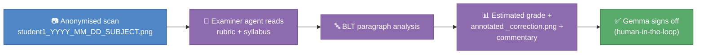

# ✍️ AI Examiner

This is one of your four end-of-course prototypes — see
[`docs/adr/001-prototype-build-order.md`](../../docs/adr/001-prototype-build-order.md)
for why it's built **last**. It's the hardest of the four (vision models
plus rubric grading), so it's deliberately built after
[`ai_homework_companion`](../ai_homework_companion/) has already
exercised the BLT rubric thinking this prototype reuses — one shared
mental model, not two disconnected tools. Today this repo has only the
foundations: the domain models and mock data below, plus a placeholder
Claude agent at [`.claude/agents/examiner.md`](../../.claude/agents/examiner.md)
that says exactly this — "not built yet, don't try to mark anything" —
if invoked before its real turn comes.

## 🎯 What this will do for you

Once fully built, this prototype will let a Claude agent mark a scanned
exam answer for you, end to end: it reads the scan, applies the right
mark scheme and syllabus quirks, scores each extended-response paragraph
against the **BLT** structure (**P**oint, **B**ecause, **L**eads to,
**T**herefore — see the `BLTParagraph` docstring in
`src/ai_examiner/models.py` for the full teaching explanation), and
hands you back an estimated grade, an annotated correction image, and
per-question commentary explaining the mark. You always get the final
word — see the sign-off step in the pipeline below.

## ✅ What exists today

- **`src/ai_examiner/models.py`** — the domain model this whole
  prototype is built on, and written to double as revision material:
  `BLTParagraph` (with `.completeness()`, a cheap structural triage
  signal — 4 core elements, plus an optional `moreover` for the
  strongest answers), `ExamSubmission` (with `.from_filename()`,
  parsing the anonymised `student1_YYYY_MM_DD_SUBJECT.png` pattern into
  a student label, exam date, and subject), and `MarkScheme` (a level
  descriptor table plus a max-marks tariff). Same "one noun, one class"
  habit as `Student`/`Exam`/`Rubric` in
  `python_course/module_07_oop/lesson_02_classes_working_together.py`
  — if those rang a bell, that's the point.
- **`mock_data/student1_2026_03_01_BUSINESS.png`** — a 1×1 placeholder
  pixel standing in for a real scan (see `mock_data/README.md`), just
  enough for `ExamSubmission.from_filename()` and the tests to point at
  a real file on disk.
- **`mock_data/mock_rubric.md`** — an illustrative 12-mark "Assess"
  level-descriptor mark scheme (4 levels, BLT + application expectations
  per level), standing in until a real one arrives — see its own ⚠️
  header for exactly what's illustrative versus sourced.
- **`tests/test_models.py`** — two passing tests: `BLTParagraph`
  completeness scoring (a full paragraph scores 1.0, a Point-and-Because
  fragment scores 0.5), and `ExamSubmission.from_filename()` parsing.

Try it yourself:

```bash
uv run pytest prototypes/ai_examiner -v
```

## 🗺️ The pipeline (target shape, not yet built)



Blue = the anonymised scan itself, today's only "real" input (mocked for
now). Purple = the reasoning stages behind the `examiner` Claude agent —
none of these are implemented yet, only modelled. Green = the pipeline's
actual gate: this agent **never** finalises a grade or sends feedback to
a student on its own — see
[`.claude/agents/examiner.md`](../../.claude/agents/examiner.md) — every
output it ever produces is a draft for Gemma to review and approve
first.

## ☁️ Cloud-portable by design

The domain models above are plain Python with zero AI calls — they'll
run anywhere. The AI reasoning (reading the scan, applying the rubric,
BLT analysis) sits behind the Claude-agent interface for now, on
Gemma's own machine, with zero API-key management (see
[ADR-002](../../docs/adr/002-claude-code-agents-as-ai-engine.md)).
When this moves to a hosted deployment later, swapping that interface
for a direct Anthropic API call — first likely on GCP, but the design
is generic enough for AWS or Azure too — is meant to be a config
change, not a rewrite: nothing in `models.py` hard-codes "Claude Code."

## 🔒 Privacy

> - **Anonymised filenames only.** Every scan this prototype ever reads
>   follows the `student1_YYYY_MM_DD_SUBJECT.png` pattern — a label like
>   `student1`, never a real name. `ExamSubmission.from_filename()`
>   enforces that shape and raises a clear `ValueError` if a file
>   doesn't match it.
> - **Real scans live only in `real_data/`.** That folder is already
>   excluded from git repo-wide (`prototypes/*/real_data/` in the
>   workspace `.gitignore`) — it never gets committed, and it's never
>   pushed to GitHub.
> - **Never in an AI context window without the anonymised pattern.**
>   The `examiner` agent's whole job depends on filenames already being
>   anonymised before it ever opens an image — this prototype doesn't
>   anonymise scans for you, it *requires* them to already be anonymised
>   on the way in. See [`docs/security.md`](../../docs/security.md) for
>   the repo's full three-layer secrets model (this is the same spirit,
>   applied to student work rather than credentials).

## 🚧 What's next

1. A `Rubric` loader that reads a `mock_rubric.md`-shaped file (or its
   real equivalent) into a `MarkScheme`.
2. The `examiner` agent's real body, replacing the current stub in
   `.claude/agents/examiner.md`: reading a scan, applying a
   `MarkScheme`, and producing `BLTParagraph` judgements per question.
3. The annotated `_correction.png` output and per-question commentary.
4. The human-in-the-loop sign-off step itself — how a draft gets
   presented to Gemma, and how her approval (or edits) get recorded.

## ❓ What's blocking full build-out

This scaffold works from a mock scan and an illustrative mark scheme on
purpose (see [ADR-004](../../docs/adr/004-first-pass-scope.md)) —
nothing here should guess at facts only Gemma knows. Five questions in
[`QUESTIONS_FOR_GEMMA.md`](../../QUESTIONS_FOR_GEMMA.md) unblock the real
build:

| Question | Unblocks |
|---|---|
| **B1** — 2–3 anonymised sample scans per paper type | Replacing `mock_data/`'s placeholder pixel with something the pipeline can actually be proven against |
| **B2** — which papers come first (IB / Edexcel IAL Units 1–4 / IGCSE)? | Choosing the first real `MarkScheme` to build against |
| **B3** — where do the official mark schemes live (Examwizard or elsewhere)? | Replacing `mock_data/mock_rubric.md`'s illustrative levels with a real, sourced mark scheme |
| **B4** — how does Gemma annotate scripts today (pen on paper, or PDF markup)? | Designing the annotated `_correction.png` output to match how she'd actually read it |
| **B5** — what would a correction output need to look like for Gemma to trust it? | Shaping the estimated-grade + commentary output itself, not just its correctness |

## 🔗 See also

- [`.claude/agents/examiner.md`](../../.claude/agents/examiner.md) — the
  Claude agent stub this README is the pointer target for; read it for
  what happens if Gemma invokes this agent before it's built.
- [`prototypes/ai_homework_companion/`](../ai_homework_companion/) — the
  companion prototype that generates the practice sets this examiner
  will eventually mark, using the same BLT rubric thinking encoded in
  its `styles/*.md` board guides.
