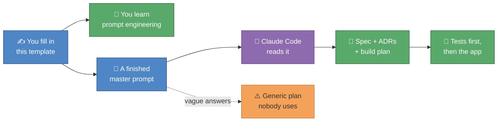

# 🧭 AI Teacher Planner — Your Master Prompt (fill-in template)

Hello Gemma! 👋 This file does **two jobs at once**:

1. 🎓 **It teaches you prompt engineering.** Every part covers one skill
   (giving the AI a role, context, constraints, examples, an output format…).
   You learn each skill by using it on a real problem: *your* planning week.
2. 🏗️ **When it's finished, it IS the prompt.** You paste the completed file
   into Claude Code, and it produces the full "360" plan for the AI Teacher
   Planner: spec → decisions (ADRs) → build plan → tests.

So every answer you write here does two things: you learn a technique, and
you give the AI a piece of what it needs. The better your answers, the
better the app. 🐦🐦🪨



---

## 📌 How to use this file

- Write your answers under each `> ✍️ Your answer:` line. Bullet points are
  fine. "I don't know yet, ask the HoD" is a perfectly good answer.
- 📝 **Draft** boxes hold what you told Alberto in conversation. Read each
  one and **correct anything wrong**. The AI will treat it as true.
- 🧠 **Prompt skill** boxes explain the technique each part teaches. Read
  them first.
- `TODO` items are tasks, not questions (e.g. "draw a screenshot", "write an
  ADR").
- You don't have to go in order, **but Part 12 (the assembled prompt) only
  works once Parts 1–11 are done.**
- 🔒 **Never paste** real student names, grades, emails, passwords or school
  login tokens into this file. Use `student1`, `Group A`, etc. This file gets
  committed to GitHub, and it gets sent to an AI.

### ✅ Progress tracker

- [ ] Part 1 — Role
- [ ] Part 2 — Context: you and your school
- [ ] Part 3 — The problem, in your words
- [ ] Part 4 — Research: what already exists
- [ ] Part 5 — Inputs: what the planner reads
- [ ] Part 6 — Features: what the planner does
- [ ] Part 7 — Users and roles
- [ ] Part 8 — Look and feel
- [ ] Part 9 — Constraints and non-negotiables
- [ ] Part 10 — General specs: user stories and acceptance tests
- [ ] Part 11 — Engineering practices: ADR, TDD, BDD
- [ ] Part 12 — The assembled master prompt
- [ ] Part 13 — Reflection

---

## 🧠 Before you start: what a good prompt is made of

A prompt is a **brief to a very fast, very literal new colleague** who has
never been to your school. Think about how you'd brief a cover teacher. You
wouldn't just say "teach Year 12". You'd tell them who the class is, where
they're up to, what to do, what *not* to do, and what to leave on your desk
afterwards.

| Ingredient | Cover-teacher version | Where it lives in this file |
|---|---|---|
| **Role** | "You're covering for a Business teacher" | Part 1 |
| **Context** | "Y12 IAL, they've just finished Unit 1 marketing" | Parts 2–5 |
| **Task** | "Run the case-study practice on p.14" | Parts 6, 12 |
| **Constraints** | "No phones; don't give out the mark scheme" | Parts 7, 9 |
| **Examples** | "Here's what a good answer looked like last year" | Parts 10, 11 |
| **Output format** | "Leave the scripts in a pile, sorted by group" | Part 12 |
| **Success criteria** | "Everyone has attempted Q1 and Q2" | Parts 3, 10 |

> 🧠 **Prompt skill: garbage in, generic out.** An AI fills every gap you
> leave with the *most average* guess. "Make a lesson planner" gets you the
> average planner, which already exists and which you already find tedious.
> Your specific details (three IAL groups, a two-week timetable, leaked past
> papers) are what make the result useful to *you*.

---

## Part 1 — 🎭 Role: who should the AI be?

> 🧠 **Prompt skill: role prompting.** Opening with "You are a…" makes the AI
> use the vocabulary, priorities and standards of that expert. It works
> best when the role is *specific* and you combine several kinds of
> expertise the job actually needs.

**Weak:** `You are a helpful assistant.`
**Better:** `You are a software architect.`
**Strong:** `You are a senior product architect who has built planning tools
for international schools, and you understand the Pearson Edexcel IAL, IGCSE
and IB Diploma curricula, UK-style two-week timetables, and safeguarding
rules for student data.`

**1.1** Which kinds of expertise does the AI need for *this* job? Tick or add.

- [ ] Software architect (TypeScript/React web apps)
- [ ] Experienced international-school teacher / Head of Department
- [ ] Exam-board specialist (Edexcel IAL / IGCSE / IB)
- [ ] UX designer for busy teachers
- [ ] Data-protection / safeguarding advisor
- [ ] Other:

**1.2** `TODO:` Write your own role sentence (1–3 sentences), combining what
you ticked.

> ✍️ Your answer:

**1.3** 🤔 Think about it: what might go wrong if the AI were *only* a
software architect, with no teacher in its role?

> ✍️ Your answer:

---

## Part 2 — 🏫 Context: you and your school

> 🧠 **Prompt skill: context is the whole game.** The AI knows nothing about
> your school. Every fact you give here is a guess it no longer has to make.
> Concrete numbers beat adjectives: "3 groups × 5 lessons per fortnight"
> beats "a few groups".

**2.1** 📝 **Draft: check and correct.**

> - I teach in an international school delivering several curricula: IB
>   Diploma, Pearson Edexcel IGCSE and Pearson Edexcel IAL.
> - My subjects are Business and Economics.
> - I often teach **three parallel groups at the same level**
>   (e.g. three IAL Business groups) and deliver the same lessons to all
>   three, with minor changes.
> - The school runs a **two-week timetable** (Week A / Week B), so the
>   groups don't get the same number of lessons, especially around
>   holidays.
> - School systems: MS Teams + OneDrive/SharePoint (main), SIMS (in a VM),
>   Toddle (IB), Examwizard (Edexcel past papers), Cognita Connect (parents),
>   SchoolCloud (parents' evenings).

> ✍️ Corrections / additions:

**2.2** `TODO:` Fill in your teaching load (anonymised; groups only, no
student names).

| Group label | Curriculum | Subject | Year | Lessons in Week A | Lessons in Week B | Lesson length (min) |
|---|---|---|---|---|---|---|
| e.g. 12A | IAL | Business | Y12 | 3 | 2 | 60 |
| | | | | | | |
| | | | | | | |
| | | | | | | |

**2.3** Which dates break the rhythm in a typical year? (half terms, INSET
days, mock weeks, trips, school events, exam leave…)

> ✍️ Your answer:

**2.4** Does your department share a Scheme of Work, or do you each write
your own? Who has the final say?

> ✍️ Your answer:

**2.5** 🤔 Which facts in this part would a teacher at a *different* school
get wrong about yours? (Those are the ones that matter most in a prompt.)

> ✍️ Your answer:

---

## Part 3 — 😩 The problem, in your words

> 🧠 **Prompt skill: state the problem, not the solution.** If you ask for
> "a calendar app", you get a calendar app. If you describe the pain ("I
> lose hours making sure Group C doesn't fall behind after half term"), the
> AI can suggest solutions you hadn't thought of. Problems also give you
> **success criteria**: you'll know it worked when the pain is gone.

**3.1** 📝 **Draft: check and correct.** Your planning week as you
described it:

> 1. I open the **syllabus** and my **Scheme of Work / long-term plan**
>    and decide how many lessons each topic needs.
> 2. I open my **timetable** and break the topics into lessons.
> 3. I repeat the lessons across my three parallel groups, but because of
>    the two-week timetable and holidays, **keeping all three groups on
>    the same content is tedious**.
> 4. I need **class activities** and **independent tasks students can't
>    just hand to AI**, so I end up doing most **exam practice in class**
>    to keep it authentic.
> 5. Keeping lessons **current** (real-world events, real businesses) means
>    I keep reworking resources. What I want is **updates added to my
>    existing resources**, like my chapter PowerPoints, not whole new
>    lessons.
> 6. **Past papers are compromised**: students can find the answers, so I
>    rewrite questions and change details in case studies myself.

> ✍️ Corrections / additions:

**3.2** `TODO:` Rank the pains 1 (worst) to 5, and estimate minutes lost per
week. These numbers become the app's **success metrics**.

| Pain | Rank | Minutes / week today | "Solved" would look like… |
|---|---|---|---|
| Keeping 3 groups in sync | | | |
| AI-resistant independent tasks | | | |
| Updating resources with current events | | | |
| Fresh exam practice (leaked papers) | | | |
| Mapping syllabus → timetable | | | |
| Other: | | | |

**3.3** Walk me through the **last time** a group fell out of sync. What
happened, how did you notice, and how did you fix it?

> ✍️ Your answer:

**3.4** 🚫 **Anti-goals**: what would make this app a failure *even if it
technically works*? (e.g. "If I have to spend longer checking the AI's
work than doing it myself.")

> ✍️ Your answer:

---

## Part 4 — 🔎 Research: what already exists

> 🧠 **Prompt skill: give the AI reference points, and check its facts.**
> "Like Trello but for lesson plans" carries a lot of meaning in a few
> words. **But** AIs sometimes describe products confidently and wrongly.
> For example, Edmodo **shut down in 2022**, yet an AI might still describe
> it as a live product. Treat anything the AI tells you about a real
> product as a lead to check, not a fact.

**4.1** `TODO:` Fill in what *you* know first, before asking any AI. Your
first-hand experience is worth more than its summary.

| App | Used it? | What it's good at | What annoys you | Steal this idea? |
|---|---|---|---|---|
| Toddle (you use it for IB) | | | | |
| ManageBac | | | | |
| Chalk / Planboard | | | | |
| PowerSchool | | | | |
| TeacherKit | | | | |
| Edmodo (closed 2022: why did it fail?) | | | | |
| Trello / Notion (not school apps, but tile-style) | | | | |
| Other: | | | | |

**4.2** `TODO:` Write the prompt you'd give a **research agent** to fill the
gaps. Use the ingredients from the table at the top. Starter (improve it!):

```text
You are a product analyst specialising in K-12 education software.
Research these planning tools: <list>.
For each, find: core features, pricing model, which curricula it supports
(IB / IGCSE / IAL), how it handles parallel classes and rotating timetables,
and common complaints from teachers (cite sources: reviews, forums).
Output: one comparison table + a list of gaps none of them fill for a
teacher with <my situation from Part 3>.
Mark anything you could not verify as UNVERIFIED.
```

> ✍️ Your improved research prompt:

**4.3** Alberto suggested studying how successful apps work, "reverse
engineering" (see https://github.com/morluto/rea). `TODO:` Open that link
**yourself** and write one sentence on what it does. Don't trust a summary,
human or AI, that you haven't checked.

> ✍️ Your answer:

**4.4** ⚖️ Where's the line? Studying a product's **public features, design
and reviews** is normal practice. Copying its code, data or branding isn't.
What's one idea you'd *borrow* and one thing you'd deliberately do
*differently*?

> ✍️ Your answer:

---

## Part 5 — 📥 Inputs: what the planner needs to read

> 🧠 **Prompt skill: name your inputs precisely.** The AI can only plan with
> what it's given. For each input, say **what it is, where it lives, what
> format it's in, and whether it's sensitive**. "The syllabus" is vague.
> "The Pearson Edexcel IAL Business specification PDF, spec points 1.1–4.6"
> is precise.

**5.1** `TODO:` Fill in the inputs table. Add rows for anything missing.

| Input | Example | Where it lives | Format | Updated how often? | Sensitive? 🔒 |
|---|---|---|---|---|---|
| Syllabus / specification | IAL Business spec | | PDF | | No |
| Scheme of Work / long-term plan | | | | | |
| Timetable (two-week cycle) | | SIMS? | | | |
| School calendar (holidays, INSET, mocks) | | Teams? | .xlsx | | |
| **Assessment calendar** (formal assessments, mocks, deadlines) | | | | | |
| **Report calendar** (report deadlines, data drops) | | | | | |
| Parents' evenings | | SchoolCloud | | | |
| Chapter PowerPoints | | OneDrive? | .pptx | | |
| Past papers + mark schemes | | Examwizard | PDF | | ⚠️ copyright |
| Student data (grades, SEN/EAL flags) | | SIMS | | | 🔒 YES |
| Other: | | | | | |

**5.2** For the **assessment calendar**: how many formal assessments per term
per group? Who sets the dates: you, the department, or the school?

> ✍️ Your answer:

**5.3** For the **report calendar**: what has to be ready for a report
(grades, comments, effort scores…)? How far ahead do you need a reminder?

> ✍️ Your answer:

**5.4** Should the planner ever see **student data**? If yes, which
fields, and why? (Tip: the safest data is data the app never touches. See
Part 9.)

> ✍️ Your answer:

**5.5** 🤔 Which of these inputs could you give the app **on day one**, and
which would need permission from IT or the department?

> ✍️ Your answer:

---

## Part 6 — 🧩 Features: what the planner does

> 🧠 **Prompt skill: prioritise, or the AI will build everything shallowly.**
> Use **MoSCoW**: **M**ust have (useless without it), **S**hould have
> (important, not fatal), **C**ould have (nice bonus), **W**on't have *this
> version* (saying no is a feature). A good first version has 3–5 Musts.

`TODO:` Give each feature an **M / S / C / W** and answer its question.
Strike out ~~ideas you hate~~. Add your own at the bottom.

### 6A. Planning and pacing

| # | Feature | M/S/C/W | Question for you |
|---|---|---|---|
| 1 | **Spec → lesson sequence**: pick topics, set lessons per topic, auto-spread over real teaching weeks (holiday-aware) | | Do you decide lessons-per-topic, or should the AI suggest them? |
| 2 | **Parallel-group parity tracker**: "12B is 2 lessons behind 12A on topic 3.2" | | Would you rather be *warned*, or have the app *suggest* catch-up options (merge two lessons, set as homework…)? |
| 3 | **Tile/board view**: topics as columns, lessons as cards you drag around, Trello style | | Columns = topics, weeks, or groups? |
| 4 | **Spec-coverage checklist**: every spec point ticked when *taught* and when *assessed* | | Is "taught but never assessed" a gap you'd want flagged? |
| 5 | **"Lost lesson" re-planner**: a snow day / trip / INSET is added → the rest of the term reflows | | Should it reflow automatically or ask you first? |
| 6 | **Cover-lesson generator** for when you're absent | | |

### 6B. Resources and tasks

| # | Feature | M/S/C/W | Question for you |
|---|---|---|---|
| 7 | **Resource refresher**: reads a chapter PowerPoint and suggests *where* to insert current-events slides (real companies, recent news), with sources | | Output as suggested slides to paste, or a list of "after slide 12, add…"? |
| 8 | **AI-resistant independent tasks, by year group** (see 📝 draft below) | | |
| 9 | **Class activity ideas** linked to a teaching-strategy library (retrieval practice, think-pair-share, debates…) | | Which strategies do you already use and love? |
| 10 | **Differentiation**: stretch and challenge / support versions of a task | | |
| 11 | **Fresh exam practice**: new case studies and question variants in the board's style, so leaked answers don't help | | ⚠️ This overlaps with the **AI Examiner** and **Homework Companion** prototypes. Where should it live? |

📝 **Draft for feature 8: check and correct.**

> - **Y11 and Y12:** independent tasks that **check understanding**, so I
>   can see whether a concept landed.
> - **Y13, before the lesson:** preview the new content and **come to
>   class with doubts/questions** (flipped learning).
> - **Y13, after the lesson:** **review content already covered** and
>   **make their own connections to the real world**.
> - In general: tasks should be hard to hand to an AI. That points towards
>   personal judgement, local or recent examples, and students' own
>   questions, not plain fact recall.

> ✍️ Corrections / additions:

**6.1** 🤔 Give one example of a task you set recently that a student
*could* have completed with AI, and how you'd change it so they couldn't.

> ✍️ Your answer:

### 6C. Calendars and tracking

| # | Feature | M/S/C/W | Question for you |
|---|---|---|---|
| 12 | **Assessment calendar view**: all groups' assessments on one screen, with **clash warnings** (e.g. two deadlines in mock week) | | |
| 13 | **Report calendar + reminders**: "Y12 reports due in 10 days; 2 groups have no assessment grade yet" | | Reminder by email, Teams, or in-app? |
| 14 | **Lesson reflection log**: a one-line "what worked / what didn't" after each lesson, shown to you next year | | |
| 15 | **Export**: to PowerPoint / Word / Excel / Teams | | Which one do you *actually* open every day? |

### 6D. The bigger "360 platform" (later, probably)

| # | Feature | M/S/C/W | Question for you |
|---|---|---|---|
| 16 | **Student view**: see upcoming pre-lesson tasks and assessment dates | | |
| 17 | **Parent view**: see upcoming assessments / report dates | | Is this helpful or a source of extra emails? 😅 |
| 18 | **Department view**: Head of Department sees coverage across all teachers | | |
| 19 | **Shared resource library** across the department | | |

### 6E. Your own ideas

| # | Feature | M/S/C/W | Why |
|---|---|---|---|
| 20 | | | |
| 21 | | | |

**6.2** If version one could do **only one** feature brilliantly, which
one, and why?

> ✍️ Your answer:

---

## Part 7 — 👥 Users and roles: who sees what

> 🧠 **Prompt skill: constraints protect you.** AIs tend to say "yes" to
> everything. Telling it clearly who must *not* see something is just as
> important as describing the features. In software this is called
> **role-based access control (RBAC)**: each role gets specific permissions.

**7.1** `TODO:` Fill in the permission matrix with **E** (edit), **V**
(view), or **–** (no access).

| Feature / data | 🧑‍🏫 Teacher | 🎓 Student | 👪 Parent | 🛠️ Admin | 👩‍💼 Head of Dept? |
|---|---|---|---|---|---|
| Scheme of Work | E | | | | |
| Lesson plans and cards | E | | | | |
| Chapter PowerPoints | E | | | | |
| Pre-lesson / independent tasks | E | | | | |
| Assessment calendar | | | | | |
| Report calendar | | | | | |
| Exam practice (questions) | | | | | |
| Exam practice (**mark schemes**) | | ⚠️ | ⚠️ | | |
| Parity / coverage tracker | | | | | |
| User accounts and roles | | | | E | |

**7.2** Who is "Admin" in real life: school IT, the Head of Department, or
you? Do we need a separate **Head of Department** role?

> ✍️ Your answer:

**7.3** Should a student see **only their own group's** tasks, or all three
parallel groups'? Why might that matter?

> ✍️ Your answer:

**7.4** 🤔 Name one thing that would cause a **real problem** if the wrong
role could see it.

> ✍️ Your answer:

---

## Part 8 — 🎨 Look and feel

> 🧠 **Prompt skill: show, don't just tell.** "Modern and clean" means
> something different to everyone. Naming specific apps you like ("cards
> like Trello, sidebar like Notion") and saying *why* gives the AI something
> concrete to aim for. Screenshots are even better.

**8.1** Name **3 apps whose look you love** and the specific thing you love
about each. (Trello's cards? Notion's calm pages? Canva's templates?)

> ✍️ Your answer:

**8.2** Name **1 app whose look you hate**, and why. (It might be one you use
at school…)

> ✍️ Your answer:

**8.3** `TODO:` Save 2–5 screenshots of designs you like into
`prototypes/ai_teacher_planner/docs/design_inspiration/`. 🔒 Make sure no
student names or data are visible.

**8.4** Quick preferences (circle one):

- Device you'll plan on most: **laptop / iPad / phone**
- Light mode / dark mode / both
- Colour-code by: **group / topic / year / curriculum**
- Density: **lots on one screen** / **calm and spacious**

> ✍️ Your answer:

**8.5** What's the **first screen** you want to see when you open the app on
a Monday morning?

> ✍️ Your answer:

---

## Part 9 — 🔒 Constraints and non-negotiables

> 🧠 **Prompt skill: hard rules go in writing, near the top.** Anything that
> must *never* happen should be stated as a rule ("MUST NOT…"), not a hope.
> The AI follows explicit rules far more reliably than implied ones.

**9.1** 📝 **Draft: already decided (check you agree).**

> - 🔒 **Credentials stay local.** School passwords and Microsoft login
>   tokens stay on the teacher's machine and are **never** sent to any AI
>   model.
> - 🔒 **No real student names** in anything the AI sees or that gets
>   committed. Use anonymised labels (`student1`, `12A`).
> - 🔒 **Student personal data** (grades, SEN, EAL) is treated as
>   sensitive under UK/EU data-protection law. Data minimisation: don't
>   collect it unless a Must-have feature needs it.
> - 👩‍🏫 **Human in the loop.** The teacher reviews every AI-generated
>   resource, task or question **before students see it**.
> - ⚖️ **Copyright.** Past papers and mark schemes belong to the exam
>   boards. The app may use them as *style references* for new questions,
>   but must not republish them.
> - 🧱 **Tech stack (Alberto's decision).** TypeScript + React web app,
>   modular, so it can later join a wider "360 platform" for teachers,
>   students and parents. This replaces the earlier Python plan
>   (ADR-003); you'll write the ADR in Part 11.

> ✍️ Anything you disagree with or want to add?

**9.2** What would your **school** (IT, safeguarding lead, leadership) need
to approve before you could use this with real classes?

> ✍️ Your answer:

**9.3** Budget: is any paid service OK (AI API costs, hosting), or must it
be free?

> ✍️ Your answer:

**9.4** 🤔 Which rule in 9.1 do you think an AI is **most likely** to break
if you don't spell it out? Why?

> ✍️ Your answer:

---

## Part 10 — 📐 General specs: user stories and acceptance tests

> 🧠 **Prompt skill: specify behaviour, not vibes.** A **user story** says
> *who* wants *what* and *why*. An **acceptance test** (written in
> **BDD** style: *Given / When / Then*) says exactly how you'd check the
> story is done. These are the most powerful lines in your prompt, because
> the AI can turn them straight into automated tests.

### Worked example (copy this shape)

> **Story:** As a **teacher with three parallel IAL groups**, I want to
> **see which group is behind on the Scheme of Work**, so that **all
> three get the same content before the assessment**.
>
> **Acceptance test:**
> - **Given** groups 12A, 12B and 12C are all planned to finish topic 3.2
>   by Friday of week 6
> - **And** 12B loses a lesson to an INSET day in week 5
> - **When** I open the parity tracker
> - **Then** I see 12B flagged as **1 lesson behind** on topic 3.2
> - **And** I'm offered at least one catch-up option

**10.1** `TODO:` Write **3–5 user stories** for your Must-have features
from Part 6.

> ✍️ Story 1:
>
> ✍️ Story 2:
>
> ✍️ Story 3:

**10.2** `TODO:` Write **one Given/When/Then acceptance test** for each story.

> ✍️ Test for story 1:
>
> ✍️ Test for story 2:
>
> ✍️ Test for story 3:

**10.3** **Non-functional specs** are about *how well* it works, not *what*
it does. Fill in what matters to you:

| Quality | Your requirement (e.g. "loads in under 2 seconds") |
|---|---|
| Speed | |
| Works offline? | |
| Accessibility (font size, colour-blind friendly) | |
| Privacy (see Part 9) | |
| Time to learn it (minutes before you're comfortable) | |

**10.4** 🤔 Look at your Story 1. Could two different developers read it
and build two *different* things? If yes, what detail is missing?

> ✍️ Your answer:

---

## Part 11 — 🛠️ Engineering practices: ADR, TDD, BDD

> 🧠 **Prompt skill: tell the AI *how* to work, not just *what* to build.**
> Left alone, an AI will happily write 2,000 lines of untested code in one
> go. Asking it to follow a process (spec first, decisions recorded, tests
> before code) gives you something you can check at each step.

| Practice | Plain-English meaning | Teaching analogy |
|---|---|---|
| **Spec-driven development** | Agree *what* it does in writing before building | Writing the mark scheme before the exam |
| **ADR** (Architecture Decision Record) | A one-page note: the decision, why, and the trade-offs | Minutes from a department meeting: "we chose textbook X because…" |
| **TDD** (Test-Driven Development) | Write a failing test first, then the code that passes it | Setting the success criteria before the lesson |
| **BDD** (Behaviour-Driven Development) | Tests written as Given/When/Then stories anyone can read | Your Part 10 acceptance tests! |

**11.1** `TODO:` Draft **ADR-005** in `docs/adr/005-planner-typescript-react.md`,
using `docs/adr/template.md`. Fill in **Context** (why Python stopped being
enough for the planner), **Decision**, and **Consequences** (one good
thing, one trade-off). Ask Alberto about anything you're unsure of. That's
part of the exercise.

> ✍️ Done? (y/n) and one sentence on the hardest part:

**11.2** Pick your **Story 1** from Part 10. Describe in words the **first
failing test** the AI should write. (Not code, just *what* it checks.)

> ✍️ Your answer:

**11.3** What's your **"definition of done"** for a feature? (e.g. tests
pass + Gemma has clicked through it + no student data stored…)

> ✍️ Your answer:

**11.4** 🤔 Why might it be *risky* to let an AI write the code **and** the
tests for that code, all on its own?

> ✍️ Your answer:

---

## Part 12 — 🚀 The assembled master prompt

> 🧠 **Prompt skill: structure and output format.** Long prompts work best
> with clear sections (XML-style tags help Claude tell them apart), the
> most important rules near the top, and an **exact description of the
> output you want**. Asking the AI to **ask clarifying questions first**
> and to **label its assumptions** stops it confidently inventing things.

**12.1** What do you want the AI to hand back? Tick:

- [ ] A written **spec** (`docs/superpowers/specs/…-ai-teacher-planner-design.md`)
- [ ] A list of **ADRs** to write (one per big decision)
- [ ] A **phased roadmap**: MVP → v2 → "360 platform"
- [ ] **Mermaid diagrams** (architecture, user flow, roles)
- [ ] A **step-by-step build plan** with tests first (TDD)
- [ ] A **risk list** (privacy, copyright, AI hallucination, school approval)
- [ ] A list of **open questions** for me
- [ ] Other:

**12.2** `TODO:` Once Parts 1–11 are done, copy this skeleton, replace each
`{{…}}` with your answers (or paste the whole part), and give it to Claude
Code in this repo.

```text
<role>
{{Part 1.2 — your role sentence}}
</role>

<hard_rules>
These rules override everything else. If a request conflicts with them, stop
and tell me.
{{Part 9.1 — the non-negotiables, as MUST / MUST NOT statements}}
</hard_rules>

<context>
{{Part 2 — me, my school, my teaching load, my timetable}}
</context>

<problem>
{{Part 3 — my planning week, ranked pains with minutes lost, anti-goals}}
</problem>

<prior_art>
{{Part 4 — what I've learned about existing tools; ideas to borrow / avoid}}
</prior_art>

<inputs>
{{Part 5 — the inputs table, including assessment and report calendars}}
</inputs>

<features>
{{Part 6 — features with MoSCoW priority; the one thing v1 must do brilliantly}}
</features>

<roles_and_permissions>
{{Part 7 — the permission matrix}}
</roles_and_permissions>

<design>
{{Part 8 — apps I love/hate and why; first screen; preferences}}
</design>

<specs>
{{Part 10 — user stories, Given/When/Then acceptance tests, non-functional specs}}
</specs>

<how_to_work>
- Follow spec → plan → build. Do not write application code until I approve
  the spec.
- Record each significant decision as an ADR in docs/adr/ using the template.
- Use TDD: a failing test before each piece of code. Turn my Given/When/Then
  tests into automated tests.
- Tech stack: TypeScript + React, modular so it can later join a wider
  platform for teachers, students and parents.
{{Part 11.3 — my definition of done}}
</how_to_work>

<task>
Using everything above, produce a complete "360" plan for the AI Teacher
Planner.
Before you start: ask me up to 5 clarifying questions about anything that
would change what gets built, then wait for my answers.
</task>

<output_format>
{{Part 12.1 — the deliverables I ticked, in that order}}
Label every assumption you make as ASSUMPTION.
Label anything about real products, exam boards or laws you could not verify
as UNVERIFIED.
</output_format>
```

**12.3** 🧪 **Test your prompt** before using it for real: give it to Claude
and read *only the clarifying questions* it asks back. Each question is a
gap in your prompt. Fill the gap here, then run it again.

> ✍️ Questions it asked → what you added:

---

## Part 13 — 🪞 Reflection

**13.1** Which prompt skill from this file surprised you most?

> ✍️ Your answer:

**13.2** Take a prompt you used with AI last month (for a lesson, an email,
anything). Rewrite it using the ingredients table at the top. What changed?

> ✍️ Your answer:

**13.3** Where else at school could you reuse this **template approach**
(role → context → problem → constraints → specs → output)?

> ✍️ Your answer:

### 🧭 You know you've got it when…

- You can explain to a colleague why "make me a lesson plan" gets a worse
  result than a prompt with context, constraints and an output format.
- You can write a Given/When/Then test for a teaching task without looking
  at the example.
- You've written an ADR and can say what "trade-off" you accepted.
- Claude's clarifying questions on your master prompt are **few and
  specific**, not "what subject do you teach?"
- You check an AI's claims about real products and exam boards instead of
  trusting them.

---

## 📖 Glossary

| Term | Meaning |
|---|---|
| **Prompt engineering** | Writing instructions so an AI reliably produces what you need |
| **Role prompting** | Starting with "You are a…" to set expertise and standards |
| **Context window** | Everything the AI can "see" at once: your prompt plus files |
| **Hallucination** | When an AI states something false with confidence |
| **MoSCoW** | Must / Should / Could / Won't: a way to prioritise features |
| **User story** | "As a… I want… so that…" |
| **BDD** | Behaviour-Driven Development: tests as Given / When / Then |
| **TDD** | Test-Driven Development: failing test → code → passing test |
| **ADR** | Architecture Decision Record: a one-page "what we decided and why" |
| **RBAC** | Role-Based Access Control: permissions by role (teacher, student…) |
| **MVP** | Minimum Viable Product: the smallest version that's genuinely useful |
| **Spec** | Specification: the agreed written description of what gets built |

---

Finished? Save, commit and push, just like with `QUESTIONS_FOR_GEMMA.md`.
Then open Claude Code in this repo and paste your Part 12 prompt. 💛
