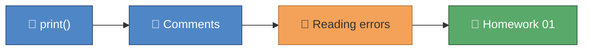

# 🎓 Module 01 — Hello, Python

Welcome to your very first day of term with Python! This module is about
saying "hello" — to the language, and to your first class register. By the
end, you'll have written and run real Python code, read your first error
message without panicking, and completed your first homework.

## 🎯 What you'll learn

- How to display text on screen with `print()`
- How strings (text) always live inside quotes
- How to write comments — notes for humans that Python ignores
- Why red error text is feedback, not failure
- How to read a Python traceback from the bottom up

## 🗺️ Concept map



## 📚 Lessons

| File | Concept | 📖 Docs | 🎬 Video |
|---|---|---|---|
| `lesson_01_your_first_program.py` | `print()`, strings, comments | [Python tutorial: intro](https://docs.python.org/3/tutorial/introduction.html) | [Mosh — Python for Beginners](https://www.youtube.com/watch?v=_uQrJ0TkZlc) |
| `lesson_02_reading_errors.py` | Reading tracebacks bottom-up | [Python tutorial: errors](https://docs.python.org/3/tutorial/errors.html) | [Search: reading error messages](https://www.youtube.com/results?search_query=python+how+to+read+error+messages) |

## 📝 Homework

Complete the three functions in `homework_01.py`, then check your work:

```
uv run pytest python_course/module_01_hello_python -v -m homework
```

## ✅ Progress checklist

- [ ] Ran `lesson_01_your_first_program.py` and read every comment
- [ ] Completed both 🧪 TRY IT experiments in lesson 1.1
- [ ] Ran `lesson_02_reading_errors.py` and read every comment
- [ ] Completed both 🧪 TRY IT experiments in lesson 1.2
- [ ] Filled in all three TODOs in `homework_01.py`
- [ ] All three homework tests pass (`uv run pytest python_course/module_01_hello_python -v -m homework`)

## 🆘 When you're stuck

1. Re-read the comments in the lesson file — the answer is usually explained right above the code.
2. Ask the homework-checker agent — it hints, it never spoils the answer.
3. Ask Claude to **explain** the concept — never to solve the homework for you.
