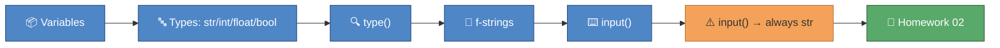

# 🎓 Module 02 — Variables & Types

Every spreadsheet cell has a type — text, a whole number, a decimal, a
tick box — and so does every value in Python. This module teaches you
to store data in labelled variables, recognise its type, weave
variables into readable sentences with f-strings, and ask the user a
question with `input()`. By the end, you'll complete your second
homework: three small functions any teacher would use for marking.

## 🎯 What you'll learn

- How to store a value in a variable with `=`
- The four starter types: `str`, `int`, `float`, `bool`
- How to check a value's type with `type()`
- Naming variables the Python way: `snake_case`, descriptive, case-sensitive
- Building text from variables with f-strings, including `:.1f` decimal control
- Asking for input with `input()` — and why you must convert it before doing maths

## 🗺️ Concept map



## 📚 Lessons

| File | Concept | 📖 Docs | 🎬 Video |
|---|---|---|---|
| `lesson_01_variables_and_types.py` | Variables, `str`/`int`/`float`/`bool`, `type()`, naming, arithmetic | [Python tutorial: using Python as a calculator](https://docs.python.org/3/tutorial/introduction.html#using-python-as-a-calculator) | [Search: Python variables and data types](https://www.youtube.com/results?search_query=python+variables+and+data+types+for+beginners) |
| `lesson_02_f_strings_and_input.py` | f-strings, `:.1f`, `input()`, `str`→`int` conversion | [Python tutorial: strings](https://docs.python.org/3/tutorial/introduction.html#strings) | [Corey Schafer — Strings: Working with Textual Data](https://www.youtube.com/watch?v=k9TUPpGqYTo) |

## 📝 Homework

Complete the three functions in `homework_02.py`, then check your work:

```
uv run pytest python_course/module_02_variables_types -v -m homework
```

## ✅ Progress checklist

- [ ] Ran `lesson_01_variables_and_types.py` and read every comment
- [ ] Completed all three 🧪 TRY IT experiments in lesson 2.1
- [ ] Ran `lesson_02_f_strings_and_input.py` and read every comment
- [ ] Completed all three 🧪 TRY IT experiments in lesson 2.2
- [ ] Filled in all three TODOs in `homework_02.py`
- [ ] All three homework tests pass (`uv run pytest python_course/module_02_variables_types -v -m homework`)

## 🆘 When you're stuck

1. Re-read the comments in the lesson file — the answer is usually explained right above the code.
2. Ask the homework-checker agent — it hints, it never spoils the answer.
3. Ask Claude to **explain** the concept — never to solve the homework for you.
