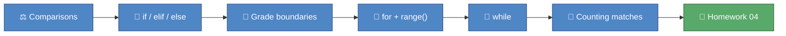

# 🎓 Module 04 — Control Flow

Every program so far has run top to bottom, once, no choices made
along the way. This module gives your code a brain: branching with
`if`/`elif`/`else` to react to a value, and repeating with `for` and
`while` loops instead of copy-pasting the same line thirty times. By
the end, you'll grade a whole class and take an attendance register
programmatically, and complete your fourth homework.

## 🎯 What you'll learn

- Comparison operators (`==`, `!=`, `<`, `>`, `<=`, `>=`) and how they produce a `bool`
- Branching with `if`, `elif`, and `else`, checked top to bottom
- Chaining boundaries into a grade table
- Repeating over a list with a `for` loop — no more one `print()` per item
- Generating numbers to loop over with `range()`
- Repeating until a condition turns `False` with `while`
- Counting matches inside a loop with a running total

## 🗺️ Concept map



## 📚 Lessons

| File | Concept | 📖 Docs | 🎬 Video |
|---|---|---|---|
| `lesson_01_if_elif_else.py` | Comparisons, `if`/`elif`/`else`, grade boundaries | [Python tutorial: if statements](https://docs.python.org/3/tutorial/controlflow.html#if-statements) | [Corey Schafer — Conditionals and Booleans](https://www.youtube.com/watch?v=DZwmZ8Usvnk) |
| `lesson_02_loops.py` | `for`, `range()`, `while`, counting matches | [Python tutorial: for statements](https://docs.python.org/3/tutorial/controlflow.html#for-statements) | [Corey Schafer — Loops and Iterations](https://www.youtube.com/watch?v=6iF8Xb7Z3wQ) |

## 📝 Homework

Complete the three functions in `homework_04.py`, then check your work:

```
uv run pytest python_course/module_04_control_flow -v -m homework
```

## ✅ Progress checklist

- [ ] Ran `lesson_01_if_elif_else.py` and read every comment
- [ ] Completed both 🧪 TRY IT experiments in lesson 4.1
- [ ] Ran `lesson_02_loops.py` and read every comment
- [ ] Completed both 🧪 TRY IT experiments in lesson 4.2
- [ ] Filled in all three TODOs in `homework_04.py`
- [ ] All three homework tests pass (`uv run pytest python_course/module_04_control_flow -v -m homework`)

## 🆘 When you're stuck

1. Re-read the comments in the lesson file — the answer is usually explained right above the code.
2. Ask the homework-checker agent — it hints, it never spoils the answer.
3. Ask Claude to **explain** the concept — never to solve the homework for you.
