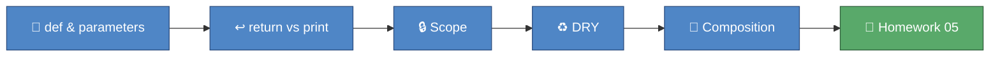

# 🎓 Module 05 — Functions

Every module so far has been one long script, top to bottom. This
module gives you the single most powerful tool for taming that: the
function. You'll learn to package a calculation up with a name, feed
it different data every time you call it, and hand a result back —
then combine small functions into bigger ones without ever repeating
yourself (DRY). By the end, you'll have a tiny toolkit of grading
functions and completed your fifth homework.

## 🎯 What you'll learn

- Defining a function with `def`, a name, and parameters
- How parameters let one function handle many different inputs
- `return` vs `print()` — handing a value back vs just displaying it
- Scope — why a variable created inside a function stays inside it
- DRY (Don't Repeat Yourself) — write a calculation once, reuse it everywhere
- Composition — functions calling other functions to build bigger behaviour

## 🗺️ Concept map



## 📚 Lessons

| File | Concept | 📖 Docs | 🎬 Video |
|---|---|---|---|
| `lesson_01_defining_functions.py` | `def`, parameters, `return`, scope | [Python tutorial: defining functions](https://docs.python.org/3/tutorial/controlflow.html#defining-functions) | [Python Tutorial for Beginners 8: Functions](https://www.youtube.com/watch?v=9Os0o3wzS_I) |
| `lesson_02_dry_and_composition.py` | Functions calling functions, DRY | [Python tutorial: more on defining functions](https://docs.python.org/3/tutorial/controlflow.html#more-on-defining-functions) | [Search: Python DRY principle](https://www.youtube.com/results?search_query=python+dry+principle+dont+repeat+yourself+tutorial) |

## 📝 Homework

Complete the three functions in `homework_05.py`, then check your work:

```
uv run pytest python_course/module_05_functions -v -m homework
```

## ✅ Progress checklist

- [ ] Ran `lesson_01_defining_functions.py` and read every comment
- [ ] Completed all three 🧪 TRY IT experiments in lesson 5.1
- [ ] Ran `lesson_02_dry_and_composition.py` and read every comment
- [ ] Completed all three 🧪 TRY IT experiments in lesson 5.2
- [ ] Filled in all three TODOs in `homework_05.py`
- [ ] All three homework tests pass (`uv run pytest python_course/module_05_functions -v -m homework`)

## 🆘 When you're stuck

1. Re-read the comments in the lesson file — the answer is usually explained right above the code.
2. Ask the homework-checker agent — it hints, it never spoils the answer.
3. Ask Claude to **explain** the concept — never to solve the homework for you.
