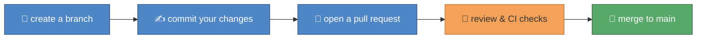

# 🎓 Module 08 — Testing and Tooling Capstone

You've completed seven homeworks by watching `-m homework` turn from
red to green — but you've never seen what's actually behind that
command. This final module pulls back the curtain: `assert` and the
red-green-refactor story that pytest automates, then `uv sync`, the
git story (add → commit → push → pull), and what the green tick on
GitHub really checks. The capstone `Gradebook` brings Module 07's
classes and Module 08's TDD together in one last homework — and this
module ends with your graduation into working on branches and PRs,
just like a real engineering team.

## 🎯 What you'll learn

- What `assert` does, and how a tiny check function is a "test" in miniature
- The red-green-refactor story, and that you've been doing it since Module 01
- What `uv sync` does with `pyproject.toml` and `uv.lock`
- The git story: `add` (stage), `commit` (snapshot), `push` (share), `pull` (receive)
- What GitHub Actions CI checks on every push, and what the green tick means
- Building one capstone class, `Gradebook`, that combines everything so far

## 🗺️ Concept map

```mermaid
flowchart LR
    A["🧪 assert & TDD"]:::concept --> B["📦 uv sync"]:::concept
    B --> C["🌿 git add"]:::concept
    C --> D["💾 git commit"]:::concept
    D --> E["⬆️ git push"]:::concept
    E --> F["🤖 CI checks"]:::warn
    F --> G["✅ green tick"]:::win
    G --> H["⬇️ git pull"]:::concept
    H --> I["📝 Homework 08"]:::win
    classDef concept fill:#4F86C6,color:#fff,stroke:#2B4C7E
    classDef win fill:#59A96A,color:#fff,stroke:#2E5E3A
    classDef warn fill:#F4A259,color:#333,stroke:#B87333
```



## 📚 Lessons

| File | Concept | 📖 Docs | 🎬 Video |
|---|---|---|---|
| `lesson_01_pytest_and_tdd.py` | `assert`, hand-rolled checks, red-green-refactor | [pytest docs: how-to guides](https://docs.pytest.org/en/stable/how-to/index.html) | [Pytest Tutorial — How to Test Python Code](https://www.youtube.com/watch?v=cHYq1MRoyI0) |
| `lesson_02_uv_git_ci.py` | `uv sync`, git add/commit/push/pull, CI's green tick | [uv docs](https://docs.astral.sh/uv/), [GitHub flow docs](https://docs.github.com/en/get-started/using-github/github-flow) | [Git & GitHub Crash Course for Beginners](https://www.youtube.com/watch?v=mAFoROnOfHs), [uv package manager tutorial](https://www.youtube.com/watch?v=AMdG7IjgSPM) |

## 📝 Homework

Complete `Gradebook.add_student()`, `Gradebook.class_average()`, and
`Gradebook.top_student()` in `homework_08.py`, then check your work:

```
uv run pytest python_course/module_08_testing_tooling -v -m homework
```

## ✅ Progress checklist

- [ ] Ran `lesson_01_pytest_and_tdd.py` and read every comment
- [ ] Completed all three 🧪 TRY IT experiments in lesson 8.1
- [ ] Ran `lesson_02_uv_git_ci.py` and read every comment
- [ ] Completed all three 🧪 TRY IT experiments in lesson 8.2 (yes, some are done in your terminal, not this file!)
- [ ] Filled in all three methods on `Gradebook` in `homework_08.py`
- [ ] The homework test passes (`uv run pytest python_course/module_08_testing_tooling -v -m homework`)
- [ ] Read the 🎓 Graduation section below

## 🆘 When you're stuck

1. Re-read the comments in the lesson file — the answer is usually explained right above the code.
2. Ask the homework-checker agent — it hints, it never spoils the answer.
3. Ask Claude to **explain** the concept — never to solve the homework for you.

## 🎓 Graduation

Eight modules, eight green ticks, one capstone `Gradebook` — you now
know everything this Python course set out to teach: variables,
collections, control flow, functions, files, errors, classes, and the
testing/tooling safety net around all of it.

Two things change from here on:

1. **Open `docs/how_to_learn_claude.md`** *(lands alongside the Claude course modules)* — your next course, becoming a "Claude Architect" who designs skills, agents, and workflows for other teachers.
2. **From now on, work on branches + PRs**, not directly on `main` — the real workflow behind every green tick you saw in Lesson 8.2:



Congratulations, Gemma — you graduated the Python course. 🎓
